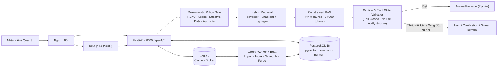

# SongNhat CRM Knowledge & Policy Assistant (CKPA)


Trợ lý tri thức và chính sách CRM nội bộ cho nhân viên được ủy quyền — hỗ trợ tra cứu quy trình bằng tiếng Việt có trích dẫn điều khoản gốc, kiểm tra phạm vi/ngày hiệu lực/trạng thái phiên bản, xuất các trường dữ liệu trọng yếu có cấu trúc (`Critical Fields`), đồng thời phát hiện thiếu dữ kiện hoặc mâu thuẫn để giữ câu trả lời và chuyển tiếp đúng chủ sở hữu chính sách (`Owner Referral`).

> **Phạm vi triển khai:** Chỉ giới hạn trong **Base Scope (`M`)** theo *SongNhat – CRM Knowledge and Policy Assistant RFP* — cung cấp hướng dẫn nội bộ có căn cứ, không nhập hồ sơ khách hàng, không thay thế thẩm quyền phê duyệt, không tự thực thi nghiệp vụ trên hệ thống bên ngoài và không kích hoạt tùy chọn mở rộng **`O1` (Selected CRM Context)** nếu chưa có báo giá, quyền dữ liệu và phê duyệt riêng.

---

## Kiến trúc Chuẩn hóa (`Modular Monolith + Deterministic Policy Gate + Constrained RAG`)

Hệ thống được thiết kế theo mô hình **5 tầng** bảo đảm kiểm soát chính sách xác định ngoài LLM prompt (*Policy Control Outside Prompt*) và nguyên tắc **fail-closed**:

1. **Edge Gateway:** `Nginx` reverse proxy (`:80`, cấu hình tại [`infra/nginx/nginx.conf`](./infra/nginx/nginx.conf)) định tuyến `/` và `/api/*`.
2. **Presentation:** `Next.js 14` / `TypeScript 5` (`:3000` — `/`, `/chat` Split-Screen Workspace, `/evidence`, `/referrals`, `/admin`).
3. **Application & Deterministic Policy Gate:** `FastAPI` Modular Monolith (`:8000 /api/v1/*`, `13` modules gồm `selection`) — thực thi RBAC/audience, vòng đời chính sách `7+2` trạng thái, ngày hiệu lực múi giờ `Asia/Ho_Chi_Minh`, ma trận thẩm quyền `5` lớp và trường trọng yếu (`critical_fields`) bằng Python/SQL xác định; pipeline **Constrained RAG** giới hạn `<= 8` đoạn / `6.000` input tokens / `900` output tokens / `<= 2` LLM calls/package và chỉ trả `AnswerPackage` sau bước validation + kiểm tra trạng thái nguồn lần cuối (cấm pre-verification streaming).
4. **Async Worker & Scheduler:** `Celery Worker + Beat` (`5.4+`, `Asia/Ho_Chi_Minh`) xử lý batch CSV (`<= 500` dòng/lô), lập chỉ mục vector, kích hoạt chính sách `scheduled` theo phút, kiểm tra `Snapshot Age` theo giờ (`check_staleness`) và xóa cache thu hồi khẩn cấp (`<= 5` phút).
5. **Data & Cache:** `PostgreSQL 16` (`pgvector + unaccent + pg_trgm`) lưu dữ liệu quan hệ, trạng thái thẩm quyền, tìm kiếm ngữ nghĩa và từ khóa/trigram tiếng Việt; `Redis 7` làm Celery broker/backend, cache và purge tức thời.



> **Phân tách 4 không gian Repo/Môi trường theo RFP:** Repository hiện tại là **`main-app-repo`** (Build repo). Tập đánh giá niêm phong (`100 Sealed`, `80 Challenges`) được tách vật lý sang **`sealed-eval-repo`** theo hàng rào *Chinese Wall* (Mục 8 & 11 RFP), môi trường `Test` tách cô lập khỏi `Production` (`SEC 06`), và hồ sơ quản trị/thương mại Bên Mua quản lý ngoài Git (`DEL 05`). Chi tiết xem tại [docs/02-architecture.md — Mục 8](./docs/02-architecture.md#8-phân-tách-kho-mã-nguồn-repos-môi-trường--không-gian-lưu-trữ-theo-rfp) và [docs/03-database-and-contracts.md](./docs/03-database-and-contracts.md).

---

## Cấu trúc Dự án

```text
.
├── .github/workflows/ci.yml      # CI pipeline (ruff, mypy, pytest, worker compileall, CSV contract check)
├── backend/                      # Active G0/G1 runtime — FastAPI Modular Monolith (13 modules, Alembic)
│   ├── migrations/               # Alembic database migrations
│   ├── src/modules/              # admin, answer, audit, evaluation, feedback, identity, ingestion,
│   │                             # knowledge, policy, referral, retrieval, selection, validation
│   └── tests/                    # Unit, contract, eval/ & ops/ test suites
├── worker/                       # Active G0/G1 runtime — Celery Worker + Beat (import_task, index_task, eval_task)
├── frontend/src/app/             # Active G0/G1 runtime — Next.js 14 App Router (/, chat, evidence, referrals, admin)
├── data/                         # Dữ liệu nạp & kiểm thử Base Scope (0% PII, không chứa sealed_100)
│   ├── g1/                       # Bộ dữ liệu nạp & kiểm thử cho Gate G1
│   ├── templates/                # Hợp đồng 2 CSV UTF-8 (passages 21 cột, critical_fields 23 cột)
│   ├── eval/                     # Bộ câu hỏi đánh giá công khai (dev/val) & hướng dẫn tách sealed
│   └── sample/                   # Dữ liệu mẫu
├── infra/                        # PostgreSQL init.sql & Nginx reverse proxy config
├── prompts/                      # System prompt tiếng Việt cho runtime G0/G1 (answer_system_vi.txt)
├── docs/                         # Trung tâm tài liệu chuẩn hóa (xem docs/README.md)
│   ├── README.md                 # Mục lục điều hướng tài liệu & lộ trình đọc theo vai trò
│   ├── 01-overview.md            # Tổng quan nghiệp vụ, Base Scope (M) & ranh giới O / O1
│   ├── 02-architecture.md        # Kiến trúc 5 tầng, Modular Monolith, RAG Gate & phân tách 4 không gian
│   ├── 03-database-and-contracts.md  # ERD 23 bảng, PostgreSQL/pgvector & hợp đồng 2 CSV UTF-8
│   ├── 04-setup-and-operations.md    # Cài đặt, vận hành, kiểm thử 4 tầng & OPS 01–08
│   ├── 05-roadmap-and-team.md    # Lộ trình 5 Gate (G0–G4), 10 vai RFP & quy tắc Dual-Hat
│   ├── rfp-compliance-matrix.md  # Ma trận đánh giá tuân thủ RFP & truy vết Jira (G0–G4)
│   ├── architecture/             # Hợp đồng API, ma trận RBAC 8 vai trò & cấu hình khóa Gate G0
│   ├── specs/g0/                 # 20 tệp đặc tả G0 (policy-and-scope, rbac-and-legal, architecture-and-contracts, qa-and-operations)
│   └── work-packages/            # Báo cáo kiểm toán & tổng kết G1 (CKPA-55, 56, 70, 71, 74, 80)
├── legacy/                       # Archived S4 Python/Streamlit prototype (ngoài active G0/G1 runtime)
│   ├── docs/                     # Tài liệu riêng của prototype cũ
│   ├── prompts/                  # Prompt S4 đã lưu trữ
│   ├── s4/                       # Prototype services & Streamlit components
│   ├── tests/                    # Tests cho prototype cũ
│   ├── pytest.ini                # Cấu hình pytest riêng cho legacy/tests
│   └── requirements.txt          # Dependency riêng của prototype
├── .env.example                  # Biến môi trường mẫu (Base Scope M)
├── docker-compose.yml            # Stack dev/test cô lập: db, redis + các service dưới --profile app
├── dev.ps1 & Makefile            # Script thao tác nhanh cho local dev, lint, mypy, pytest, check-csv, migrate
└── README.md
```

---

## Quick Start

### 1. Chuẩn bị môi trường

Tạo tệp `.env` từ `.env.example` nếu chưa có (không ghi đè `.env` hiện tại và không commit secrets):

```powershell
# PowerShell (Windows)
if (-not (Test-Path .env)) { Copy-Item .env.example .env }
```

```bash
# Bash (Linux / macOS)
[ -f .env ] || cp .env.example .env
```

### 2. Khởi chạy hạ tầng bằng Docker Compose / PowerShell / Make

```powershell
# Chỉ bật PostgreSQL (pgvector + unaccent + pg_trgm) và Redis cho dev local
.\dev.ps1 dev-db        # hoặc: make dev-db

# Chạy migration cơ sở dữ liệu & backend dev server local (tuỳ chọn)
.\dev.ps1 migrate       # hoặc: make migrate
.\dev.ps1 dev

# Hoặc chạy toàn bộ stack ứng dụng (db, redis, backend, worker, beat, frontend, nginx)
.\dev.ps1 up            # hoặc: make up / docker compose --profile app up --build -d

# Dừng stack
.\dev.ps1 down          # hoặc: make down / docker compose --profile app down
```

Các địa chỉ truy cập trong môi trường phát triển mặc định (có thể tùy biến port qua `.env`):

| Dịch vụ | Địa chỉ |
|---|---|
| Nginx Gateway | `http://localhost` |
| Frontend (Next.js 14) | `http://localhost:3000` |
| Backend Health Check | `http://localhost:8000/health` |
| API Docs (FastAPI) | `http://localhost:8000/docs` |

> Chi tiết cấu hình và vận hành xem tại [`dev.ps1`](./dev.ps1), [`Makefile`](./Makefile) và [docs/04-setup-and-operations.md](./docs/04-setup-and-operations.md). Không dùng mật khẩu phát triển mặc định cho môi trường Production.

### 3. Kiểm tra Lint, Typecheck (`mypy`), CSV & Test (`pytest`)

```powershell
.\dev.ps1 lint          # ruff check . + mypy src (backend) + compileall (worker/src)
.\dev.ps1 check-csv     # kiểm tra header 2 tệp CSV UTF-8 (21 & 23 cột)
.\dev.ps1 test          # pytest -q (backend)
make lint               # chạy ruff + mypy + compileall + lint frontend
make test               # chạy pytest -q + build frontend
```

Hoặc chạy trực tiếp trong từng thành phần:

```bash
# Backend
cd backend
python -m ruff check .
python -m mypy src
python -m pytest -q

# Frontend
cd ../frontend
npm run lint
npm run build
```

Để chạy bộ test của prototype đã lưu trữ trong `legacy/tests/`:

```bash
python -m pytest -c legacy/pytest.ini legacy/tests -q
```

---

## Tài liệu Dự án (`docs/`)

Xem mục lục đầy đủ và lộ trình đọc theo vai trò tại [docs/README.md](./docs/README.md):

| Tài liệu | Nội dung chính |
|---|---|
| [docs/01-overview.md](./docs/01-overview.md) | Mục tiêu nghiệp vụ, phạm vi Base Scope (`M`), ranh giới ngoài phạm vi (`O`) & tách riêng `O1` |
| [docs/02-architecture.md](./docs/02-architecture.md) | Kiến trúc 5 tầng, `6` bất biến (`INV-01..06`), `Celery Worker + Beat`, `5` ADRs & phân tách 4 không gian Repo/Môi trường |
| [docs/03-database-and-contracts.md](./docs/03-database-and-contracts.md) | Thiết kế CSDL (`PostgreSQL 16 + pgvector + unaccent + pg_trgm`), `erDiagram` 23 bảng, vòng đời `7+2` & hợp đồng 2 CSV UTF-8 |
| [docs/04-setup-and-operations.md](./docs/04-setup-and-operations.md) | Cài đặt, vận hành, kiểm thử 4 tầng (`60/40/100 Sealed` + `80 Challenges`), `OPS 01–08`, Backup/Restore & Open Exit |
| [docs/05-roadmap-and-team.md](./docs/05-roadmap-and-team.md) | Lộ trình `5` Release Gates (`G0–G4`), đội `10` người chuẩn RFP (`P1–P5`, `S1–S5`), quy tắc **Dual-Hat** & quy chuẩn Git/Jira |
| [docs/rfp-compliance-matrix.md](./docs/rfp-compliance-matrix.md) | Ma trận đánh giá tuân thủ RFP & truy vết Jira theo cổng nghiệm thu (`G0–G4`) |
| [docs/architecture/rbac-matrix.md](./docs/architecture/rbac-matrix.md) | Hợp đồng API `/api/v1/*`, cấu trúc `AnswerPackage` 7 phần, ma trận RBAC 8 vai trò & cấu hình khóa Gate G0 |
| [`docs/specs/g0/`](./docs/specs/g0/) | Bộ `20` tệp đặc tả kỹ thuật Gate G0 (phạm vi & chính sách, RBAC & pháp lý, kiến trúc & hợp đồng, QA & vận hành) |
| [`docs/work-packages/`](./docs/work-packages/) | Báo cáo kiểm toán & tổng kết gói công việc G1 (`CKPA-55`, `CKPA-56`, `CKPA-70`, `CKPA-71`, `CKPA-74`, `CKPA-80`) |

---

## Tổ chức Đội 10 người (Chuẩn RFP Mục 11), Quy tắc Dual-Hat & 5 Release Gates

- **Phía Purchaser (`P1–P5`):** `P1` Mỹ Vân (*Purchaser sponsor*) · `P2` Hữu Tài (*Policy owners*) · `P3` Chí Kha (*Knowledge and data steward*) · `P4` Trà My (*Staff users*) · `P5` Anh Khoa (*Privacy and security owners*).
- **Phía Supplier Team (`S1–S5`):** `S1` Hoàng Tiến (*Named lead*) · `S2` Quốc Hưng (*Integration engineer*) · `S3` Yến Nhi (*Retrieval and application engineer*) · `S4` Quý Hải (*Quality lead — đánh giá độc lập*) · `S5` Ngọc Duy (*Operations specialist*).
- **Quy tắc vận hành Dual-Hat & Chinese Wall (RFP Mục 2, 8 & 11):** Cho phép kiêm nhiệm vai trò có kiểm soát nhưng bắt buộc bảo toàn trách nhiệm giải trình và hàng rào độc lập: `S4` (*Quality lead*) không viết code hay tinh chỉnh hệ thống sản xuất cùng đội Build (`S2, S3, S5`); nhóm `S2, S3, S5` bị cấm xem/truy cập `sealed-eval-repo` (`100 Sealed`) và không đóng vai `Staff user` trong Pilot (`G3`); quyền sở hữu và phê duyệt nội dung chính sách luôn thuộc `P2` phía SongNhat.
- **5 Release Gates (`G0–G4`):** `G0 Ready to Build` → `G1 Controlled Offline` → `G2 Supervised Use` → `G3 Pilot Acceptance` (*tối thiểu 20 ngày làm việc có giám sát*) → `G4 Production Handover`. **Không gộp `G3` và `G4` thành một cổng.**

---

## Nguyên tắc Cốt lõi & Thứ tự Ưu tiên Tài liệu

1. **Policy Control Outside Prompt & Fail-Closed:** Quyền, phạm vi, thẩm quyền, ngày hiệu lực và trạng thái nguồn phải được kiểm soát xác định trong mã ứng dụng; khi không xác minh được, hệ thống phải giữ câu trả lời (`Hold`) hoặc chuyển chủ sở hữu (`Owner Referral`).
2. **Đúng nguồn quan trọng hơn câu trả lời trôi chảy:** 0 unauthorized disclosure, 0 fabricated critical field/approval/citation, 0 câu trả lời hiện hành từ chính sách `withdrawn` hoặc `scheduled` chưa đến ngày hiệu lực.
3. **Thứ tự ưu tiên tài liệu khi có mâu thuẫn:** (1) Hợp đồng đã ký và các phụ lục sửa đổi → (2) RFP và các văn bản bổ sung → (3) Đề xuất được chấp thuận → (4) Bộ tài liệu trong `docs/` và `README.md`.
