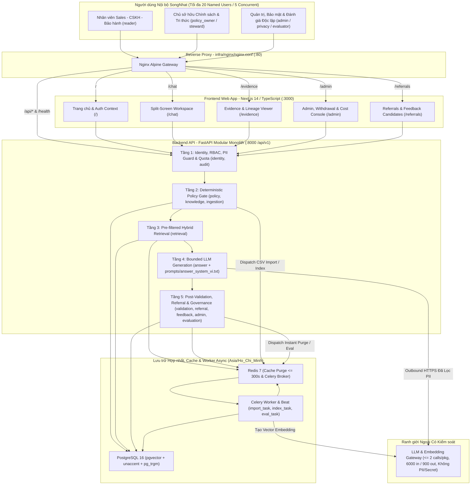
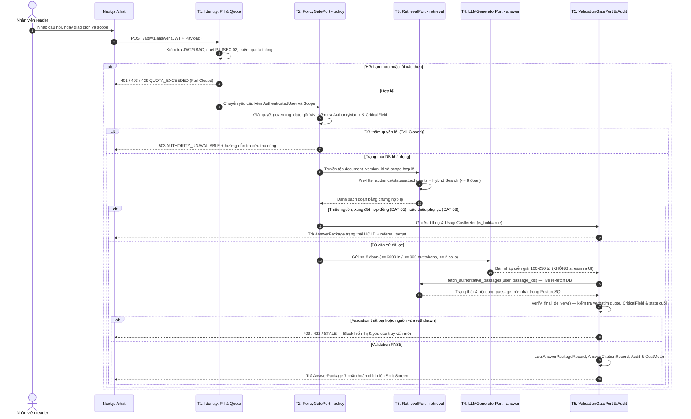
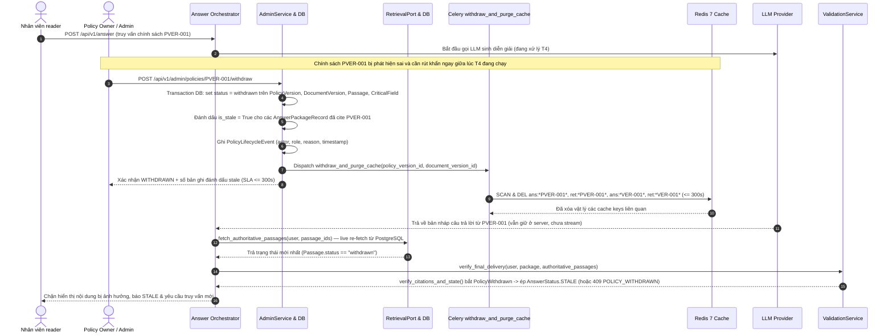
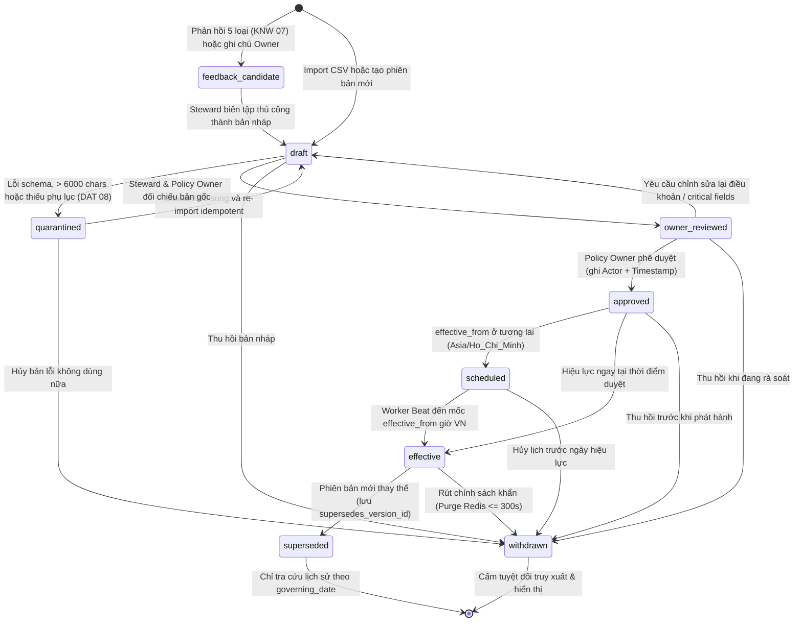

# 02 — Kiến trúc Tổng thể: Modular Monolith + Deterministic Policy Gate + Constrained RAG

> Tài liệu thiết kế kiến trúc hệ thống **SongNhat CRM Knowledge & Policy Assistant (CKPA)** ánh xạ trực tiếp vào `12` module Backend (`backend/src/modules/`), `3` tệp Worker (`worker/src/tasks/`), `5` routes Frontend (`frontend/src/app/`) và hợp đồng `5` tầng tại [backend/src/shared/contracts.py](../backend/src/shared/contracts.py).
>
> *(Lưu ý RFP Mục 6 & Mục 13: Kiến trúc dưới đây là thiết kế tham chiếu cho tuyến phát triển tùy chỉnh có giới hạn — không khóa nhà cung cấp, model AI hay workflow engine; mọi thành phần tuân thủ chặt Base Scope `M`, không chứa code `O1`.)*

> **Tổ chức mã nguồn:** Runtime G0/G1 đang hoạt động gồm UI/UX trong `frontend/`, API và nghiệp vụ trong `backend/src/` (cấu hình chuẩn tại `backend/src/config.py` + `.env.example`), tác vụ bất đồng bộ trong `worker/src/tasks/` và prompt tại `prompts/answer_system_vi.txt`. Bản Python/Streamlit S4 trước đây được lưu trữ (archived prototype) tại `legacy/s4/` cùng `legacy/prompts/`, `legacy/tests/`, `legacy/pytest.ini`, tài liệu và dependency riêng — hoàn toàn nằm ngoài luồng runtime G0/G1 hiện tại.

---

## 1. Sáu Bất biến Kiến trúc (`INV-01 .. INV-06`)

Toàn bộ mã nguồn và kiểm thử hợp đồng tại [backend/tests/test_srs_scaffold_contracts.py](../backend/tests/test_srs_scaffold_contracts.py) và [backend/tests/test_architecture_contracts.py](../backend/tests/test_architecture_contracts.py) bắt buộc bảo toàn `6` bất biến sau:

| Mã | Tên bất biến | Quy tắc kỹ thuật bắt buộc | Triển khai trên Repo |
|---|---|---|---|
| **INV-01** | **Policy Control Outside Prompt** | Quyền (`RBAC`, `audience`), trạng thái phát hành, ngày hiệu lực giờ Việt Nam (`Asia/Ho_Chi_Minh`), `6` chiều phạm vi (`scope`), phát hiện xung đột và toán học ngưỡng `critical_fields` phải chạy bằng code Python/SQL xác định; **tuyệt đối không giao cho prompt LLM**. | `shared/auth.py`, `modules/policy/`, `modules/retrieval/` |
| **INV-02** | **Fail-Closed** | Nếu danh tính tổ chức (`501`/`401`), quyền truy cập (`403`) hoặc trạng thái thẩm quyền DB (`503 AUTHORITY_UNAVAILABLE`) không xác minh được, hệ thống dừng trả lời an toàn và chuyển hướng tra cứu CSV thủ công / chuyển chủ sở hữu. | `main.py`, `shared/auth.py`, `shared/exceptions.py` |
| **INV-03** | **No Pre-Verification Streaming** | Cấm truyền phát (`stream`) nội dung câu trả lời ra UI trước khi hoàn tất `validation` trích dẫn, đối chiếu trường trọng yếu và re-check authoritative state cuối cùng (`ENABLE_ANSWER_STREAMING = False`). | `config.py`, `answer/service.py`, `validation/service.py` |
| **INV-04** | **Deterministic Critical Output** | Giá trị, toán tử (`<=, <, >=, >, ==, in, between, required`), đơn vị, tiền tệ (`VND/USD`), vai trò duyệt, thời hạn, ngoại lệ và tài liệu bắt buộc lấy trực tiếp từ bảng `critical_fields` và render bằng thành phần UI xác định; văn xuôi LLM không được thay đổi chúng. | `policy/service.py`, `answer/schemas.py`, `frontend/src/app/chat/page.tsx` |
| **INV-05** | **Untrusted Data Isolation** | Câu hỏi đầu vào và văn bản `<retrieved_passages>` chỉ là dữ liệu không đáng tin cậy, không phải chỉ thị hệ thống; cấm nhúng secret, cấm web search, cấm cấp tool tùy ý cho LLM. | `prompts/answer_system_vi.txt`, `shared/pii_guard.py` |
| **INV-06** | **Atomic Authoritative Withdrawal** | Thu hồi chính sách (`withdrawn`) cập nhật authoritative state trong DB trước khi xác nhận, đánh dấu `is_stale = True` các `AnswerPackage` bị ảnh hưởng, chặn các generation đang chạy ở tầng `validation` và xóa vật lý cache Redis trong `<= 300s` (`<= 5` phút). | `admin/service.py`, `validation/service.py`, `worker/src/tasks/index_task.py` |

---

## 2. Sơ đồ Kiến trúc Tổng thể



---

## 3. Pipeline 5 Tầng & Ánh xạ tới [shared/contracts.py](../backend/src/shared/contracts.py)

Hàm `AnswerOrchestratorService.execute_pipeline` trong [backend/src/modules/answer/service.py](../backend/src/modules/answer/service.py) điều phối **5 Tầng tuần tự**, giao tiếp qua `6` `@runtime_checkable` `Protocol` ports và các value objects bất biến định nghĩa tại [backend/src/shared/contracts.py](../backend/src/shared/contracts.py) để đội Dev (`S2`, `S3`, `S5`) nối adapter DB/LLM ở Gate `G1` mà vẫn giữ ranh giới sạch trong Modular Monolith:

| Tầng | Tên tầng & Trách nhiệm | Module tham gia | Port / Contract trong `shared/contracts.py` | Cơ chế bảo vệ & Fail-Closed |
|---|---|---|---|---|
| **Tầng 1** | **Identity, Emergency Disable, PII Guard & Quota Gate** | `identity`, `shared/auth.py`, `shared/pii_guard.py`, `audit` | `get_current_user`, `scan_query_for_pii` & `AuditMeterPort.check_monthly_quota` → `QuotaStatus` | Chặn `401/501` nếu chưa xác thực; kiểm tra `emergency_disabled` (`OPS 05`) & phạm vi `ANS 07`; gắn `pii_warning` khi phát hiện SĐT/email/CCCD/MST (`SEC 02`); trả `HOLD` khi vượt trần `1.000` packages / `2.000` calls/tháng. |
| **Tầng 2** | **Deterministic Policy Gate** | `policy`, `knowledge` | `PolicyGatePort` (`resolve_governing_date_vn`, `evaluate_policy_gate` → `PolicyGateDecision`) | Xác định `governing_date` theo `Asia/Ho_Chi_Minh`; kiểm tra `5` lớp `AuthorityTier`; lọc trạng thái `7+2` & `6` chiều `scope`; phát hiện xung đột hợp đồng–chính sách (`DAT 05` → `HOLD`); kiểm tra `has_essential_attachments` (`DAT 08`); tra cứu `CriticalField` xác định. Lỗi DB thẩm quyền → `503 AUTHORITY_UNAVAILABLE`. |
| **Tầng 3** | **Pre-filtered Hybrid Retrieval** | `retrieval`, `knowledge` | `RetrievalPort` (`search_hybrid(user, HybridQuerySpec)`, `compute_rrf_score` & `fetch_authoritative_passages`) | Chuẩn hóa tiếng Việt + mở rộng từ điển `VIETNAMESE_CRM_SYNONYMS`; thực thi **Pre-filtering** quyền `audience`, trạng thái, `effective_from/to` và `is_tombstoned=false` **trước khi** xếp hạng lai RRF (`pgvector` + FTS `unaccent` + `pg_trgm`). Giới hạn cứng `<= 8` đoạn (`<= 6.000` ký tự Unicode/đoạn). |
| **Tầng 4** | **Bounded LLM Generation** | `answer`, `prompts/answer_system_vi.txt` | `LLMGeneratorPort` (`generate(LLMGenerationRequest)` → `LLMGenerationResult`) | Đóng gói `build_untrusted_prompt_envelope` (`html.escape` trong XML `<user_question>`, `<retrieved_passages>`, `<critical_fields>` — `INV-05`); ép ngân sách `<= 2` calls/package, `<= 6.000` input tokens, `<= 900` output tokens, timeout `20s`; sinh diễn giải `100–250` từ tiếng Việt. Không stream ra UI (`INV-03`). |
| **Tầng 5** | **Post-Validation, Cache Purge & Audit** | `validation`, `audit`, `admin`, `referral`, `feedback` | `ValidationGatePort` (`verify_critical_fields_integrity`, `verify_final_delivery`), `RetrievalPort.fetch_authoritative_passages`, `AuditMeterPort`, `CachePurgePort` | Ngay trước `verify_final_delivery`, gọi `RetrievalPort.fetch_authoritative_passages` để re-fetch trạng thái mới nhất từ PostgreSQL; đối chiếu `quoted_text`, kiểm tra toàn vẹn `CriticalField` và **re-check quyền & authoritative state DB lần cuối** (chặn *Worked Case 9* nếu nguồn vừa `withdrawn` → `AnswerStatus.STALE` / `409 POLICY_WITHDRAWN`); ghi `AuditLog` & `UsageCostMeter`; gọi `CachePurgePort.purge_policy_caches` / `withdraw_and_purge_cache(policy_version_id, document_version_id)` (`<= 300s`). |

---

## 4. Bản đồ 12 Module Backend, 3 Worker Tasks & 5 Frontend Routes

### 4.1 Mười hai (12) Module Backend (`backend/src/modules/*`)
Mỗi module tuân thủ chuẩn `4` tệp (`router.py`, `schemas.py`, `service.py`, `models.py`) và gắn đủ vào [backend/src/main.py](../backend/src/main.py):

| # | Module | Trách nhiệm cốt lõi | Vai trò RFP chính |
|---:|---|---|---|
| 1 | `identity` | Xác thực danh tính tổ chức (`OIDC/JWT` tại G1), hồ sơ user, kiểm tra `least privilege` & `audience` (`SEC 01`). | `S5` (`P5` duyệt) |
| 2 | `knowledge` | Quản lý `Document`, `DocumentVersion`, `Passage`, `PassageEmbedding`, `supersedes`, `is_tombstoned` & `SnapshotAge`. | `S2` (`P3` nguồn) |
| 3 | `ingestion` | Validate `2` CSV UTF-8 cơ sở (`21`/`23` cột), `ImportManifest` đối soát, staging `ImportRecord`, `QuarantineRow`, idempotent retry & late-batch guard. *(Không có O1).* | `S2` (`P3` dữ liệu) |
| 4 | `policy` | `AuthorityEntry` (`5` lớp), `PolicyVersion`, `CriticalField`, `PolicyLifecycleEvent`, `governing_date` giờ VN, tính toán ngưỡng & `DAT 05` Conflict Hold. | `S3` (`P2` duyệt) |
| 5 | `retrieval` | Chuẩn hóa query tiếng Việt, từ điển viết tắt CRM (`VIETNAMESE_CRM_SYNONYMS`), Pre-filtered Hybrid Search (`pgvector` + `unaccent` + `pg_trgm` RRF). | `S3` |
| 6 | `answer` | Điều phối Pipeline `5` tầng, phát hiện ngoài phạm vi (`ANS 07`), giữ nguyên `task_id` khi `follow-up`/`regenerate`, trả `AnswerPackage` `7` phần. | `S3` |
| 7 | `validation` | Kiểm định citation nguyên văn, khớp `critical_fields`, kiểm tra quyền & authoritative state cuối trước hiển thị (`KNW 04`, `Worked Case 9`). | `S3` |
| 8 | `referral` | Quản lý `LocalReferral` (`referred` → `owner_responded` → `closed`) với ngữ cảnh tối thiểu (không gửi email/Zalo, không ghi CRM). | `S3` (`P2` phản hồi) |
| 9 | `feedback` | Tiếp nhận `5` loại phản hồi (`KNW 07`), theo dõi chủ đề chưa trả lời được, đẩy vào hàng đợi `feedback_candidate` (`auto_applied = False`). | `S3` (`P3/P2` duyệt) |
| 10 | `audit` | Nhật ký truy cập/sự cố giới hạn quyền đọc (`AuditLog`), bộ đếm `UsageCostMeter` (`OPS 06`), xuất dữ liệu mở `OPS 08`. | `S5, S2` (`P5` kiểm) |
| 11 | `evaluation` | Cô lập phân vùng `dev_60`, `val_40`, `sealed_100` (Chinese Wall qua `ensure_partition_access`) & `challenges_80`, kiểm tra ngưỡng Mục 8 RFP. | `S4` (Độc lập) |
| 12 | `admin` | Chuyển trạng thái vòng đời (`ALLOWED_LIFECYCLE_TRANSITIONS`), kích hoạt **Instant Withdrawal**, `Emergency Disable` (`OPS 05`) & `OpsSummary`. | `S5, S3` (`P2/P3`) |

### 4.2 Ba (3) Tệp Worker Tasks (`worker/src/tasks/*`, múi giờ `Asia/Ho_Chi_Minh`)
Được khai báo trong [worker/src/celery_app.py](../worker/src/celery_app.py) (`enable_utc = False`, `timezone = "Asia/Ho_Chi_Minh"`) và chạy qua dịch vụ `worker` + `beat` trong [docker-compose.yml](../docker-compose.yml):
1. [worker/src/tasks/import_task.py](../worker/src/tasks/import_task.py): `run_batch_import` (xử lý lô `<= 500` dòng/`<= 30` phút `OPS 01`) và Beat job `check_staleness` (chạy mỗi `3600s` kiểm tra ngưỡng `> 25h`).
2. [worker/src/tasks/index_task.py](../worker/src/tasks/index_task.py): `index_passages` (tạo vector `pgvector`), Beat job `activate_scheduled_policies` (chạy mỗi `60s` kích hoạt bản ghi `scheduled` khi `effective_from <= now_vn`), và `withdraw_and_purge_cache(policy_version_id, document_version_id)` (xóa khóa Redis `ans:*{id}*` & `ret:*{id}*` trong `<= 300s`).
3. [worker/src/tasks/eval_task.py](../worker/src/tasks/eval_task.py): `run_evaluation` (chạy đánh giá ngoại tuyến theo phân vùng `dev_60`, `val_40`, `sealed_100`, `challenges_80`).

### 4.3 Năm (5) Routes Frontend (`frontend/src/app/*`)
1. `/`: Trang chủ, ngữ cảnh xác thực, cảnh báo sử dụng nội bộ & hướng dẫn tra cứu thủ công khi bảo trì (`OPS 05`).
2. `/chat`: **Split-Screen Workspace** — Trái: nhập câu hỏi, chọn `governing_date` & `scope`, hiển thị diễn giải `100–250` từ, `HOLD`, nút tạo `LocalReferral` & `Feedback` (`5` lý do); Phải: nguyên văn trích dẫn có highlight, nguồn bản gốc, bảng `Critical Fields` xác định từ DB, `Snapshot Age` & banner cảnh báo `STALE`.
3. `/evidence`: Xem chi tiết văn bản gốc, lịch sử phiên bản (`supersedes`), thực thi kiểm tra `403/409` đồng nhất qua `GET /api/v1/knowledge/passages/{passage_id}`.
4. `/admin`: Bảng điều khiển thông số Base Scope (`OpsSummary`), chuyển trạng thái vòng đời, nút **Instant Withdrawal (`<= 300s`)**, nạp CSV & xuất dữ liệu mở (`OPS 08`).
5. `/referrals`: Theo dõi `LocalReferral` (`referred` → `owner_responded` → `closed`) và hàng đợi `feedback_candidate`.

---

## 5. Ba Sequence Diagrams Trọng tâm

### 5.1 Luồng Q&A 5 Tầng (Kiểm soát Quyền, Hold & Final Validation)



### 5.2 Worked Case 9 — Instant Withdrawal Mid-Answer (`<= 5` phút / `300s`)



### 5.3 Luồng Import 2 CSV UTF-8, Đối soát Manifest & Quarantine

```mermaid
sequenceDiagram
    autonumber
    actor Steward as P3 Knowledge Steward
    participant API as POST /api/v1/ingestion/csv/validate
    participant Ing as IngestionService
    participant Worker as Celery import_task & index_task
    participant DB as PostgreSQL Import & Knowledge

    Steward->>API: Nạp tệp CSV UTF-8 (passages 21 cột hoặc critical_fields 23 cột) + batch_type
    API->>Ing: Kiểm tra mã hóa UTF-8, khớp header 21/23 cột, giới hạn <= 500 dòng
    alt Sai header hoặc vượt 500 dòng
        Ing-->>API: Trả CsvValidationReport (rejected_rows > 0, SCHEMA_HEADER_MISMATCH / BATCH_LIMIT_EXCEEDED)
        API-->>Steward: Từ chối batch trước khi ghi DB
    else Cấu trúc batch hợp lệ
        Ing->>Ing: Kiểm tra từng dòng: record_action (upsert/tombstone), <= 6000 chars, has_essential_attachments, currency
        Ing-->>API: Phân loại accepted_rows vs quarantine_issues (DAT 08 / OPS 04)
        API->>Worker: Dispatch run_batch_import(batch_id, source_type, batch_type)
        Worker->>DB: Kiểm tra idempotency_key (chống trùng khi retry) & late-batch guard (không ghi đè bản mới hơn)
        Worker->>DB: Stage dòng hợp lệ trong import_records; lưu ImportManifest & QuarantineRow kèm reason_code
        Worker->>Worker: Kích hoạt index_passages cho các đoạn được duyệt tạo Vector(1536) vào passage_embeddings
        Worker-->>Steward: Hoàn tất batch <= 30 phút (OPS 01) kèm Snapshot Age mới
    end
```

---

## 6. Vòng đời Chính sách (`7+2` Trạng thái — `PolicyLifecycleStatus`)

Khớp với `PolicyLifecycleStatus` trong [backend/src/shared/enums.py](../backend/src/shared/enums.py) và `ALLOWED_LIFECYCLE_TRANSITIONS` trong [backend/src/modules/admin/models.py](../backend/src/modules/admin/models.py):



| Nhóm trạng thái | Được Retrieval? | Quy tắc kiểm soát bắt buộc |
|---|---|---|
| `feedback_candidate`, `quarantined` | **Không** | Hai trạng thái đầu vào/cách ly phụ trợ; cấm tự huấn luyện hay tự phát hành (`KNW 06`, `DAT 08`). |
| `draft`, `owner_reviewed`, `approved` | **Không** | Chưa đến bước phát hành; mọi chuyển đổi ghi đầy đủ `PolicyLifecycleEvent` (`actor_id`, `actor_role`, `reason`, `timestamp`). |
| `scheduled` | **Chỉ Future Preview** | Worker `activate_scheduled_policies` (`60s`/lần) chỉ chuyển lên `effective` khi `effective_from <= now_vn` (`Asia/Ho_Chi_Minh`); `AdminService` chặn mọi nỗ lực kích hoạt sớm bằng HTTP `409 SOURCE_CONFLICT`. |
| `effective` | **Có** | Được truy xuất nếu khớp `audience`, `scope`, `governing_date` và `has_essential_attachments=True`. |
| `superseded` | **Chỉ Historical Mode** | Chỉ mở khi `governing_date` nằm trong quá khứ và gắn nhãn *"Hướng dẫn lịch sử"*; sửa hồi tố tạo phiên bản mới chứ không ghi đè im lặng nội dung lịch sử. |
| `withdrawn` | **Cấm tuyệt đối** | Fail-closed (`409 POLICY_WITHDRAWN`), chặn mọi truy xuất/citation/direct URL, đánh dấu `is_stale=True` và xóa cache vật lý `<= 300s`. |

---

## 7. Năm Quyết định Kiến trúc Trọng yếu (`5 ADRs`)

| Mã ADR | Quyết định | Bối cảnh & Lý do lựa chọn | Hệ quả & Ràng buộc đánh đổi |
|---|---|---|---|
| **ADR-001** | **Modular Monolith (`FastAPI` 12 modules) thay cho Microservices & Workflow Engine ngoài** | Quy mô đội Build gọn (`S2, S3, S5`), thời gian triển khai `10` tuần và nhu cầu transaction nguyên tử khi thu hồi chính sách tức thời. RFP không bắt buộc Camunda hay orchestrator riêng. | Tách ranh giới module qua `shared/contracts.py` (Ports/DTOs) ở G1 để dễ bảo trì; tránh overhead mạng, đồng bộ phân tán và chi phí vận hành nhiều service rời. |
| **ADR-002** | **Deterministic Policy Gate ngoài LLM Prompt (`INV-01`, `INV-04`)** | Các kiểm soát trọng yếu (quyền `audience`, `governing_date` giờ VN, `6` chiều `scope`, xung đột `DAT 05` và ngưỡng số học `CriticalField`) có ngưỡng lỗi bằng `0` (`0` lỗi chặn phát hành G2). | LLM chỉ đảm nhận diễn giải tiếng Việt `100–250` từ trên ngữ cảnh đã lọc; mọi tham số số/tiền tệ/vai trò lấy thẳng từ PostgreSQL và render cố định trên UI. |
| **ADR-003** | **Cấm Pre-Verification Streaming (`INV-03`)** | Nếu stream token trực tiếp từ LLM ra trình duyệt, câu trả lời có thể chứa trích dẫn sai, số liệu lệch hoặc tham chiếu văn bản vừa bị `withdrawn` giữa chừng (*Worked Case 9*). | Phản hồi đồng bộ qua `POST /api/v1/answer` sau khi `ValidationService` hoàn tất đối chiếu và re-check DB; chấp nhận đợi trọn gói trong mục tiêu độ trễ `p95 <= 25s` (`OPS 02`). |
| **ADR-004** | **PostgreSQL 16 (`pgvector` + `unaccent` + `pg_trgm` G1) làm kho dữ liệu & tìm kiếm hợp nhất** | Corpus Base Scope tối đa `300` passages và `50` critical fields; gộp dữ liệu quan hệ, trạng thái thẩm quyền, FTS tiếng Việt và vector `1536` chiều vào một CSDL duy nhất. | Loại bỏ nhu cầu dựng thêm MinIO hay Vector DB rời; giúp filter quyền/trạng thái nguyên tử bằng SQL trước xếp hạng và đơn giản hóa Backup/Restore Replay (`RTO 4h / RPO 24h`). |
| **ADR-005** | **Nạp dữ liệu qua 2 CSV UTF-8 & Xuất dữ liệu mở (`OPS 08`), tách biệt `O1`** | Ngăn rò rỉ dữ liệu khách hàng thật (`SEC 02`), tránh chi phí và rủi ro kết nối CRM sống ngoài phạm vi RFP, đồng thời bảo đảm khả năng thoát không khóa nhà cung cấp. | Yêu cầu `P3` Steward xuất CSV chuẩn `21`/`23` cột với tối đa `500` dòng/ngày và xử lý hàng đợi Quarantine thủ công khi thiếu chú thích/bảng (`DAT 08`). |

---

## 8. Phân tách Kho Mã nguồn (Repos), Môi trường & Không gian Lưu trữ theo RFP

RFP **không áp đặt** cấu trúc monorepo/multi-repo hay framework cụ thể, nhưng các ràng buộc bắt buộc (`M`) về **tách biệt kiểm thử độc lập — Chinese Wall** (`RFP Mục 8 & Mục 11`, chi tiết tại [DEL01-G / CKPA-30](./specs/g0/qa-and-operations/CKPA-30_SUB20_DEL01G_Independent_Acceptance_Plan_280_Cases_And_SealedRepo.md)) và **tách môi trường Test/Prod** (`SEC 06`) chia toàn bộ hệ sinh thái dự án thành **4 không gian độc lập**:

### 8.1 Tổng quan 4 Không gian Lưu trữ

| Không gian | Loại | Nội dung được phép lưu | Nội dung cấm tuyệt đối |
|---|---|---|---|
| **1. `main-app-repo`** *(repo hiện tại)* | Kho Git Build chính | Mã nguồn (`backend/`, `worker/`, `frontend/`, `infra/`, `prompts/answer_system_vi.txt`), CSV mẫu & corpus G1 (`data/templates/`, `data/g1/`), tập eval công khai sạch PII (`dev_60`: `VG-04/06/07/12/16`; `val_40`: `VG-01/08/14`), đặc tả kỹ thuật G0 (`docs/specs/g0/`), báo cáo G1 (`docs/work-packages/`). | `sealed_100` (8 nhóm `VG-02/03/05/09/10/11/13/15`), đáp án `challenges_80`, PII thật, secrets/API key thật, hồ sơ báo giá `DEL 05` & chấm thầu Bên Mua (Mục 13–14). |
| **2. `sealed-eval-repo`** *(tách vật lý)* | Kho Git Niêm phong (`Chinese Wall`) | `100 Sealed` (8 nhóm `VG` độc lập, `0%` chồng lấp `dev_60`/`val_40`), `80 Challenges` (`40` chung + `40 VN 02`), nhãn chuẩn 6 chiều do `[P2]` & `[P3]` đối soát độc lập (`Kappa >= 0.80`), manifest `SHA-256`. | Mã nguồn sản xuất; quyền Read/Clone/Fork/Export của đội Build (`[S2]`, `[S3]`), `[S5]` (`administrator`) và `[P4]`. |
| **3. Hạ tầng `Test` vs `Production`** (`SEC 06`) | 2 môi trường chạy tách VPC/DB/Storage/Keys | **Test (`G1–G2`):** Dữ liệu giả lập/sạch `0%` PII cho `OPS 01–06`, `SEC 01/05` và chạy chấm điểm độc lập.<br>**Prod (`G3–G4`):** Corpus chính thức, tùy chọn `O1` *(chỉ nếu duyệt riêng)*, Audit Logs chống rò rỉ (`SEC 01/08`), Backup mã hóa (`RTO <= 4h / RPO <= 24h`, lịch Annex C bảo toàn `Withdrawn`). | Dùng dữ liệu PII thật trên môi trường Test; dùng chung DB, khóa bí mật hoặc network giữa Test và Prod. |
| **4. Kho Quản trị & Thương mại ngoài Git** | Jira / Drive Bên Mua | Sổ nguồn & văn bản chính sách gốc có chữ ký (`Source Register` của `[P2]`/`[P3]`), hồ sơ thương mại/báo giá 14 dòng & TCO 3 năm (`DEL 05`), hồ sơ chấm thầu Mục 13 & quyết định cổng G0–G4 Mục 14 (`CKPA-37`, `CKPA-39`, `CKPA-41`). | Commit trực tiếp hồ sơ giá hoặc chấm thầu Bên Mua vào `main-app-repo`. |

### 8.2 Ma trận Phân quyền Giữa `main-app-repo` và `sealed-eval-repo`

| Vai trò RFP Mục 11 | Quyền trên `main-app-repo` | Quyền trên `sealed-eval-repo` & `sealed_100` | Quy tắc chống rò rỉ bắt buộc |
|---|---|---|---|
| **`[S2]`, `[S3]`** *(Build Engineers)* | `READ / WRITE` code Build | **`DENY TUYỆT ĐỐI`** (`0%` Read/Clone/Fork/Export) | Ticket lỗi Jira chỉ ghi `Task_ID`, `Variant_Group_ID`, mã `Hold/Defect`; cấm dán nguyên văn câu hỏi niêm phong. |
| **`[S5]`** *(Operations / `administrator`)* | Vận hành hạ tầng, CI/CD, backup | **`DENY TUYỆT ĐỐI`** (`administrator = DENY`) | Khi `Eval Runner` chạy chế độ `eval_audit_mode = true`, log hạ tầng chỉ ghi `task_id_hash`, latency, token, HTTP status. |
| **`[S4]`** *(Quality Lead — Independent QA)* | **`READ_ONLY`** (`0%` commit/merge code Build) | **`READ / WRITE / EXECUTE_EVAL`** (MFA bắt buộc) | Chủ trì vận hành kho niêm phong, ký số `SHA-256` manifest; không viết/tinh chỉnh prompt hay logic truy xuất sản xuất. |
| **`[P2]`, `[P3]`** *(Two Policy Reviewers)* | `READ` & duyệt corpus CSV | **`ALLOW_CONTROLLED_REVIEW`** | Gán nhãn kép độc lập 6 chiều (`Gold Labels`) và ký xác nhận kết quả nghiệm thu chính sách. |
| **`[P5]`** *(Privacy & Security Owner)* | `READ` & kiểm toán bảo mật/PII | `READ_AUDIT_LOGS / VERIFY_PII_RBAC` (`DENY` câu hỏi thô) | Kiểm toán ACL của `sealed-eval-repo` và xác nhận `0%` PII thật. |
| **`[P1]`** *(Sponsor)* & **`[S1]`** *(Named Lead)* | Phê duyệt cổng / quản lý tiến độ | `READ_SUMMARY_ONLY` (`DENY` câu hỏi thô) | Chỉ xem bảng chỉ số tổng hợp và mã băm `SHA-256`. |
| **`[P4]`** *(5 Representative Staff Users)* | Tham gia UAT & Pilot 20 ngày (G3) | **`DENY`** | Không xem trước đề thi `100 Sealed` để bảo toàn tính khách quan ở G3. |

> **Quy tắc tái kiểm thử khi lộ đề (RFP Mục 8):** Nếu bất kỳ ca nào thuộc `sealed_100` bị lộ sang đội Build, ca đó mất hiệu lực niêm phong và bắt buộc thay thế/kiểm thử lại độc lập trước khi duyệt cổng G2.

