# 03 — Cơ sở Dữ liệu & Hợp đồng Dữ liệu / API

> Tài liệu đặc tả lược đồ cơ sở dữ liệu PostgreSQL 16 (`24` bảng ORM trên `9` module lưu trữ), chiến lược đánh chỉ mục tìm kiếm lai, hợp đồng `2` tệp CSV UTF-8, danh mục `12` nhóm API `/api/v1/*`, bảng mã lỗi Fail-Closed, cấu trúc JSON `AnswerPackage` `7` phần và thiết kế `shared/contracts.py` cho đội Dev ở Gate `G1`.

---

## 1. Hạ tầng PostgreSQL 16 & Extensions

Cấu hình khởi tạo CSDL nằm tại [infra/db/init.sql](../infra/db/init.sql) và kết nối qua SQLAlchemy 2.0 Async (`DATABASE_URL` trong [backend/src/db.py](../backend/src/db.py)):

| Extension | Trạng thái hiện tại | Vai trò kỹ thuật |
|---|---|---|
| `vector` (`pgvector 0.8+`) | Đã cài trong `init.sql` | Lưu trữ vector `PassageEmbedding.embedding` với `Vector(settings.EMBEDDING_DIM)` (mặc định `1536` khớp `EMBEDDING_MODEL = "text-embedding-3-small"`). |
| `unaccent` | Đã cài trong `init.sql` | Chuẩn hóa truy vấn và văn bản tiếng Việt bỏ dấu cho PostgreSQL Full-Text Search (`VN 01`). |
| `uuid-ossp` | Đã cài trong `init.sql` | Sinh định danh UUID khi cần tạo khóa tham chiếu nội bộ. |
| `pg_trgm` | Đã cài trong `init.sql` | Hỗ trợ tìm kiếm mờ trigram (`trgm_rank` trong RRF) cho lỗi gõ/thuật ngữ tiếng Việt kết hợp `unaccent`. |

---

## 2. Sơ đồ Thực thể Quan hệ (`erDiagram`) & Danh mục Bảng ORM

Tệp [backend/migrations/env.py](../backend/migrations/env.py) nạp `9` module có mô hình ORM, tạo thành **`23` bảng ORM** (`17` bảng thực thể nghiệp vụ lõi + `6` bảng liên kết/sự kiện/đối soát phụ trợ gồm `user_roles`, `import_manifests`, `import_records`, `policy_lifecycle_events`, `answer_citations`, `evaluation_case_results`). Ba module `admin`, `retrieval`, `validation` xử lý logic miền không tạo bảng riêng.

```mermaid
erDiagram
    users ||--o{ user_roles : "has_roles"
    documents ||--o{ document_versions : "has_versions"
    document_versions ||--o{ passages : "contains"
    passages ||--|| passage_embeddings : "indexed_as"

    authority_matrix ||--o{ policies : "governs"
    policies ||--o{ policy_versions : "has_versions"
    document_versions ||--o{ policy_versions : "backs"
    policy_versions ||--o{ critical_fields : "defines"
    policy_versions ||--o{ policy_lifecycle_events : "audits"

    import_batches ||--|| import_manifests : "reconciles"
    import_batches ||--o{ import_records : "stages"
    import_batches ||--o{ quarantine_rows : "isolates"

    answer_packages ||--o{ answer_citations : "cites"
    evaluation_runs ||--o{ evaluation_case_results : "records"

    users {
        string id PK
        string email UK
        string full_name
        string company
        string branch
        string department
        boolean is_active
    }
    user_roles {
        int id PK
        string user_id FK
        string role_name
        string allowed_audiences
    }
    documents {
        string id PK
        string title
        string policy_family
        string authority_tier
        string owner
        string source_ref
    }
    document_versions {
        string id PK
        string document_id FK
        string approver
        datetime recorded_at
        datetime published_at
        datetime effective_from
        datetime effective_to
        string status
        string supersedes_version_id
    }
    passages {
        string id PK
        string document_id FK
        string document_version_id FK
        string title
        text content
        string source_ref
        int page_number
        string clause_ref
        string language
        string scope
        string audience
        string status
        boolean has_essential_attachments
        boolean is_tombstoned
    }
    passage_embeddings {
        string passage_id PK
        string embedding_model
        vector_1536 embedding
    }
    authority_matrix {
        string id PK
        string authority_tier
        string policy_family
        string owner_name
        string owner_role
        string backup_owner
        int escalation_sla_hours
    }
    policies {
        string id PK
        string title
        string policy_family
        string authority_entry_id FK
    }
    policy_versions {
        string id PK
        string policy_id FK
        string document_version_id FK
        string scope
        string audience
        string status
        datetime effective_from
        datetime effective_to
        datetime recorded_at
        string supersedes_version_id
        string owner
        string approver
    }
    critical_fields {
        string id PK
        string policy_id
        string policy_version_id FK
        string document_version_id
        string field_name
        string field_type
        string operator
        string value
        string unit
        string currency
        string approval_role
        string time_limit
        text exception_condition
        text required_documents
        string source_clause
        string scope
        string audience
        string status
    }
    policy_lifecycle_events {
        int id PK
        string policy_version_id FK
        string from_status
        string to_status
        string actor_id
        string actor_role
        text reason
    }
    import_batches {
        string id PK
        string source_type
        string batch_type
        datetime batch_timestamp
        string idempotency_key UK
        string submitted_by
        string status
    }
    import_manifests {
        string batch_id PK
        int expected_rows
        int received_rows
        int accepted_rows
        int rejected_rows
        int quarantined_rows
        json summary_json
    }
    import_records {
        int id PK
        string batch_id FK
        string source_type
        string record_id
        int row_number
        json raw_payload
    }
    quarantine_rows {
        int id PK
        string batch_id FK
        int row_number
        string record_id
        string reason_code
        text reason_detail
        json raw_payload
        boolean resolved
    }
    answer_packages {
        string id PK
        string task_id
        string user_id
        text original_question
        date governing_date
        string scope
        string status
        text guidance_text
        text hold_reason
        string referral_target
        boolean is_stale
        int llm_calls_used
        json package_payload
    }
    answer_citations {
        int id PK
        string answer_package_id FK
        string passage_id
        string document_version_id
        int page_number
        string clause_ref
    }
    change_impact_reports {
        string id PK
        string event_type
        string source_type
        string source_id
        string policy_version_id
        string document_version_id
        string actor_id
        text reason
        int stale_answers_marked
        int active_view_refresh_interval_seconds
    }
    local_referrals {
        string id PK
        string task_id
        string answer_package_id
        string requester_id
        string target_owner
        string policy_family
        text question_summary
        string status
        text owner_response
        text resolution_note
    }
    feedback_candidates {
        string id PK
        string task_id
        string answer_package_id
        string reporter_id
        string reason
        string unanswered_topic
        text comment
        string candidate_status
        boolean auto_applied
    }
    audit_logs {
        int id PK
        string actor_id
        string actor_role
        string action
        string resource_type
        string resource_id
        string outcome
        text detail
        json metadata_json
    }
    usage_cost_meters {
        int id PK
        string month_key
        string task_id
        string answer_package_id
        int llm_calls
        int input_tokens
        int output_tokens
        boolean is_hold
        boolean is_error
        numeric estimated_cost_vnd
    }
    evaluation_runs {
        string id PK
        string release_gate
        string partition
        string evaluator_id
        int total_cases
        int critical_control_errors
        float applicability_rate
        float grounding_rate
        float completeness_rate
        float recall_at_5
        float usefulness_rate
        float fabrication_on_unanswerable_rate
        boolean passed_thresholds
        text notes
    }
    evaluation_case_results {
        int id PK
        string run_id FK
        string case_id
        string partition
        string category
        boolean is_answerable
        boolean passed
        boolean critical_error
        text detail
    }
```



### 2.1 Tóm tắt 24 Bảng ORM theo Module & Chiến lược Index

| Module | Danh sách Bảng ORM (`__tablename__`) | Ghi chú khóa & Chiến lược Index (Hiện tại + Migration G1) |
|---|---|---|
| `identity` | `users`, `user_roles` | `users.email` (`unique, index`), `user_roles(user_id, role_name)` (`uq_user_role`). |
| `knowledge` | `documents`, `document_versions`, `passages`, `passage_embeddings`, `change_impact_reports` | `status`, `document_id`, `document_version_id`, `is_tombstoned` đánh B-Tree index. **G1 bổ sung:** (1) Composite B-Tree `(status, is_tombstoned, has_essential_attachments)` trên `passages` cho Pre-retrieval Filter; (2) GIN `to_tsvector('simple', unaccent(content))` + GIN `gin_trgm_ops` trên `passages.content`; (3) HNSW `vector_cosine_ops` trên `passage_embeddings.embedding` (`Vector(EMBEDDING_DIM)` = `1536`). `change_impact_reports` lưu thay đổi nguồn, số answer bị stale và giới hạn refresh view chủ động. |
| `policy` | `authority_matrix`, `policies`, `policy_versions`, `critical_fields`, `policy_lifecycle_events` | **G1 bổ sung:** Composite B-Tree `(status, effective_from, effective_to)` trên `policy_versions` phục vụ lọc `governing_date` giờ VN; giữ audit bất biến trên `policy_lifecycle_events`. |
| `ingestion` | `import_batches`, `import_manifests`, `import_records`, `quarantine_rows` | `import_batches.idempotency_key` (`unique`) đảm bảo retry idempotent; `import_records` lưu staging dòng hợp lệ, `quarantine_rows(batch_id, resolved)` hỗ trợ Steward xử lý hàng đợi lỗi. |
| `answer` | `answer_packages`, `answer_citations` | Answer package và citations được lưu đồng bộ sau validation; index `task_id`, `user_id`, `status`, `is_stale`, `answer_citations.document_version_id` hỗ trợ đánh dấu stale khi lifecycle hoặc nguồn authoritative đổi. |
| `referral` | `local_referrals` | Index `task_id`, `answer_package_id`, `requester_id`, `target_owner`, `status`. |
| `feedback` | `feedback_candidates` | Index `task_id`, `answer_package_id`, `reporter_id`, `reason`; mặc định `auto_applied=False`. |
| `audit` | `audit_logs`, `usage_cost_meters` | Index `actor_id`, `action`, `month_key`, `task_id` phục vụ tổng hợp quota tháng (`1.000` pkg / `2.000` calls). |
| `evaluation` | `evaluation_runs`, `evaluation_case_results` | Index `release_gate`, `partition`, `run_id`, `case_id` tách biệt `real_200` (`dev_60/val_40/sealed_100`) và `challenges_80`. |

*(Lưu ý: Toàn bộ 24 bảng đều kế thừa `TimestampMixin` với cột `created_at` và `updated_at` kiểu `DateTime(timezone=True)`.)*

**KNW 04 Change Impact:** Khi lifecycle sang `effective`, `superseded` hoặc `withdrawn`, khi thu hồi tức thời, hoặc khi ingestion thay đổi/tombstone nguồn authoritative, hệ thống ghi `change_impact_reports` và đồng bộ đánh dấu stale các answer package có citation đến document version bị ảnh hưởng. `POST /api/v1/validation/verify` đọc trạng thái stale đã lưu và kiểm tra lại passage/citation từ DB; không tin trạng thái do client gửi. Giao diện Chat/Evidence kiểm tra khi focus và polling mỗi `60` giây; thay đổi đang mở có thể được phát hiện trễ tối đa một chu kỳ polling.

---

## 3. Hợp đồng 2 CSV UTF-8 (`data/templates/`) & Quy tắc Ingestion

### 3.1 Nguyên tắc chung (`DAT 01, DAT 02, DAT 08`)
- **Định dạng mã hóa:** Bắt buộc UTF-8 (`utf-8` hoặc `utf-8-sig`); cấm TCVN3, VNI-Windows, Windows-1258.
- **Tần suất & Trần khối lượng:** Tối đa `1` batch/ngày/schema, tối đa **`500` dòng** thay đổi/batch (`IMPORT_MAX_ROWS_PER_BATCH=500`).
- **Tách biệt `full_snapshot` vs `delta` (`BatchType`):** Mỗi batch phải ghi rõ `batch_type` và `idempotency_key` duy nhất; xuất `ImportManifest` bảo toàn cân bằng `expected_rows` vs `accepted_rows + rejected_rows + quarantined_rows`.
- **Partial Apply Full-Snapshot (`DAT 02`):** Các dòng `accepted` được upsert vào trạng thái chuẩn. Các dòng `quarantined` không ghi đè bản ghi chuẩn; nếu ID đã tồn tại, giữ nguyên bản `last-known-good` cũ. Toàn lô vẫn bảo toàn `expected_rows = accepted_rows + quarantined_rows`.
- **Tombstone trong Full-Snapshot:** Chỉ tombstone bản ghi `active` thuộc họ/`scope` của lô và vắng mặt hoàn toàn trong file CSV mới, đồng thời không nằm trong danh sách lỗi/ID quarantine của lô. Không tombstone theo dòng bị thiếu ID hoặc dòng lỗi định dạng ID.
- **Tombstone trong Delta:** Không tombstone bản ghi vắng mặt. Chỉ thực thi xóa mềm khi dòng CSV có `record_action = tombstone` hoặc `delete` tường minh.
- **Idempotency & Late-Batch Guard:** Chạy lại cùng `idempotency_key` và cùng SHA-256 payload là no-op và trả kết quả batch cũ. Cùng key nhưng payload khác trả `409 Conflict`.
- **Mốc thứ tự lô:** Dùng `batch_timestamp` UTC+7/ISO-8601 do nguồn xuất bản; không dùng `source_recorded_at`/`recorded_at` để so sánh batch muộn. Nếu `incoming.batch_timestamp < current.last_batch_timestamp` thì bỏ qua batch. Nếu bằng nhau, chỉ cập nhật khi ID phiên bản `document_version_id/policy_version_id` có bằng chứng cao hơn; nếu không có, từ chối cập nhật.
- **Xóa tường minh (`Tombstone`):** Thiếu dòng trong CSV tuyệt đối không tự hiểu là lệnh xóa; xóa hợp lệ phải dùng `record_action = "tombstone"` hoặc đối soát `full_snapshot` đã duyệt.
- **Snapshot Age:** `snapshot_age_seconds = now_utc - latest_committed_batch_timestamp`; age tính theo timestamp batch đã commit, không tính thời gian server nhận file.
- **Tách biệt `O1` (`DAT 07`):** Không tồn tại CSV template thứ `3` cho ngữ cảnh khách hàng trong Base Scope.
- **Feature flag O1:** `ENABLE_O1_CONTEXT_IMPORT=false` mặc định. Khi tắt, API O1 trả `403 O1_OPTION_DISABLED_IN_BASE_SCOPE`; không nạp hồ sơ khách hàng. Khi bật phải dùng validator O1 riêng, context allowlist, trần 2.000 dòng và bảng riêng ngoài bảng tri thức chính sách. Trạng thái mua O1 cần S1/Purchaser xác nhận trước khi thay đổi `.env`.
- **Kiểm chứng checksum & quarantine:** Khi gửi manifest G1, validator đối chiếu SHA-256 theo đúng canonical field set của `data/g1/scripts/validate_g1_repo.ps1`. Dòng hợp lệ được lưu vào `import_records` theo batch; dòng lỗi giữ nguyên payload trong `quarantine_rows`. Đây là vùng staging, không tự phát hành bản ghi vào retrieval.
- **Nạp có kiểm soát:** `POST /api/v1/ingestion/csv/import` yêu cầu `idempotency_key` và manifest checksum. Nạp lại cùng key/cùng nội dung trả lại cùng batch; dùng lại key với nội dung khác trả `409`.

### 3.2 `passages_template.csv` — `21` Cột UTF-8
Khớp 100% `PASSAGES_CSV_COLUMNS` trong [backend/src/modules/ingestion/service.py](../backend/src/modules/ingestion/service.py) và tệp mẫu [data/templates/passages_template.csv](../data/templates/passages_template.csv):

| STT | Tên cột | Kiểu | Bắt buộc | Quy tắc kiểm tra & Quarantine |
|---:|---|---|:---:|---|
| 1 | `passage_id` | `string` | Có | Mã định danh đoạn ổn định duy nhất (VD: `PAS-001`) |
| 2 | `document_id` | `string` | Có | Mã tài liệu gốc ổn định (`<= 30` tài liệu active) |
| 3 | `document_version_id` | `string` | Có | Mã phiên bản tài liệu (VD: `VER-001`) |
| 4 | `title` | `string` | Có | Tiêu đề tài liệu / điều khoản |
| 5 | `content` | `text` | Có | Văn bản đã biên tập, **`<= 6.000` ký tự Unicode**; vượt -> `PASSAGE_TOO_LONG` |
| 6 | `source_ref` | `string` | Có | Tham chiếu nguồn kho gốc ổn định (VD: `SP-POL-2026-001`) |
| 7 | `page_number` | `integer` | Có | Số trang bản gốc (`>= 1`) |
| 8 | `clause_ref` | `string` | Có | Điều/khoản/mục gốc (VD: `Điều 2.3`) |
| 9 | `language` | `enum` | Có | `vi` (mặc định) hoặc `en` (nếu có ngôn ngữ chi phối đã duyệt) |
| 10 | `owner` | `string` | Có | Chủ sở hữu chính sách (`Policy Owner`) |
| 11 | `approver` | `string` | Khi duyệt | Người phê duyệt có thẩm quyền (`DAT 01`) |
| 12 | `recorded_at` | `ISO-8601` | Có | Thời điểm hệ thống ghi nhận (`Asia/Ho_Chi_Minh`, chống late-batch) |
| 13 | `published_at` | `ISO-8601` | Khi phát hành | Thời điểm phát hành (`DAT 01`, tách biệt `effective_from`) |
| 14 | `effective_from` | `ISO-8601` | Có | Thời điểm bắt đầu hiệu lực (`Asia/Ho_Chi_Minh`) |
| 15 | `effective_to` | `ISO-8601` | Không | Thời điểm hết hiệu lực (để trống nếu vô thời hạn) |
| 16 | `scope` | `string` | Có | 6 chiều phạm vi (`company:SN;branch:all;role:sales;customer_group:all;product:all`) |
| 17 | `audience` | `string` | Có | Danh sách vai trò được phép xem (`reader,policy_owner,steward,administrator`) |
| 18 | `status` | `enum` | Có | `draft`, `owner_reviewed`, `approved`, `scheduled`, `effective`, `superseded`, `withdrawn` |
| 19 | `supersedes` | `string` | Không | ID phiên bản bị thay thế (`DAT 01, DAT 05`) |
| 20 | `has_essential_attachments` | `boolean` | Có | Phải là `true`; khác `true` -> **`MISSING_ESSENTIAL_ATTACHMENTS`** vào Quarantine (`DAT 08`) |
| 21 | `record_action` | `enum` | Có | `upsert` hoặc `tombstone`; khác -> **`INVALID_RECORD_ACTION`** |

### 3.3 `critical_fields_template.csv` — `23` Cột UTF-8
Khớp 100% `CRITICAL_FIELDS_CSV_COLUMNS` trong [backend/src/modules/ingestion/service.py](../backend/src/modules/ingestion/service.py) và tệp mẫu [data/templates/critical_fields_template.csv](../data/templates/critical_fields_template.csv):

| STT | Tên cột | Kiểu | Bắt buộc | Quy tắc kiểm tra (`DAT 06, OPS 04`) |
|---:|---|---|:---:|---|
| 1 | `field_id` | `string` | Có | Mã định danh trường ổn định (VD: `CF-001`; tối đa `50` dòng Base Scope) |
| 2 | `policy_id` | `string` | Có | Mã chính sách (`POL-001`) |
| 3 | `policy_version_id` | `string` | Có | Mã phiên bản chính sách (`PVER-001`) |
| 4 | `document_version_id` | `string` | Có | Mã phiên bản tài liệu nguồn (`VER-001`) |
| 5 | `field_name` | `string` | Có | Tên trường chính sách (VD: `Hạn mức chiết khấu tiêu chuẩn tối đa`) |
| 6 | `field_type` | `enum` | Có | `number`, `currency`, `duration`, `role`, `document_list`, `boolean`, `text_rule` |
| 7 | `operator` | `enum` | Có | `<=`, `<`, `>=`, `>`, `==`, `in`, `between`, `required` |
| 8 | `value` | `string` | Có | Giá trị chuẩn hóa (VD: `10`, `50000000`, `5;10`) |
| 9 | `unit` | `string` | Điều kiện | Đơn vị đo (`%`, `ngày làm việc`, `giờ`, `tháng`) |
| 10 | `currency` | `string` | Điều kiện | Bắt buộc (`VND`/`USD`) khi `field_type=currency`; thiếu -> **`MISSING_CURRENCY_UNIT`** (`OPS 04`) |
| 11 | `approval_role` | `string` | Có | Vai trò có thẩm quyền duyệt (VD: `Sales Manager`) |
| 12 | `time_limit` | `string` | Không | Hạn xử lý (VD: `24 gio lam viec`) |
| 13 | `exception_condition` | `string` | Không | Điều kiện ngoại lệ hoặc `none` |
| 14 | `required_documents` | `string` | Không | Tài liệu bắt buộc phân tách bởi dấu `;` |
| 15 | `effective_from` | `ISO-8601` | Có | Thời điểm bắt đầu hiệu lực (`Asia/Ho_Chi_Minh`) |
| 16 | `effective_to` | `ISO-8601` | Không | Thời điểm hết hiệu lực |
| 17 | `scope` | `string` | Có | Phạm vi áp dụng khớp `passages` |
| 18 | `audience` | `string` | Có | Đối tượng được phép xem (`SEC 01`) |
| 19 | `source_clause` | `string` | Có | Điều khoản/trang gốc (VD: `Điều 2.3, trang 4`) |
| 20 | `owner` | `string` | Có | Chủ sở hữu chính sách |
| 21 | `approver` | `string` | Có | Người phê duyệt giá trị chính xác (`Phụ lục C`) |
| 22 | `status` | `enum` | Có | Trạng thái vòng đời (`draft` .. `withdrawn`) |
| 23 | `record_action` | `enum` | Có | `upsert` hoặc `tombstone` (`DAT 02`) |

### 3.4 Bảng Mã lỗi Quarantine Hiện hữu (`IngestionService`)
- `SCHEMA_HEADER_MISMATCH`: Sai tên hoặc số lượng cột (`!= 21` hoặc `!= 23`).
- `BATCH_LIMIT_EXCEEDED`: Số dòng vượt quá `500` dòng/batch (`IMPORT_MAX_ROWS_PER_BATCH`).
- `INVALID_RECORD_ACTION`: Giá trị `record_action` không phải `upsert` hay `tombstone`.
- `PASSAGE_TOO_LONG`: Độ dài `content` vượt `6.000` ký tự Unicode (`PASSAGE_MAX_CHARS`).
- `MISSING_ESSENTIAL_ATTACHMENTS`: Cờ `has_essential_attachments != "true"` (`DAT 08`).
- `MISSING_CURRENCY_UNIT`: Dòng `field_type == "currency"` bị thiếu `currency` (`OPS 04`).
- `MISSING_REQUIRED_FIELD`, `INVALID_*`, `DUPLICATE_RECORD_ID`, `CHECKSUM_MISSING`, `CHECKSUM_MISMATCH`: Lỗi giá trị/kiểu từng dòng; dòng được cách ly và lưu raw payload.

---

## 4. Danh mục 12 Nhóm API `/api/v1/*` & Bảng Mã lỗi Fail-Closed

### 4.1 Danh mục Endpoints Thực tế (`backend/src/main.py` & `modules/*/router.py`)
*(Không có endpoint công khai nào ngoài `GET /health` và `POST /api/v1/identity/token`.)*

| Nhóm Prefix | Endpoint cụ thể | Quyền RBAC yêu cầu | Chức năng chính |
|---|---|---|---|
| **Health** | `GET /health` | Public | Trả telemetry: `status`, `timezone`, `streaming_enabled` (`false`), `mounted_modules` (`12`). |
| **1. `identity`** | `POST /api/v1/identity/token`, `GET /api/v1/identity/me`, `POST /api/v1/identity/check-permission` | Public (`/token`) / Authenticated | Xác thực OIDC/JWT (G1), trả hồ sơ & kiểm tra quyền `audience`. |
| **2. `ingestion`** | `POST /api/v1/ingestion/csv/validate`, `POST /api/v1/ingestion/csv/import`, `GET /api/v1/ingestion/quarantine` | `steward`, `policy_owner`, `administrator` | Dry-run hoặc nạp có kiểm soát `2` CSV UTF-8 (`21`/`23` cột) với manifest checksum; xem danh sách dòng `QuarantineRow`. |
| **3. `knowledge`** | `GET /api/v1/knowledge/passages/{passage_id}`, `GET /api/v1/knowledge/documents/{document_id}/lineage`, `GET /api/v1/knowledge/snapshot-age` | Authenticated (`audience` checked) | Xem chi tiết nguồn trực tiếp (thực thi `403`/`409` đồng nhất với `/chat`), lịch sử `supersedes` & độ tuổi snapshot. |
| **4. `policy`** | `GET /api/v1/policy/authority-matrix`, `GET /api/v1/policy/versions/{policy_version_id}/critical-fields`, `POST /api/v1/policy/threshold-check` | Authenticated | Đọc `5` lớp thẩm quyền, lấy `CriticalField` từ DB & tính so sánh biên ngoài LLM. |
| **5. `retrieval`** | `POST /api/v1/retrieval/search` | Authenticated | Chuẩn hóa truy vấn tiếng Việt + tìm kiếm lai đã pre-filter (`<= 8` đoạn). |
| **6. `answer`** | `POST /api/v1/answer`, `POST /api/v1/answer/follow-up`, `POST /api/v1/answer/regenerate` | Authenticated | Trả `AnswerPackage` `7` phần đồng bộ sau validation (không stream), giữ `task_id`. |
| **7. `validation`** | `POST /api/v1/validation/verify` | Authenticated | Đọc stale flag đã lưu và kiểm tra lại từng citation/passage từ DB ngay trước hiển thị; trả `active_view_refresh_interval_seconds=60` (`KNW 04`). |
| **8. `referral`** | `POST /api/v1/referral`, `GET /api/v1/referral`, `PATCH /api/v1/referral/{referral_id}` | Authenticated (`PATCH`: `policy_owner`, `referral_handler`, `steward`, `administrator`) | Tạo và cập nhật phiếu chuyển xử lý nội bộ (`referred` → `owner_responded` → `closed`). |
| **9. `feedback`** | `POST /api/v1/feedback`, `GET /api/v1/feedback/candidates`, `GET /api/v1/feedback/unanswered-topics` | Authenticated; danh sách/aggregate: `steward`, `policy_owner`, `administrator` | Ghi nhận đúng `5` phân loại `KNW 07` vào hàng đợi (`auto_applied=false`); thống kê topic ẩn danh chỉ trả nhóm có `k >= 5`, không trả reporter/task/answer IDs. |
| **10. `audit`** | `GET /api/v1/audit/logs`, `GET /api/v1/audit/cost-meter`, `GET /api/v1/audit/export-open` | `privacy_security_owner`, `administrator` (`/logs`); `policy_owner`, `steward`, `administrator` | Xem audit log hạn chế quyền, theo dõi quota tháng & xuất dữ liệu mở `OPS 08`. |
| **11. `evaluation`** | `POST /api/v1/evaluation/runs`, `GET /api/v1/evaluation/runs` | `independent_evaluator`, `administrator` (chặn dev truy cập `sealed_100`) | Ghi nhận & đọc kết quả đánh giá theo phân vùng độc lập Chinese Wall. |
| **12. `admin`** | `POST /api/v1/admin/policies/{policy_version_id}/transition`, `POST /api/v1/admin/policies/{policy_version_id}/withdraw`, `POST /api/v1/admin/emergency-disable`, `GET /api/v1/admin/ops-summary`, `GET /api/v1/admin/change-impacts` | `steward`/`policy_owner`/`administrator` (`withdraw`: `policy_owner`, `administrator`; `emergency-disable`: `administrator`) | Chuyển trạng thái vòng đời, xem Change Impact, rút chính sách tức thời (`<= 300s`), tắt khẩn cấp & xem cấu hình. |

### 4.2 Bảng Mã lỗi Fail-Closed (`backend/src/main.py` & `shared/auth.py`)

Mọi domain exception được ánh xạ thống nhất qua `_EXCEPTION_STATUS_MAP` thành JSON `{"error_code": "...", "detail": "..."}`:

| HTTP Status | `error_code` / Exception | Điều kiện kích hoạt Fail-Closed |
|---|---|---|
| `401 Unauthorized` | OAuth2 Bearer thiếu/không hợp lệ | Chưa gửi header `Authorization: Bearer ...` hoặc token hết hạn. |
| `403 Forbidden` | `ACCESS_DENIED` (`AccessDenied`) | Thiếu vai trò `require_roles`, không khớp `audience`, truy cập `superseded` khi không bật historical mode, hoặc vi phạm **Chinese Wall `sealed_100`**. |
| `404 Not Found` | `POLICY_NOT_FOUND` (`PolicyNotFound`) | Không tìm thấy `document_id`, `passage_id`, `policy_version_id` hoặc `referral_id`. |
| `409 Conflict` | `POLICY_WITHDRAWN`, `STALE_ANSWER_BLOCKED`, `SOURCE_CONFLICT` | Nguồn bị `withdrawn` / `tombstoned` (kể cả rút giữa chừng *Worked Case 9*), câu trả lời đã `stale`, chuyển trạng thái vòng đời trái phép hoặc kích hoạt `scheduled` trước giờ VN. |
| `422 Unprocessable Content` | `INSUFFICIENT_EVIDENCE`, `CITATION_INVALID`, `CRITICAL_FIELD_MISSING` | Thiếu nguồn xác thực, sai lệch trích dẫn nguyên văn (`quoted_text`), hoặc thiếu tham số trường trọng yếu bắt buộc. |
| `429 Too Many Requests` | `QUOTA_EXCEEDED` (`QuotaExceeded`) | Vượt trần tháng `1.000` `AnswerPackage` hoặc `2.000` LLM calls (Common Bid Basis). |
| `501 Not Implemented` | Placeholder xác thực trước G1 | `get_current_user` và `POST /api/v1/identity/token` từ chối fail-closed cho tới khi nối OIDC/JWT thật tại Gate `G1`. |
| `503 Service Unavailable` | `AUTHORITY_UNAVAILABLE` (`AuthorityUnavailable`) | Không kiểm tra được trạng thái thẩm quyền trên PostgreSQL — chặn trả lời & chuyển tra cứu thủ công. |

---

## 5. Hợp đồng JSON `AnswerPackage` 7 Phần & Thiết kế `shared/contracts.py` cho G1

### 5.1 Hợp đồng JSON `AnswerPackage` 7 Phần
Khớp hoàn toàn giữa [backend/src/modules/answer/schemas.py](../backend/src/modules/answer/schemas.py) và [frontend/src/types/answer.ts](../frontend/src/types/answer.ts):

```json
{
  "answer_id": "ANS-9F2A1C4E10",
  "task_id": "TASK-3B8D12A1",
  "status": "answered",
  "original_question": "Báo giá chiết khấu 12% cho động cơ tiêu chuẩn cần ai phê duyệt?",
  "governing_date": "2026-11-18",
  "timezone": "Asia/Ho_Chi_Minh",
  "scope": "company:SN;branch:all;role:sales;customer_group:all;product:all",
  "is_historical": false,
  "is_future_preview": false,
  "guidance_text": "Mức chiết khấu tiêu chuẩn tối đa là 10%. Với mức đề xuất 12% (vượt ngưỡng 10%), nhân viên phải trình Giám đốc Kinh doanh phê duyệt ngoại lệ bằng văn bản trước khi gửi báo giá.",
  "verbatim_quotes": [
    "Chiết khấu tối đa cho đơn hàng tiêu chuẩn là 10%; mọi trường hợp vượt 10% phải chuyển Giám đốc Kinh doanh phê duyệt bằng văn bản trước khi báo giá."
  ],
  "citations": [
    {
      "document_id": "DOC-001",
      "document_version_id": "VER-001",
      "passage_id": "PAS-001",
      "title": "Quy định hạn mức chiết khấu thương mại",
      "page_number": 4,
      "clause_ref": "Điều 2.3",
      "quoted_text": "Chiết khấu tối đa cho đơn hàng tiêu chuẩn là 10%; mọi trường hợp vượt 10% phải chuyển Giám đốc Kinh doanh phê duyệt bằng văn bản trước khi báo giá.",
      "evidence_url": "/evidence?passage_id=PAS-001"
    }
  ],
  "critical_fields": [
    {
      "field_id": "CF-001",
      "policy_id": "POL-001",
      "policy_version_id": "PVER-001",
      "document_version_id": "VER-001",
      "field_name": "Hạn mức chiết khấu tiêu chuẩn tối đa",
      "field_type": "number",
      "operator": "<=",
      "value": "10",
      "unit": "%",
      "currency": null,
      "approval_role": "Sales Manager",
      "time_limit": "24 gio lam viec",
      "exception_condition": "Vượt 10% cần trình Giám đốc Kinh doanh duyệt ngoại lệ",
      "required_documents": ["Phieu de xuat bao gia", "Bang tinh gia von"],
      "source_clause": "Điều 2.3, trang 4",
      "status": "effective"
    }
  ],
  "missing_facts": [],
  "hold_reason": null,
  "uncertainty_note": null,
  "referral_target": "policy_owner",
  "internal_use_warning": "Hướng dẫn làm việc nội bộ — nhân viên phải kiểm tra hoàn cảnh, nguồn hiện hành và thẩm quyền trước khi hành động; không thay thế phê duyệt hay thực thi.",
  "pii_warning": null,
  "snapshot_age_hours": 2.5,
  "llm_calls_used": 1
}
```

### 5.2 Hợp đồng [backend/src/shared/contracts.py](../backend/src/shared/contracts.py) cho Team Dev G1
Tệp [backend/src/shared/contracts.py](../backend/src/shared/contracts.py) đã chuẩn hóa sẵn `5` value objects (`@dataclass(frozen=True, slots=True)`) và `6` `@runtime_checkable` `Protocol` ports làm ranh giới giao tiếp chuẩn giữa `5` tầng để đội Dev (`S2`, `S3`, `S5`) nối adapter DB/LLM thực ở Gate `G1`:

- **Value Objects chuẩn:** `QuotaStatus`, `PolicyGateDecision`, `HybridQuerySpec`, `LLMGenerationRequest`, `LLMGenerationResult`.

| Port (`Protocol`) | Tầng & Module cài đặt | Phương thức & Hợp đồng Chuẩn (`contracts.py`) |
|---|---|---|
| **`PolicyGatePort`** | Tầng 2 (`modules/policy/service.py`) | `resolve_governing_date_vn(requested_date)` và `evaluate_policy_gate(candidates, requested_date, allow_future_preview, critical_fields, snapshot_age_hours, is_snapshot_stale) -> PolicyGateDecision` — chốt `governing_date` giờ VN, phát hiện xung đột `DAT 05` và lọc `CriticalFieldItem` xác định. |
| **`RetrievalPort`** | Tầng 3 (`modules/retrieval/service.py`) | `compute_rrf_score(vector_rank, fts_rank, trgm_rank, k=60)`, `async search_hybrid(user, spec: HybridQuerySpec) -> list[PassageSummary]` (pre-filter `audience` + `status` + `has_essential_attachments=True` trước RRF, `<= 8` đoạn) và `async fetch_authoritative_passages(user, passage_ids) -> dict[str, PassageSummary]` (live re-fetch ngay trước Tầng 5 `verify_final_delivery`). |
| **`LLMGeneratorPort`** | Tầng 4 (`modules/answer/`) | `async generate(request: LLMGenerationRequest) -> LLMGenerationResult` — nhận `system_prompt`, `user_prompt_envelope` XML đã `html.escape`, tối đa `8` đoạn, `max_input_tokens=6000`, `max_output_tokens=900`, `timeout_seconds=20`. |
| **`ValidationGatePort`** | Tầng 5 (`modules/validation/service.py`) | `verify_critical_fields_integrity(guidance_text, critical_fields)` và `verify_final_delivery(user, package, authoritative_passages, emergency_disabled=False) -> AnswerPackage` — re-check quyền + authoritative state cuối DB, chống *Worked Case 9* (`AnswerStatus.STALE` / `HOLD`). |
| **`AuditMeterPort`** | Tầng 1 & 5 (`modules/audit/service.py`) | `async check_monthly_quota(db=None, month_key=None) -> QuotaStatus`, `async record_usage_meter(...)` và `async record_audit_event(...)` — kiểm soát trần `1.000` pkg / `2.000` calls và ghi đủ `hold`/`error`/tokens. |
| **`CachePurgePort`** | Tầng 5 & Admin (`worker/src/tasks/index_task.py`) | `async purge_policy_caches(policy_version_id, document_version_id) -> int` — bảo đảm xóa vật lý khóa `ans:*` và `ret:*` trong Redis `<= 300s` sau transaction DB `withdrawn`. |
