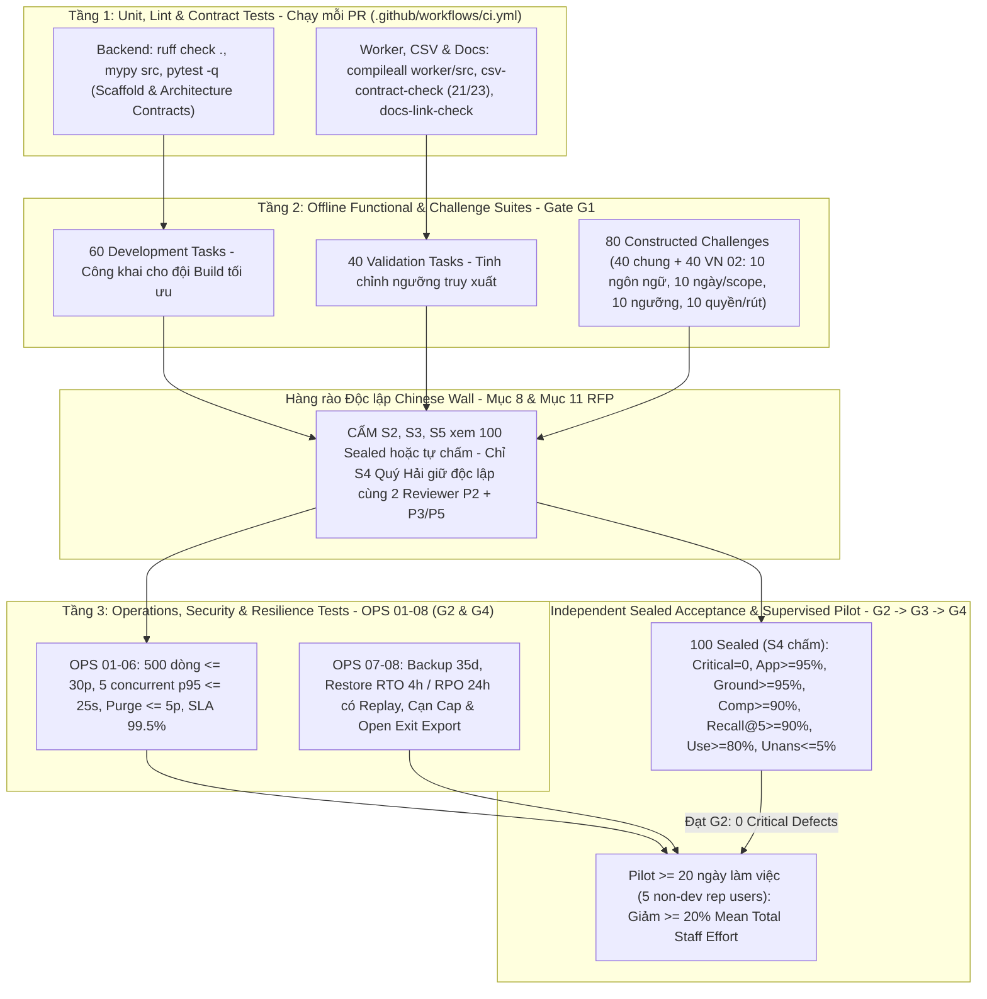

# 04 — Hướng dẫn Cài đặt Local, Kiểm thử 4 Tầng, Vận hành & Tuân thủ Pháp lý

> Sổ tay thực hành triển khai môi trường local, vận hành tác vụ nền Celery Beat, chiến lược kiểm thử `4` tầng chuẩn Mục 8 & Phụ lục D RFP (`OPS 01–08`), quy trình khôi phục có Replay (`OPS 07`), thoát khả chuyển (`OPS 08`), ứng phó sự cố/SLA (`SEC 07–08`) và tuân thủ pháp lý Việt Nam (Phụ lục C & F).

---

## 1. Hướng dẫn Cài đặt Local & Docker Compose

### 1.1 Yêu cầu tiên quyết & Biến môi trường
- **Công cụ cục bộ:** `Python 3.12+`, `Node.js 20+` (nếu chạy `frontend/` trực tiếp ngoài Docker), `Docker` & `Docker Compose v2`.
- **Khởi tạo cấu hình:** Sao chép [.env.example](../.env.example) thành `.env` tại thư mục gốc repository và điền `LLM_API_KEY` (hoặc cấu hình `LLM_PROVIDER=openai | azure | local` sau khi được `P5` duyệt).
  - Kiểm tra lại các cờ bất biến trong `.env`: `APP_TIMEZONE=Asia/Ho_Chi_Minh`, `ENABLE_ANSWER_STREAMING=false`, `ANSWER_SYSTEM_PROMPT_PATH=prompts/answer_system_vi.txt`, `LLM_REQUEST_TIMEOUT_SECONDS=20`, `OPS_LATENCY_P95_SECONDS=25`, `EMERGENCY_DISABLE_CACHE_KEY=ckpa:emergency_disable`, `EMBEDDING_DIM=1536`, `IMPORT_SNAPSHOT_STALENESS_HOURS=25`, `CACHE_WITHDRAWAL_MAX_SECONDS=300`.

### 1.2 Khởi chạy Hybrid Dev (Windows `dev.ps1` / Linux `Makefile`)
Phù hợp cho kỹ sư Build (`S2`, `S3`, `S5`) debug nhanh Backend/Worker cục bộ kết hợp DB & Redis trong Docker:

| Mục tiêu | Windows ([dev.ps1](../dev.ps1)) | Linux/macOS ([Makefile](../Makefile)) | Diễn giải |
|---|---|---|---|
| Bật DB & Redis | `.\dev.ps1 dev-db` | `make dev-db` | Chạy `db` (`pgvector/pgvector:pg16`, auto-chạy [infra/db/init.sql](../infra/db/init.sql) bật `vector`, `uuid-ossp`, `unaccent`, `pg_trgm`) và `redis` (`redis:7-alpine`). |
| Migrate DB | `.\dev.ps1 migrate` | `make migrate` | Chạy `alembic upgrade head` trong `backend/`. |
| Bật Backend API | `.\dev.ps1 dev` | `cd backend && uvicorn src.main:app --reload --port 8000` | Chạy FastAPI dev server tại `http://localhost:8000` (Swagger `/docs`, `/health`). |
| Kiểm tra Lint & CSV | `.\dev.ps1 lint`, `.\dev.ps1 check-csv` | `make lint`, `make check-csv` | Chạy `ruff check .`, `mypy src`, `compileall worker/src`, `npm run lint` (`Makefile`) và kiểm tra header `21`/`23` cột CSV UTF-8. |
| Chạy Test | `.\dev.ps1 test` | `make test` | Chạy `pytest -q` (và `npm run build` trong `Makefile`). |

Để chạy Celery Worker & Beat cục bộ (tại thư mục `worker/`):
```bash
celery -A src.celery_app worker -l info
celery -A src.celery_app beat -l info
```

### 1.3 Khởi chạy Full Stack qua Docker Compose (`--profile app`)
Tệp [docker-compose.yml](../docker-compose.yml) chia tách dịch vụ nền (`db`, `redis`) với cụm ứng dụng đầy đủ dưới `--profile app` (`backend` gắn `./prompts:/app/prompts:ro`, `worker`, `beat`, `frontend`, `nginx` cấu hình tại [infra/nginx/nginx.conf](../infra/nginx/nginx.conf)):

```bash
# Khởi chạy toàn bộ stack Base Scope (db, redis, backend, worker, beat, frontend, nginx)
docker compose --profile app up --build -d   # hoặc .\dev.ps1 up / make up

# Xem logs hoặc tắt stack
docker compose --profile app logs -f
docker compose --profile app down            # hoặc .\dev.ps1 down / make down
```

### 1.4 Cô lập Môi trường Kiểm thử G1 (`SEC 04`, `SEC 06`) & Cấu hình IAM 4 Vai trò (`20 Named Users` — `SEC 01`, `SEC 08`)
- **Tách biệt `100%` Dev/Test khỏi Production (`SEC 06`):**
  - Môi trường kiểm thử G1 chạy trên mạng bridge cô lập `ckpa_g1_isolated_net` với `security_opt: no-new-privileges:true`, cho phép tùy biến cổng máy trạm qua `.env` (`POSTGRES_PORT`, `REDIS_PORT`, `BACKEND_PORT`, `FRONTEND_PORT`, `NGINX_PORT`).
  - Phương thức `settings.verify_sec06_test_prod_isolation()` trong [backend/src/config.py](../backend/src/config.py) cưỡng chế chặn hai chiều: cấm môi trường `development`/`test` kết nối tới danh sách máy chủ DB Production (`PROD_DATABASE_HOST_DENYLIST`), cấm môi trường `production` dùng khóa mặc định hoặc DB của `dev`/`test`, và gắn nhãn `env` vào mọi JWT token để chặn dùng chéo token giữa `Test` và `Prod`.
- **Khóa cứng Model Training & Telemetry (`SEC 04`):**
  - Các cờ `LLM_ALLOW_TRAINING=false`, `LLM_ZERO_DATA_RETENTION=true`, `LLM_TELEMETRY_ENABLED=false` được khóa ở cả tầng cấu hình ứng dụng và biến môi trường container.
- **IAM 4 Vai trò Hệ thống chuẩn Mục 2 RFP trên `20 Named Users / 5 Concurrent Sessions` (`SEC 01`, `SEC 08`):**
  - Danh bạ `G1_NAMED_USERS_DIRECTORY` trong [backend/src/shared/auth.py](../backend/src/shared/auth.py) định danh đúng `20` người dùng được cấp phép (`PILOT_MAX_NAMED_USERS=20`), giới hạn tối đa `5` phiên đồng thời (`PILOT_MAX_CONCURRENT_SESSIONS=5`) trên `4` vai trò hệ thống chuẩn (`reader`, `policy_owner`, `steward`, `administrator` — kèm kiểm tra kết hợp vai trò tương thích được `P5` duyệt và tách biệt độc lập `S4` theo Mục 11 RFP).
  - Mọi thao tác cấp phát JWT (`/api/v1/identity/token`), kiểm tra quyền (`/api/v1/identity/check-permission`) và thẩm định trạng thái cô lập hạ tầng (`/api/v1/identity/iam-status`) đều ghi nhận nhật ký kiểm toán `SEC 08`.

---

## 2. Tác vụ Lịch (Celery Beat) & Dọn Cache Thu hồi (`<= 300s`)

Tất cả lịch trình chạy theo múi giờ **`Asia/Ho_Chi_Minh`** (`app.conf.enable_utc = False` trong [worker/src/celery_app.py](../worker/src/celery_app.py)):

| Tên tác vụ / Beat Job | Lịch chạy / Kích hoạt | Mô tả & Ngưỡng vận hành |
|---|---|---|
| `check_staleness` | Beat mỗi **`3600s` (`1h`)** | Kiểm tra độ tuổi bản chụp dữ liệu cuối cùng so với `IMPORT_SNAPSHOT_STALENESS_HOURS=25` (**cảnh báo `> 25h`** trên `/chat`, `/evidence`, `/admin`). |
| `activate_scheduled_policies` | Beat mỗi **`60s`** | Quét các bản ghi `scheduled` có `effective_from <= now_vn` (`Asia/Ho_Chi_Minh`) để chuyển sang `effective` (`KNW 03`); cấm kích hoạt sớm trước giờ duyệt. |
| `withdraw_and_purge_cache` | Sự kiện tức thời (on-demand) | Chạy ngay khi `Policy Owner` / `Administrator` gọi `POST /api/v1/admin/policies/{id}/withdraw`; `SCAN` và `DEL` toàn bộ khóa `ans:*{id}*`, `ret:*{id}*` trong Redis với hạn tối đa **`<= 300s` (`<= 5` phút)**. |
| `run_batch_import` & `index_passages` | Khi Steward nạp CSV | Xử lý idempotent lô `<= 500` dòng trong `<= 30` phút (`OPS 01`) và cập nhật `Vector(1536)` trong `passage_embeddings`. |

### 2.1 KNW 03/04/07 — Workflow, Change Impact & Feedback
- **Workflow KNW 03:** Bảy trạng thái chính thức là `draft → owner_reviewed → approved → scheduled → effective → superseded / withdrawn`; `quarantined` thuộc riêng DAT 02 và không phải trạng thái lifecycle. Lệnh chuyển sang `effective` bị từ chối nếu `effective_from` còn ở tương lai theo `Asia/Ho_Chi_Minh`; worker chỉ kích hoạt `scheduled` khi đã đến hạn.
- **Change Impact KNW 04:** Lifecycle thay đổi và sửa đổi/tombstone nguồn từ ingestion tạo report, đánh dấu answer package có citation liên quan là stale trong cùng transaction. `/api/v1/validation/verify` kiểm tra authoritative DB state. Chat và Evidence Viewer làm mới khi cửa sổ focus và mỗi 60 giây; đây là giới hạn refresh của active view, không phải cam kết push tức thời.
- **Feedback KNW 07:** Năm nhãn hiển thị là `missing source`, `obsolete rule`, `wrong scope`, `omitted exception`, `rejection` (API giữ mã tương thích `missing_source`, `outdated_rule`, `wrong_scope`, `missing_exception`, `rejected`). Mọi phản hồi được giữ làm candidate (`auto_applied=false`), tuyệt đối không tự huấn luyện hay cập nhật tri thức. Aggregate unanswered topics chuẩn hóa/ẩn PII phổ biến và chỉ hiển thị nhóm có ít nhất năm phản hồi; aggregate không xuất ID người gửi, task hoặc answer.

---

## 3. Chiến lược Kiểm thử 4 Tầng & Hàng rào Chinese Wall



### 3.1 Chi tiết Bộ Kiểm thử `60 / 40 / 100` & `80 Challenges` (`40 VN 02`)
- **Phân vùng `real_200`:** `200` tác vụ câu hỏi thực tế được phép sử dụng, giữ các biến thể và bản ghi liên quan trọn trong cùng phân vùng:
  - `60 Development` & `40 Validation`: Dùng phát triển và hiệu chỉnh ngưỡng ở `G1` (`S2, S3, S5`).
  - `100 Sealed Acceptance`: **Niêm phong tuyệt đối** dưới quyền quản lý của **`S4` Quý Hải**; nhãn chuẩn do `Two policy reviewers` (`P2` Hữu Tài + `P3` Chí Kha hoặc `P5` Anh Khoa) thống nhất. Nếu lộ ca nào cho đội Build, ca đó phải được thay thế và đánh giá độc lập lại.
- **Bộ `80 Constructed Challenges` (báo cáo tách riêng khỏi `real_200`):**
  - `40` ca chung: chính sách tương lai/hết hiệu lực, biên ngưỡng (`<, <=, ==, >=, >`), thiếu chú thích/bảng (`DAT 08`), xung đột hợp đồng (`DAT 05`), sai vai trò, ghi chú CRM cũ ghi đè, prompt injection (`ANS 08`) và thu hồi giữa lúc sinh câu trả lời (*Worked Case 9*).
  - **`40` ca định hướng Việt Nam (`VN 02`):** `10` ca ngôn ngữ (Unicode, thiếu dấu, viết tắt CRM, thuật ngữ tiếng Anh trộn lẫn, phủ định), `10` ca ngày giờ VN & phạm vi, `10` ca ngưỡng tiền tệ/đơn vị/ngoại lệ, `10` ca quyền `audience` & thu hồi khẩn.

### 3.2 Bảng Ngưỡng Nghiệm thu Mục 8 RFP & Kiểm thử Vận hành `OPS 01–08`

| Nhóm kiểm thử | Mã / Tiêu chí | Ngưỡng bắt buộc | Nguyên tắc đo & Ghi chú |
|---|---|---|---|
| **Đánh giá Độc lập (Mục 8 RFP)** | `Critical Controls` | **`0` lỗi** | Bất kỳ lỗi lộ trái quyền, bịa trường trọng yếu, phê duyệt giả hoặc dùng nguồn `withdrawn`/tương lai làm hiện hành **chặn phát hành ngay**. |
| | `Applicability` | **`>= 95%`** | Đúng phiên bản, phạm vi và `governing_date` trên các ca `100 Sealed` trả lời được. |
| | `Grounding & Completeness` | **`>= 95%` căn cứ; `>= 90%` đầy đủ; `0` trích dẫn bịa** | Báo tách *raw* vs *staff-used*, đầy đủ tử số và mẫu số. |
| | `Retrieval` | **`Recall@5 >= 90%`** | Trên tập con `Sealed` có bằng chứng áp dụng; báo riêng ca trả lời được, không trả lời được và thiếu nguồn. |
| | `Usefulness & Unanswerable` | **`>= 80%` hữu ích; `<= 5%` thiếu căn cứ khi không trả lời được** | **Các ca `HOLD` vẫn giữ trong mẫu số tổng**; ca không thể trả lời vẫn áp dụng `0` dung sai lỗi trọng yếu. |
| **Pilot Thực tế (`G3`)** | `Observed Effort` | **`>= 20` ngày làm việc; `>= 5` non-dev users; giảm `>= 20%` effort** | So với cùng corpus đã làm sạch có thể tìm kiếm; tính đủ chuẩn bị, kiểm tra, lần thử thất bại, sửa và fallback; đếm mỗi tác vụ 1 lần. |
| **Vận hành (`OPS`)** | `OPS 01` Import Volume | **`500` dòng `<= 30` phút** | Đối soát `100%` manifest, idempotent retry, late-batch guard & tombstone. |
| | `OPS 02` Response Latency | **`p95 <= 25s` ở `5` concurrent users (`100` req)** | Trong giới hạn `<= 8` đoạn, `<= 2` calls, `6000 in / 900 out`; ghi rõ thời gian từng tầng, `hold`, lỗi & throttling. |
| | `OPS 03–04` Date & Fields | `100%` pass ranh giới | Chính xác `00:00`/`23:59` giờ VN (`UTC+7`) và biên `<, <=, ==, >=, >`, thiếu `currency`. |
| | `OPS 05` Withdrawal & Fallback | Purge **`<= 5` phút (`300s`)** | Test rút khẩn giữa chừng + bật `Emergency Disable` và tra cứu CSV thủ công. |
| | `OPS 06` Availability & Metering | **`>= 99.5%`** (`08:00–17:00` VN) | Cost Meter ghi đủ mọi lượt thử, `hold`, `error`, `retry`, tokens & chi phí. |
| | `OPS 07` Backup & Restore | **`RTO <= 4h` hỗ trợ / `RPO <= 24h` / `35` ngày** | Bắt buộc **Replay deletion, withdrawal & RBAC** trước khi mở truy cập. |
| | `OPS 08` Cap Exhaustion & Exit | `0%` cắt cụt im lặng; `100%` đọc mở | Chạm trần `1000 pkg / 2000 calls` báo lỗi/hold rõ ràng; Export đọc được trên trình đọc trung lập. |

---

## 4. Backup, Restore có Replay & Open Exit Export (`OPS 07`, `OPS 08`)

### 4.1 Quy trình Backup & Restore Replay (`OPS 07`, Gate `G2` & `G4`)
1. **Sao lưu xoay vòng (`35` ngày — Phụ lục C):** Snapshot hằng ngày PostgreSQL 16 (dữ liệu + `pgvector` + bảng audit/lifecycle), cấu hình Redis và thư mục `./data` (templates, manifest, export).
2. **Quy trình Khôi phục Bắt buộc có Replay (`RTO <= 4h` hỗ trợ, `RPO <= 24h`):**
   - Khôi phục DB và `./data` lên môi trường sạch ở chế độ **khóa traffic người dùng** (*maintenance lock*).
   - **Bước Replay bắt buộc trước khi mở lại API:** Chạy lại danh sách sự kiện sau thời điểm snapshot từ nhật ký kiểm soát/ledger bảo toàn: (a) các lệnh xóa `tombstone` và lịch sử xóa Annex C, (b) các lệnh thu hồi chính sách `withdrawn`, và (c) trạng thái phân quyền `RBAC` / thu hồi tài khoản hiện hành.
   - **Tiêu chí đậu:** `0%` chính sách đã thu hồi, dữ liệu đã xóa hoặc quyền đã tước bị "sống lại" (*resurrected*); xóa sạch cache Redis trước khi mở cổng Nginx.

### 4.2 Quy trình Open Exit Export (`OPS 08`, Gate `G4`)
- Sử dụng endpoint `GET /api/v1/audit/export-open` và công cụ xuất định dạng mở (`JSON` / `UTF-8 CSV` / `Markdown`) xuất trọn bộ: `documents`, `document_versions`, `passages`, `critical_fields`, `authority_matrix`, `local_referrals`, `feedback_candidates`, `audit_logs` được phép và mapping tài liệu.
- **`P3` Chí Kha** kiểm tra mở đọc `100%` tệp xuất bằng trình đọc trung lập (Excel / LibreOffice / JSON parser độc lập), không phụ thuộc công cụ độc quyền nhà cung cấp.
- Sau khi nghiệm thu thoát, nhà cung cấp xác nhận xóa toàn bộ bản sao chỉ mục, cache và backup còn tồn đọng theo lịch xóa Annex C.

---

## 5. Incident Runbook, SLA & Change Control (`SEC 07`, `SEC 08`)

### 5.1 SLA Vận hành & Thời hạn Thông báo
- **Giờ hỗ trợ thỏa thuận:** **`08:00–17:00`** giờ Việt Nam các ngày làm việc (`DEL 06`), mục tiêu độ sẵn sàng **`>= 99.5%`** (trừ bảo trì có kế hoạch báo trước).
- **Xử lý sự cố Production nghiêm trọng:**
  - Thời gian xác nhận (`ACK`): **`<= 2 giờ hỗ trợ`**.
  - Mục tiêu cô lập sự cố (`Containment`): **`<= 4 giờ hỗ trợ`**.
- **Thông báo sự cố Dữ liệu hoặc Kiểm soát trọng yếu nghi ngờ (`SEC 07`):** Mục tiêu hợp đồng **`<= 4 giờ liên tục` (`4 hours elapsed`)** kể từ khi nhận biết sự cố, báo đồng thời tới **`P1` Mỹ Vân**, **`P5` Anh Khoa** (Privacy/Security/Legal Owner) và **`P2` Hữu Tài**. *(Lưu ý: Các mốc hợp đồng này không thay thế nghĩa vụ thông báo theo thời hạn luật định của Việt Nam.)*

### 5.2 Năm (5) Bước Ứng phó Sự cố & Phương án Dự phòng Thủ công (`OPS 05`)
Khi phát hiện lộ quyền truy cập, bịa `critical_fields`, chính sách `withdrawn`/tương lai hiển thị như hiện hành hoặc rò rỉ dữ liệu:
1. **Cô lập tức thời (`Emergency Disable`):** `S5` Ngọc Duy hoặc `P5` Anh Khoa kích hoạt `POST /api/v1/admin/emergency-disable` (`disabled=true`), đồng thời gọi `withdraw` nếu liên quan nội dung sai lệch để dọn cache `<= 300s`.
2. **Chuyển tra cứu thủ công:** Thông báo trên `/` và `/chat` hướng dẫn nhân viên tra cứu trực tiếp **gói `2` tệp CSV đã phê duyệt** tại kho tài liệu nội bộ và chuyển tuyến xử lý qua `Policy Owner` trong giờ `08:00–17:00`.
3. **Thông báo & Bảo toàn bằng chứng:** Báo cáo trong `<= 4h` (`SEC 07`), khóa quyền truy cập bản ghi audit hạn chế (`AuditLog`) phục vụ điều tra — không phát tán log chứa dữ liệu nhạy cảm.
4. **Phân tích Nguyên nhân gốc (`RCA`) & Khắc phục:** Đội Build (`S2`, `S3`, `S5`) phân tích nguyên nhân, vá lỗi trên nhánh sửa đổi và cập nhật test hồi quy.
5. **Kiểm thử lại Độc lập (`Independent Retest`):** **`S4` Quý Hải** xác minh lại toàn bộ kiểm soát và ca test bị ảnh hưởng trước khi **`P5` & `P2`** ký duyệt mở lại dịch vụ.

### 5.3 Quy trình Kiểm soát Thay đổi (`SEC 08` — Change Control)
Mọi thay đổi về **nhà cung cấp LLM/Embedding, phiên bản model, system prompt (`prompts/`), logic truy xuất (`retrieval`), schema CSV/DB, hoặc phạm vi (`O1`)** bắt buộc tuân theo `4` bước:
1. Lập Change Request nêu rõ phạm vi, tác động tới quyền/pháp lý/chi phí (`DEL 05`) và kế hoạch rollback.
2. Xin phê duyệt của `P1`, `P2` (nếu đổi nội dung/logic chính sách) và `P5` (nếu đổi subprocessor/nơi xử lý dữ liệu — `SEC 04`).
3. Chạy lại bộ kiểm thử hồi quy + kiểm tra độc lập của `S4` trên các kiểm soát bị ảnh hưởng.
4. Triển khai kèm khả năng rollback tức thì hoặc tắt khẩn cấp `Emergency Disable`.

---

## 6. Checklist Pháp lý Việt Nam (Phụ lục F) & Lưu giữ Dữ liệu (Phụ lục C)

### 6.1 Checklist Rà soát Pháp lý Trước Dữ liệu thật (`SEC 03`, `VN 05`, Gate `G2`)
Trước khi cho phép đưa dữ liệu vận hành thật hoặc mở Pilot `G2`, **`P5` Anh Khoa** cùng **Legal Owner** phải xác minh hiệu lực hiện hành, hoàn tất phân loại và ký duyệt văn bản có ngày đối chiếu các quy phạm nêu tại **Phụ lục F RFP**:

| Văn bản pháp lý nêu tại Phụ lục F | Nội dung cần thẩm định & ký duyệt trước Gate `G2` | Trạng thái bắt buộc |
|---|---|---|
| **Luật Bảo vệ dữ liệu cá nhân `91/2025/QH15`** & **Nghị định `356/2025/NĐ-CP`** | Xác định mục đích, cơ sở xử lý hợp pháp, phân vai Bên kiểm soát/Bên xử lý, quyền chủ thể dữ liệu, rà soát nhà thầu phụ & chuyển dữ liệu xuyên biên giới (`SEC 04`), tối thiểu hóa PII (`SEC 02`). | Ký duyệt trước `G2` |
| **Luật Trí tuệ nhân tạo `134/2025/QH15`** & **Nghị định `142/2026/NĐ-CP`** | Xác định hệ thống CKPA có thuộc phạm vi điều chỉnh, nghĩa vụ minh bạch, giám sát con người (`Human-in-the-loop` — hướng dẫn nội bộ không tự quyết định) và hồ sơ đánh giá tuân thủ. | Ký duyệt trước `G2` |
| **Luật An ninh mạng `116/2025/QH15`** | Kiểm tra yêu cầu bảo vệ hệ thống thông tin, lưu trữ nhật ký và báo cáo sự cố an ninh mạng áp dụng thực tế. | Ký duyệt trước `G2` |
| **Quyết định `33/2026/QĐ-TTg`** | Đối chiếu tiêu chí **Danh mục hệ thống AI rủi ro cao**; ghi rõ kết luận phân loại rủi ro có căn cứ pháp lý (không tự suy diễn miễn trừ). | Ký duyệt trước `G2` |

*(Cảnh báo tuân thủ: Việc đặt máy chủ tại Việt Nam, mã hóa dữ liệu hay có nhân sự phê duyệt **không tự động chứng minh tuân thủ** hay miễn trừ nghĩa vụ pháp luật; danh sách trên phải được Legal Owner xác minh văn bản mới nhất tại thời điểm triển khai.)*

### 6.2 Mốc Lưu giữ & Xóa Vận hành Đề xuất (`Phụ lục C`)
Các mốc thời gian dưới đây là **đề xuất vận hành** trong Phụ lục C, phải được Legal Owner và Records Owner (`P5` / `P3`) phê duyệt chính thức trước dữ liệu thật (không thay thế thời hạn luật định):

| Loại dữ liệu | Mốc đề xuất (Phụ lục C) | Quy tắc quản trị & Xóa |
|---|---|---|
| **Nhật ký Answer & Local Referral** | `<= 12 tháng` (`12m`) | Giới hạn quyền truy cập audit; tách biệt chặn hiển thị tức thời khi `withdrawn` với thời điểm xóa vật lý hết hạn. |
| **Ngữ cảnh `O1` (chỉ nếu bật CR sau G0)** | `<= 12 tháng` (`12m`) | Base Scope hiện không lưu hồ sơ khách hàng; nếu bật CR riêng chỉ lưu trường allowlist tối thiểu. |
| **Bản xuất thô đối soát (`Raw Exports`)** | `<= 90 ngày` (`90d`) | `P3` (`Reconciliation owners`) chịu trách nhiệm xóa bản sao tiện ích thừa quá `90` ngày trừ khi có phê duyệt giữ lại. |
| **Bản sao lưu xoay vòng (`Backups`)** | `35 ngày` (`35d`) | Xóa theo vòng quay `35` ngày; mọi lần restore bắt buộc replay xóa/thu hồi/quyền trước khi cấp truy cập. |
| **Dữ liệu phía Nhà cung cấp AI (`SEC 04`)** | Cấm lưu/huấn luyện | Khóa cấu hình không cho nhà cung cấp lưu prompt/dữ liệu để huấn luyện hoặc tái sử dụng; xóa sạch chỉ mục/cache khi kết thúc hợp đồng (`G4`). |
