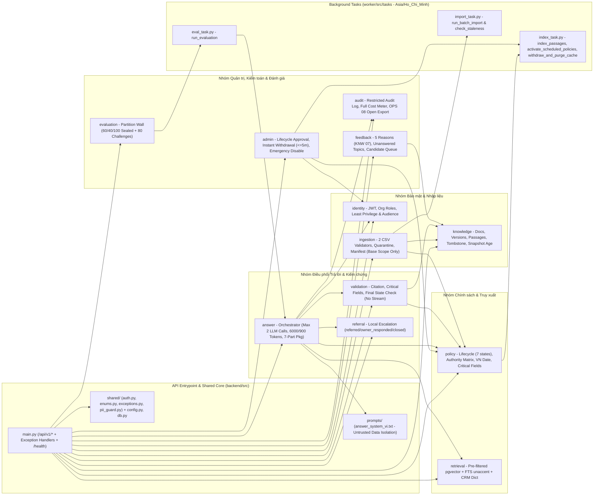

# Sơ đồ Module Backend & Worker — SongNhat CKPA

> Kiến trúc **Modular Monolith** trên `backend/src/` (`FastAPI / Python 3.12+`) kết hợp `worker/src/` (`Celery 5.4+`, múi giờ `Asia/Ho_Chi_Minh`).
> Tham chiếu chuẩn: [SRS](../specs/srs.md) (Mục 4.3 & Mục 7.2).

---

## 1. Sơ đồ phụ thuộc giữa 12 Module, Shared Core & 3 Worker Tasks

---

## 2. Cấu trúc chuẩn mỗi Module & Quy ước ranh giới

Mỗi thư mục dưới `backend/src/modules/<module>/` tuân theo chuẩn 4 file để tách biệt giao thức HTTP với nghiệp vụ cốt lõi:
- `router.py`: Tiếp nhận HTTP request, kiểm tra quyền qua `get_current_user` / `require_roles` từ `shared/auth.py`.
- `schemas.py`: Pydantic v2 input/output contracts khớp [SRS](../specs/srs.md) và [erd-and-csv-contract.md](./erd-and-csv-contract.md).
- `service.py`: Nghiệp vụ thuần (Applicability, Critical Fields, Quarantine, Validation, Orchestration, Cost Metering).
- `models.py`: SQLAlchemy 2.0 async ORM mapping xuống PostgreSQL 16 + `pgvector`.

---

## 3. Ranh giới an toàn giữa các nhóm Module
- **Tách quyền đánh giá (`evaluation` vs `answer/retrieval`):** Endpoint `evaluation` chỉ định danh vai trò `independent_evaluator` / `administrator` được phân quyền đọc tập `sealed_100`.
- **Tách dữ liệu ứng viên (`feedback` vs `policy`):** `feedback` chỉ tạo bản ghi `feedback_candidate`; mọi chuyển đổi thành `draft → effective` phải đi qua `policy` + `admin` có phê duyệt của `policy_owner`.
- **Ranh giới Base Scope (`M`):** Toàn bộ codebase chỉ phục vụ `2` nguồn CSV cơ sở (`passages`, `critical_fields`); không chứa endpoint hay schema nhập hồ sơ khách hàng / `O1`.
