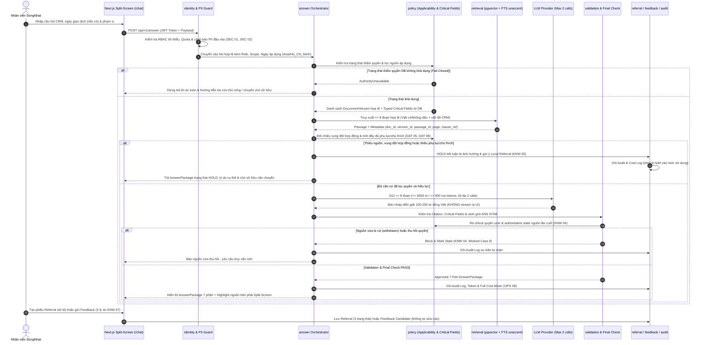
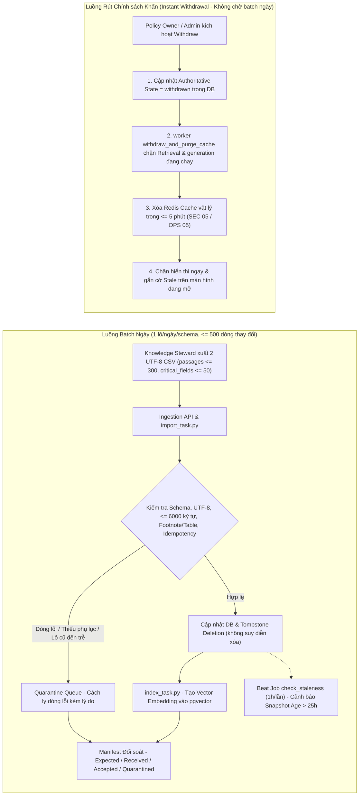

# Luồng Nghiệp vụ Chính — SongNhat CKPA

> Đặc tả 2 luồng vận hành cốt lõi theo RFP (Mục 6, Phụ lục A, Phụ lục B) và [SRS](../specs/srs.md) (Mục 5).

---

## 1. Luồng Hỏi – Đáp Có Kiểm soát, Hold & Chuyển Chủ Sở Hữu

### Quy tắc bất biến trên luồng hỏi – đáp
- **Không phụ thuộc prompt cho logic nghiệp vụ:** Quyền RBAC, trạng thái phát hành, ngày hiệu lực `Asia/Ho_Chi_Minh`, phạm vi (`scope`) và giá trị `critical_fields` xử lý hoàn toàn ở backend (`identity`, `policy`, `validation`).
- **Không stream trước khi kiểm tra cuối:** Chỉ hiển thị `AnswerPackage` sau khi đã đối soát citation và re-check authoritative state nguồn (`KNW 04`, RFP trang 4).
- **Hold rõ ràng thay vì đoán:** Xung đột hợp đồng/chính sách hoặc thiếu phụ lục/chú thích phải giữ kết luận và gợi ý chuyển chủ sở hữu (`referral`), không dùng bộ nhớ LLM hay web công khai (`ANS 06`).

---

## 2. Luồng Nhập liệu 2 CSV Hàng ngày & Rút Chính sách Tức thời

### Quy tắc đối soát & độ mới dữ liệu
- **Idempotency & Late-batch:** Chạy lại cùng batch không gây trùng; batch cũ hơn không được ghi đè dữ liệu mới (`DAT 02`).
- **Tombstone:** Thiếu dòng không giải thích không được tự xem là lệnh xóa; xóa chính thức phải qua `record_action=tombstone` hoặc đối soát `full_snapshot` đã duyệt.
- **Snapshot Age:** Celery Beat chạy `check_staleness` mỗi `3600s`; ngưỡng mặc định là `IMPORT_SNAPSHOT_STALENESS_HOURS=25`.
