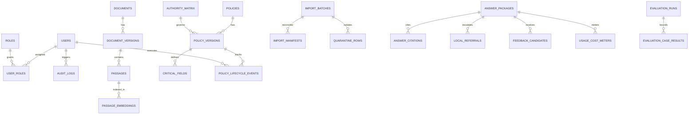

# Thiết kế Cơ sở Dữ liệu (ERD) & Hợp đồng 2 CSV UTF-8 — SongNhat CKPA

> Đặc tả chi tiết schema cơ sở dữ liệu PostgreSQL 16 + `pgvector` và hợp đồng dữ liệu `2` tệp CSV UTF-8 cơ sở theo RFP (`DAT 01–08`, `KNW 03`, `Phụ lục C`) và [SRS](../specs/srs.md) (Mục 7.3).

---

## 1. Sơ đồ Quan hệ Thực thể (ERD)

---

## 2. Hợp đồng CSV Cơ sở 1: `passages_template.csv` (21 cột UTF-8)

> Đường dẫn mẫu: [data/templates/passages_template.csv](../../data/templates/passages_template.csv)  
> Giới hạn Base Scope: tối đa `30` tài liệu, `300` đoạn, mỗi đoạn `<= 6.000` ký tự Unicode; batch ngày `<= 500` dòng thay đổi.

| STT | Tên cột | Kiểu | Bắt buộc | Quy tắc kiểm tra (`DAT 01, DAT 02, DAT 08, KNW 03`) |
|---:|---|---|:---:|---|
| 1 | `passage_id` | `string` | Có | ID đoạn ổn định duy nhất (VD: `PAS-001`) |
| 2 | `document_id` | `string` | Có | ID tài liệu gốc ổn định (VD: `DOC-001`) |
| 3 | `document_version_id` | `string` | Có | ID phiên bản tài liệu (VD: `VER-001`) |
| 4 | `title` | `string` | Có | Tiêu đề tài liệu / điều khoản |
| 5 | `content` | `text` | Có | Văn bản đã tuyển chọn, `<= 6.000` ký tự Unicode; không cắt ngắn âm thầm |
| 6 | `source_ref` | `string` | Có | Tham chiếu nguồn gốc ổn định (mã tài liệu/đường dẫn kho lưu trữ) |
| 7 | `page_number` | `integer` | Có | Số trang gốc (`>= 1`) |
| 8 | `clause_ref` | `string` | Có | Điều/khoản/mục gốc (VD: `Điều 1.1`) |
| 9 | `language` | `enum` | Có | Ngôn ngữ nội dung (`vi` mặc định; `en` nếu nguồn song ngữ có ngôn ngữ chi phối) |
| 10 | `owner` | `string` | Có | Chủ sở hữu chính sách (`Policy Owner`) |
| 11 | `approver` | `string` | Có (khi duyệt) | Người phê duyệt có thẩm quyền (`DAT 01`) |
| 12 | `recorded_at` | `ISO-8601` | Có | Thời điểm hệ thống ghi nhận/chỉnh sửa (`Asia/Ho_Chi_Minh`) |
| 13 | `published_at` | `ISO-8601` | Có (khi phát hành) | Thời điểm phát hành (`DAT 01`, tách biệt với `effective_from`) |
| 14 | `effective_from` | `ISO-8601` | Có | Thời điểm bắt đầu hiệu lực (`Asia/Ho_Chi_Minh`) |
| 15 | `effective_to` | `ISO-8601` | Không | Thời điểm hết hiệu lực (rỗng nếu chưa ấn định ngày kết thúc) |
| 16 | `scope` | `string` | Có | Phạm vi áp dụng (`company:SN;branch:all;role:sales;customer_group:all;product:all`) |
| 17 | `audience` | `string` | Có | Nhóm vai trò được phép xem (`reader,policy_owner,steward,administrator`) |
| 18 | `status` | `enum` | Có | `draft`, `owner_reviewed`, `approved`, `scheduled`, `effective`, `superseded`, `withdrawn` |
| 19 | `supersedes` | `string` | Không | `document_version_id` / `passage_id` bị thay thế (`DAT 01, DAT 05`) |
| 20 | `has_essential_attachments` | `boolean` | Có | `true` nếu đủ chú thích/bảng/sơ đồ/phụ lục; `false` -> đẩy Quarantine & Hold (`DAT 08`) |
| 21 | `record_action` | `enum` | Có | `upsert` hoặc `tombstone` (cấm suy diễn xóa từ dòng vắng mặt — `DAT 02`) |

---

## 3. Hợp đồng CSV Cơ sở 2: `critical_fields_template.csv` (23 cột UTF-8)

> Đường dẫn mẫu: [data/templates/critical_fields_template.csv](../../data/templates/critical_fields_template.csv)  
> Giới hạn Base Scope: tối đa `50` dòng trường chính sách quan trọng thuộc 3 nhóm đề xuất.

| STT | Tên cột | Kiểu | Bắt buộc | Quy tắc kiểm tra (`DAT 06, DAT 01, DAT 02, Phụ lục C`) |
|---:|---|---|:---:|---|
| 1 | `field_id` | `string` | Có | ID trường ổn định (VD: `CF-001`) |
| 2 | `policy_id` | `string` | Có | ID chính sách (`Rule ID` / `POL-001`) |
| 3 | `policy_version_id` | `string` | Có | ID phiên bản điều khoản chính sách |
| 4 | `document_version_id` | `string` | Có | Liên kết phiên bản tài liệu chứa điều khoản gốc |
| 5 | `field_name` | `string` | Có | Tên trường chính sách (VD: `Han muc chiet khau toi da`) |
| 6 | `field_type` | `enum` | Có | `number`, `currency`, `duration`, `role`, `document_list`, `boolean`, `text_rule` |
| 7 | `operator` | `enum` | Có | `<=`, `<`, `>=`, `>`, `==`, `in`, `between`, `required` (`DAT 06`) |
| 8 | `value` | `string` | Có | Giá trị có cấu trúc chuẩn hóa (VD: `10`, `50000000`, `5;10`) |
| 9 | `unit` | `string` | Có điều kiện | Đơn vị đo lường (`%`, `ngày làm việc`, `giờ`, `tháng`) |
| 10 | `currency` | `string` | Có điều kiện | Tiền tệ khi `field_type=currency` (`VND`, `USD`) — thiếu -> Quarantine (`OPS 04`) |
| 11 | `approval_role` | `string` | Có | Vai trò có thẩm quyền phê duyệt (VD: `Sales Director`) |
| 12 | `time_limit` | `string` | Không | Thời hạn xử lý / hiệu lực ràng buộc (VD: `48 gio lam viec`) |
| 13 | `exception_condition` | `string` | Không | Điều kiện ngoại lệ được duyệt (hoặc `none`) |
| 14 | `required_documents` | `string` | Không | Danh sách tài liệu bắt buộc (ngăn cách bằng `;`) |
| 15 | `effective_from` | `ISO-8601` | Có | Thời điểm bắt đầu hiệu lực (`Asia/Ho_Chi_Minh`) |
| 16 | `effective_to` | `ISO-8601` | Không | Thời điểm hết hiệu lực |
| 17 | `scope` | `string` | Có | Phạm vi áp dụng khớp `passages` |
| 18 | `audience` | `string` | Có | Đối tượng được phép xem (`SEC 01`) |
| 19 | `source_clause` | `string` | Có | Điều khoản gốc chính xác (VD: `Điều 2.3, trang 4`) |
| 20 | `owner` | `string` | Có | Chủ sở hữu chịu trách nhiệm |
| 21 | `approver` | `string` | Có | Người phê duyệt giá trị chính xác (`Phụ lục C`) |
| 22 | `status` | `enum` | Có | Trạng thái vòng đời (`draft` .. `withdrawn`) |
| 23 | `record_action` | `enum` | Có | `upsert` hoặc `tombstone` (`DAT 02`) |

---

## 4. Ranh giới ngoài Base Scope: Tùy chọn `O1` (Selected CRM Context)

- **Trong Base Scope (`M`):** Không xây dựng endpoint, bảng hay schema cho `O1`; hệ thống chỉ tiếp nhận đúng `2` CSV UTF-8 (`passages` và `critical_fields`).
- Nếu được phê duyệt riêng bằng phụ lục hợp đồng tại `G0`: phát triển tách biệt thành Change Request cho schema CSV thứ `3` (`account_key`, `record_id`, allowlist tối thiểu, `source_cutoff_at`, `source_system`, `audience`, `version`; trần `2.000` dòng ban đầu, `5.000` dòng lưu giữ).
