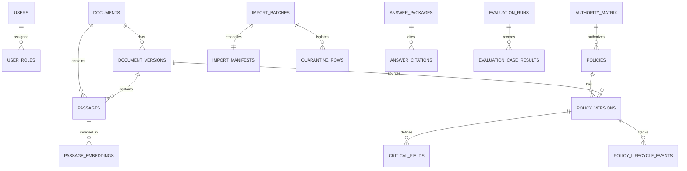

# Thiết kế Cơ sở Dữ liệu (ERD) & Hợp đồng 2 CSV UTF-8 — SongNhat CKPA

> Đặc tả chi tiết schema cơ sở dữ liệu PostgreSQL 16 + `pgvector` và hợp đồng dữ liệu `2` tệp CSV UTF-8 cơ sở theo RFP (`DAT 01–08`, `KNW 03`, `KNW 07`, `VN 01`, `Phụ lục C`), [SRS](../specs/srs.md) (Mục 7.3, Mục 8) và mã nguồn SQLAlchemy models (`identity`, `knowledge`, `policy`, `ingestion`, `referral`, `feedback`, `audit`, `evaluation`).
>
> **Vị trí Git dự kiến:** `docs/architecture/erd-and-csv-contract.md` (nhánh `docs/CKPA-6-freeze-2-csv-contracts-and-db-erd`). Bản đính kèm này chưa được đồng bộ lên Git và chưa tạo PR.

## 1. Sơ đồ Quan hệ Thực thể (ERD)

### 1.1. Sơ đồ quan hệ tổng quan

> Sơ đồ chỉ thể hiện các khóa ngoại được khai báo trong SQLAlchemy models; các liên kết nghiệp vụ không có FK trong model được lược bỏ.

### 1.2. Đặc tả chi tiết các bảng lõi (PostgreSQL 16 + `pgvector`)

> **Quy ước chung và PostgreSQL Extensions:**
>
> * **Extensions bắt buộc (`infra/db/init.sql`):**
>   * `CREATE EXTENSION IF NOT EXISTS "uuid-ossp";`
>   * `CREATE EXTENSION IF NOT EXISTS vector;`
>   * `CREATE EXTENSION IF NOT EXISTS "unaccent";` (phục vụ chuẩn hóa tìm kiếm tiếng Việt không dấu theo `VN 01`)
> * **Timestamp dùng chung:** Các model kế thừa `TimestampMixin` có `created_at` và `updated_at` kiểu `TIMESTAMPTZ`, `NOT NULL`; giá trị khởi tạo lấy từ `NOW()`.
> * **Kiểu JSON:** Các model dùng SQLAlchemy `JSON` (PostgreSQL `JSON`), không phải `JSONB`, trừ khi được ghi rõ.
> * **Khóa chính (PK):** Phần lớn là `VARCHAR(64)`; `user_roles`, `policy_lifecycle_events`, `audit_logs`, `usage_cost_meters`, `answer_citations`, `quarantine_rows` và `evaluation_case_results` dùng `INTEGER` autoincrement; `import_manifests.batch_id` là PK đồng thời là FK.
> * Các `default` dưới đây là giá trị mặc định khai báo trong SQLAlchemy model; không mặc định hiểu là `server_default` trong DDL.

#### A. Nhóm Identity & Audit (`identity`, `audit`)

* **`users`** (`identity/models.py`):
  * `id` (`VARCHAR(64)`, PK)
  * `email` (`VARCHAR(255)`, NOT NULL)
  * `full_name` (`VARCHAR(255)`, NOT NULL)
  * `company` (`VARCHAR(64)`, NOT NULL, default `SN`)
  * `branch` (`VARCHAR(64)`, NOT NULL, default `all`)
  * `department` (`VARCHAR(64)`, NOT NULL, default `crm`)
  * `is_active` (`BOOLEAN`, NOT NULL, default `TRUE`)
  * *Index:* `email` (unique index theo khai báo `unique=True`, `index=True`).
  * `created_at`, `updated_at` (`TIMESTAMPTZ`, NOT NULL; từ `TimestampMixin`)

* **`user_roles`** (`UserRoleAssignment` trong `identity/models.py` — không tách bảng `roles` rời):
  * `id` (`INTEGER`, PK, autoincrement)
  * `user_id` (`VARCHAR(64)`, FK -> `users.id` ON DELETE CASCADE, NOT NULL)
  * `role_name` (`VARCHAR(64)`, NOT NULL)
  * `allowed_audiences` (`VARCHAR(255)`, NOT NULL, default `reader`; không phải mảng)
  * *Ràng buộc:* UNIQUE (`user_id`, `role_name`); `user_id` có index.
  * `created_at`, `updated_at` (`TIMESTAMPTZ`, NOT NULL; từ `TimestampMixin`)

* **`audit_logs`** (`audit/models.py`):
  * `id` (`INTEGER`, PK, autoincrement)
  * `actor_id` (`VARCHAR(64)`, NOT NULL, có index; model không khai báo FK)
  * `actor_role` (`VARCHAR(64)`, NOT NULL)
  * `action` (`VARCHAR(128)`, NOT NULL, có index)
  * `resource_type` (`VARCHAR(64)`, NOT NULL)
  * `resource_id` (`VARCHAR(64)`, NOT NULL)
  * `outcome` (`VARCHAR(32)`, NOT NULL)
  * `detail` (`TEXT`, NULL)
  * `metadata_json` (`JSON`, NOT NULL, default `{}`)
  * `created_at`, `updated_at` (`TIMESTAMPTZ`, NOT NULL; từ `TimestampMixin`)

#### B. Nhóm Knowledge & Vector Search (`knowledge`)

* **`documents`** (`knowledge/models.py`):
  * `id` (`VARCHAR(64)`, PK; ánh xạ từ CSV `document_id`, VD: `DOC-001`)
  * `title` (`VARCHAR(500)`, NOT NULL)
  * `policy_family` (`VARCHAR(64)`, NOT NULL)
  * `authority_tier` (`VARCHAR(64)`, NOT NULL, default `policy`)
  * `owner` (`VARCHAR(128)`, NOT NULL)
  * `source_ref` (`VARCHAR(500)`, NOT NULL)
  * `created_at`, `updated_at` (`TIMESTAMPTZ`, NOT NULL; từ `TimestampMixin`)

* **`document_versions`** (`knowledge/models.py`):
  * `id` (`VARCHAR(64)`, PK; ánh xạ từ CSV `document_version_id`, VD: `VER-001`)
  * `document_id` (`VARCHAR(64)`, FK -> `documents.id` ON DELETE CASCADE, NOT NULL)
  * `approver` (`VARCHAR(128)`, NULL)
  * `recorded_at` (`TIMESTAMPTZ`, NOT NULL)
  * `published_at` (`TIMESTAMPTZ`, NULL)
  * `effective_from` (`TIMESTAMPTZ`, NOT NULL)
  * `effective_to` (`TIMESTAMPTZ`, NULL)
  * `status` (`VARCHAR(32)`, NOT NULL, default `draft`, có index)
  * `supersedes_version_id` (`VARCHAR(64)`, NULL; model không khai báo FK)
  * *Index:* `document_id`.
  * `created_at`, `updated_at` (`TIMESTAMPTZ`, NOT NULL; từ `TimestampMixin`)

* **`passages`** (`knowledge/models.py`):
  * `id` (`VARCHAR(64)`, PK; ánh xạ từ CSV `passage_id`)
  * `document_id` (`VARCHAR(64)`, FK -> `documents.id` ON DELETE CASCADE, NOT NULL)
  * `document_version_id` (`VARCHAR(64)`, FK -> `document_versions.id` ON DELETE CASCADE, NOT NULL)
  * `title` (`VARCHAR(500)`, NOT NULL)
  * `content` (`TEXT`, NOT NULL — giới hạn `<= 6.000` ký tự là quy tắc ứng dụng, không phải CHECK trong model)
  * `source_ref` (`VARCHAR(500)`, NOT NULL)
  * `page_number` (`INTEGER`, NOT NULL; model không khai báo CHECK)
  * `clause_ref` (`VARCHAR(255)`, NOT NULL)
  * `language` (`VARCHAR(8)`, NOT NULL, default `vi`)
  * `scope` (`VARCHAR(500)`, NOT NULL)
  * `audience` (`VARCHAR(255)`, NOT NULL; không phải `TEXT[]`)
  * `status` (`VARCHAR(32)`, NOT NULL, default `draft`, có index)
  * `has_essential_attachments` (`BOOLEAN`, NOT NULL, default `TRUE`)
  * `is_tombstoned` (`BOOLEAN`, NOT NULL, default `FALSE`, có index)
  * *Index:* `document_id`, `document_version_id`.
  * `created_at`, `updated_at` (`TIMESTAMPTZ`, NOT NULL; từ `TimestampMixin`)
  * `owner`, `approver`, `recorded_at`, `published_at`, `effective_from`, `effective_to`, `supersedes_version_id` không nằm trên `passages`; chúng thuộc `documents` hoặc `document_versions`.

* **`passage_embeddings`**:
  * `passage_id` (`VARCHAR(64)`, PK đồng thời FK -> `passages.id` ON DELETE CASCADE)
  * Không có cột `id` riêng.
  * `embedding_model` (`VARCHAR(128)`, NOT NULL)
  * `embedding` (`vector(1536)`, NOT NULL — *chốt số chiều chính thức theo provider ở CKPA-9*)
  * `created_at`, `updated_at` (`TIMESTAMPTZ`, NOT NULL; từ `TimestampMixin`)
  * Model chưa khai báo HNSW index.

#### C. Nhóm Policy & Governance (`policy`)

* **`policies`** (`policy/models.py`):
  * `id` (`VARCHAR(64)`, PK; ánh xạ từ CSV `policy_id`)
  * `title` (`VARCHAR(500)`, NOT NULL)
  * `policy_family` (`VARCHAR(64)`, NOT NULL)
  * `authority_entry_id` (`VARCHAR(64)`, FK -> `authority_matrix.id`, NULL)
  * `created_at`, `updated_at` (`TIMESTAMPTZ`, NOT NULL; từ `TimestampMixin`)

* **`authority_matrix`** (`policy/models.py`):
  * `id` (`VARCHAR(64)`, PK)
  * `authority_tier` (`VARCHAR(32)`, NOT NULL)
  * `policy_family` (`VARCHAR(64)`, NOT NULL)
  * `owner_name` (`VARCHAR(128)`, NOT NULL)
  * `owner_role` (`VARCHAR(64)`, NOT NULL)
  * `backup_owner` (`VARCHAR(128)`, NULL)
  * `escalation_sla_hours` (`INTEGER`, NOT NULL, default `24`)
  * `created_at`, `updated_at` (`TIMESTAMPTZ`, NOT NULL; từ `TimestampMixin`)

* **`policy_versions`** (`policy/models.py`):
  * `id` (`VARCHAR(64)`, PK; ánh xạ từ CSV `policy_version_id`)
  * `policy_id` (`VARCHAR(64)`, FK -> `policies.id` ON DELETE CASCADE, NOT NULL)
  * `document_version_id` (`VARCHAR(64)`, FK -> `document_versions.id`, NOT NULL)
  * `scope` (`VARCHAR(500)`, NOT NULL)
  * `audience` (`VARCHAR(255)`, NOT NULL)
  * `owner` (`VARCHAR(128)`, NOT NULL)
  * `approver` (`VARCHAR(128)`, NULL)
  * `effective_from` (`TIMESTAMPTZ`, NOT NULL)
  * `effective_to` (`TIMESTAMPTZ`, NULL)
  * `recorded_at` (`TIMESTAMPTZ`, NOT NULL)
  * `status` (`VARCHAR(32)`, NOT NULL, default `draft`, có index)
  * `supersedes_version_id` (`VARCHAR(64)`, NULL; model không khai báo FK)
  * *Index:* `policy_id`, `document_version_id`.
  * `created_at`, `updated_at` (`TIMESTAMPTZ`, NOT NULL; từ `TimestampMixin`)

* **`critical_fields`** (`policy/models.py`):
  * `id` (`VARCHAR(64)`, PK; ánh xạ từ CSV `field_id`)
  * `policy_id` (`VARCHAR(64)`, NOT NULL; model không khai báo FK)
  * `policy_version_id` (`VARCHAR(64)`, FK -> `policy_versions.id` ON DELETE CASCADE, NOT NULL)
  * `document_version_id` (`VARCHAR(64)`, NOT NULL; model không khai báo FK)
  * `field_name` (`VARCHAR(255)`, NOT NULL)
  * `field_type` (`VARCHAR(32)`, NOT NULL)
  * `operator` (`VARCHAR(16)`, NOT NULL)
  * `value` (`VARCHAR(255)`, NOT NULL)
  * `unit` (`VARCHAR(64)`, NULL)
  * `currency` (`VARCHAR(16)`, NULL)
  * `approval_role` (`VARCHAR(128)`, NOT NULL)
  * `time_limit` (`VARCHAR(128)`, NULL)
  * `exception_condition` (`TEXT`, NULL)
  * `required_documents` (`TEXT`, NULL; không phải mảng)
  * `scope` (`VARCHAR(500)`, NOT NULL)
  * `audience` (`VARCHAR(255)`, NOT NULL)
  * `source_clause` (`VARCHAR(255)`, NOT NULL)
  * `status` (`VARCHAR(32)`, NOT NULL, default `draft`, có index)
  * *Index:* `policy_id`, `policy_version_id`.
  * Model không có `effective_from`, `effective_to`, `owner`, `approver` hoặc `is_tombstoned` trên bảng này. Ngày hiệu lực, owner và approver được lưu ở `policy_versions`.
  * `created_at`, `updated_at` (`TIMESTAMPTZ`, NOT NULL; từ `TimestampMixin`)

* **`policy_lifecycle_events`** (`policy/models.py`):
  * `id` (`INTEGER`, PK, autoincrement)
  * `policy_version_id` (`VARCHAR(64)`, FK -> `policy_versions.id` ON DELETE CASCADE, NOT NULL)
  * `actor_id` (`VARCHAR(64)`, NOT NULL; model không khai báo FK)
  * `actor_role` (`VARCHAR(64)`, NOT NULL)
  * `from_status` (`VARCHAR(32)`, NULL)
  * `to_status` (`VARCHAR(32)`, NOT NULL)
  * `reason` (`TEXT`, NOT NULL)
  * *Index:* `policy_version_id`.
  * `created_at`, `updated_at` (`TIMESTAMPTZ`, NOT NULL; từ `TimestampMixin`)

#### D. Nhóm Ingestion & Quarantine (`ingestion`)

* **`import_batches`** (`ingestion/models.py`):
  * `id` (`VARCHAR(64)`, PK)
  * `source_type` (`VARCHAR(32)`, NOT NULL)
  * `batch_type` (`VARCHAR(32)`, NOT NULL)
  * `batch_timestamp` (`TIMESTAMPTZ`, NOT NULL)
  * `idempotency_key` (`VARCHAR(128)`, UNIQUE, NOT NULL)
  * `submitted_by` (`VARCHAR(64)`, NOT NULL; model không khai báo FK)
  * `status` (`VARCHAR(32)`, NOT NULL, default `validated`)
  * `created_at`, `updated_at` (`TIMESTAMPTZ`, NOT NULL; từ `TimestampMixin`)

* **`import_manifests`** (`ingestion/models.py`):
  * `batch_id` (`VARCHAR(64)`, PK đồng thời FK -> `import_batches.id` ON DELETE CASCADE)
  * `expected_rows`, `received_rows`, `accepted_rows`, `rejected_rows`, `quarantined_rows` (`INTEGER`, NOT NULL)
  * `summary_json` (`JSON`, NOT NULL, default `{}`)
  * `created_at`, `updated_at` (`TIMESTAMPTZ`, NOT NULL; từ `TimestampMixin`)

* **`quarantine_rows`** (`ingestion/models.py`):
  * `id` (`INTEGER`, PK, autoincrement)
  * `batch_id` (`VARCHAR(64)`, FK -> `import_batches.id` ON DELETE CASCADE, NOT NULL)
  * `row_number` (`INTEGER`, NOT NULL)
  * `record_id` (`VARCHAR(64)`, NULL)
  * `reason_code` (`VARCHAR(64)`, NOT NULL)
  * `reason_detail` (`TEXT`, NOT NULL)
  * `raw_payload` (`JSON`, NOT NULL, default `{}`)
  * `resolved` (`BOOLEAN`, NOT NULL, default `FALSE`)
  * *Index:* `batch_id`.
  * `created_at`, `updated_at` (`TIMESTAMPTZ`, NOT NULL; từ `TimestampMixin`)

#### E. Nhóm Answer, Referral, Feedback & Evaluation (`referral`, `feedback`, `audit`, `evaluation`)

* **`answer_packages`** (`answer/models.py`):
  * `id` (`VARCHAR(64)`, PK)
  * `task_id` (`VARCHAR(64)`, NOT NULL, có index)
  * `user_id` (`VARCHAR(64)`, NOT NULL, có index; model không khai báo FK)
  * `original_question` (`TEXT`, NOT NULL)
  * `governing_date` (`DATE`, NOT NULL)
  * `scope` (`VARCHAR(500)`, NOT NULL)
  * `status` (`VARCHAR(32)`, NOT NULL, có index)
  * `guidance_text` (`TEXT`, NOT NULL)
  * `hold_reason` (`TEXT`, NULL)
  * `referral_target` (`VARCHAR(128)`, NULL)
  * `is_stale` (`BOOLEAN`, NOT NULL, default `FALSE`, có index)
  * `llm_calls_used` (`INTEGER`, NOT NULL, default `0`)
  * `package_payload` (`JSON`, NOT NULL, default `{}`)
  * *Index:* `task_id`, `user_id`, `status`, `is_stale`.
  * `created_at`, `updated_at` (`TIMESTAMPTZ`, NOT NULL; từ `TimestampMixin`)

* **`answer_citations`** (`answer/models.py`):
  * `id` (`INTEGER`, PK, autoincrement)
  * `answer_package_id` (`VARCHAR(64)`, FK -> `answer_packages.id` ON DELETE CASCADE, NOT NULL)
  * `passage_id` (`VARCHAR(64)`, NOT NULL; model không khai báo FK)
  * `document_version_id` (`VARCHAR(64)`, NOT NULL; model không khai báo FK)
  * `page_number` (`INTEGER`, NOT NULL)
  * `clause_ref` (`VARCHAR(255)`, NOT NULL)
  * *Index:* `answer_package_id`, `passage_id`, `document_version_id`.
  * `created_at`, `updated_at` (`TIMESTAMPTZ`, NOT NULL; từ `TimestampMixin`)

* **`local_referrals`** (`referral/models.py`, `SRS-FR-07.1`):
  * `id` (`VARCHAR(64)`, PK)
  * `task_id` (`VARCHAR(64)`, NOT NULL, có index)
  * `answer_package_id` (`VARCHAR(64)`, NULL, có index; model không khai báo FK)
  * `requester_id` (`VARCHAR(64)`, NOT NULL, có index)
  * `target_owner` (`VARCHAR(128)`, NOT NULL, có index)
  * `policy_family` (`VARCHAR(64)`, NOT NULL)
  * `question_summary` (`TEXT`, NOT NULL)
  * `status` (`VARCHAR(32)`, NOT NULL, default `referred`, có index)
  * `owner_response`, `resolution_note` (`TEXT`, NULL)
  * `created_at`, `updated_at` (`TIMESTAMPTZ`, NOT NULL; từ `TimestampMixin`)

* **`feedback_candidates`** (`feedback/models.py`, `KNW 07`):
  * `id` (`VARCHAR(64)`, PK)
  * `task_id` (`VARCHAR(64)`, NOT NULL, có index)
  * `answer_package_id` (`VARCHAR(64)`, NULL, có index; model không khai báo FK)
  * `reporter_id` (`VARCHAR(64)`, NOT NULL, có index)
  * `reason` (`VARCHAR(32)`, NOT NULL, có index)
  * `unanswered_topic` (`VARCHAR(255)`, NULL)
  * `comment` (`TEXT`, NOT NULL)
  * `candidate_status` (`VARCHAR(32)`, NOT NULL, default `feedback_candidate`)
  * `auto_applied` (`BOOLEAN`, NOT NULL, default `FALSE`)
  * `created_at`, `updated_at` (`TIMESTAMPTZ`, NOT NULL; từ `TimestampMixin`)

* **`usage_cost_meters`** (`audit/models.py`, `SRS-FR-08.1`):
  * `id` (`INTEGER`, PK, autoincrement)
  * `month_key` (`VARCHAR(7)`, NOT NULL — định dạng `YYYY-MM` phục vụ tổng hợp ngân sách tháng)
  * `task_id` (`VARCHAR(64)`, NOT NULL, có index)
  * `answer_package_id` (`VARCHAR(64)`, NULL; model không khai báo FK)
  * `llm_calls`, `input_tokens`, `output_tokens` (`INTEGER`, NOT NULL, default `0`)
  * `is_hold`, `is_error` (`BOOLEAN`, NOT NULL, default `FALSE`)
  * `estimated_cost_vnd` (`NUMERIC(14,2)`, NOT NULL, default `0`)
  * *Index:* `month_key`, `task_id`.
  * `created_at`, `updated_at` (`TIMESTAMPTZ`, NOT NULL; từ `TimestampMixin`)

* **`evaluation_runs`** (`evaluation/models.py`, SRS Mục 8):
  * `id` (`VARCHAR(64)`, PK)
  * `release_gate` (`VARCHAR(8)`, NOT NULL, có index)
  * `partition` (`VARCHAR(32)`, NOT NULL, có index)
  * `evaluator_id` (`VARCHAR(64)`, NOT NULL; model không khai báo FK)
  * `total_cases` (`INTEGER`, NOT NULL)
  * `critical_control_errors` (`INTEGER`, NOT NULL, default `0`)
  * `applicability_rate`, `grounding_rate`, `completeness_rate`, `recall_at_5`, `usefulness_rate`, `fabrication_on_unanswerable_rate` (`FLOAT`, NOT NULL)
  * `passed_thresholds` (`BOOLEAN`, NOT NULL, default `FALSE`)
  * `notes` (`TEXT`, NULL)
  * *Index:* `release_gate`, `partition`.
  * `created_at`, `updated_at` (`TIMESTAMPTZ`, NOT NULL; từ `TimestampMixin`)

* **`evaluation_case_results`** (`evaluation/models.py`):
  * `id` (`INTEGER`, PK, autoincrement)
  * `run_id` (`VARCHAR(64)`, FK -> `evaluation_runs.id` ON DELETE CASCADE, NOT NULL)
  * `case_id` (`VARCHAR(64)`, NOT NULL, có index)
  * `partition` (`VARCHAR(32)`, NOT NULL, có index)
  * `category` (`VARCHAR(64)`, NOT NULL)
  * `is_answerable` (`BOOLEAN`, NOT NULL, default `TRUE`)
  * `passed`, `critical_error` (`BOOLEAN`, NOT NULL, default `FALSE`)
  * `detail` (`TEXT`, NULL)
  * *Index:* `run_id`, `case_id`, `partition`.
  * `created_at`, `updated_at` (`TIMESTAMPTZ`, NOT NULL; từ `TimestampMixin`)

> **Lưu ý về chuẩn hóa CSV → ORM:** Hai CSV là hợp đồng đầu vào, không phải phép chiếu 1:1 của từng bảng. Trong `passages_template.csv`, `owner` được lưu trên `documents`; `approver`, `recorded_at`, `published_at`, `effective_from`, `effective_to` và `supersedes` được lưu trên `document_versions`. Các cột nội dung còn lại mô tả passage. `record_action` là chỉ thị xử lý, hiện không phải cột của `Passage`, `CriticalField` hay `ImportManifest`. Trong `critical_fields_template.csv`, `effective_from`, `effective_to`, `owner` và `approver` được lưu trên `policy_versions`; `scope`, `audience` và `status` hiện có trên cả `policy_versions` lẫn `critical_fields`. `record_action` không phải cột ORM. Model `CriticalField` hiện không có `is_tombstoned`.

## 2. Hợp đồng CSV Cơ sở 1: `passages_template.csv` (21 cột UTF-8)

> Đường dẫn mẫu: [data/templates/passages_template.csv](../../data/templates/passages_template.csv)
>
> Giới hạn Base Scope: tối đa `30` tài liệu, `300` đoạn, mỗi đoạn `<= 6.000` ký tự Unicode; batch ngày `<= 500` dòng thay đổi.

| STT | Tên cột | Kiểu | Bắt buộc | Quy tắc kiểm tra (`DAT 01, DAT 02, DAT 08, KNW 03`) |
| :--- | :--- | :--- | :--- | :--- |
| 1 | `passage_id` | `string` | Có | ID đoạn ổn định duy nhất (VD: `PAS-001`) -> ánh xạ `passages.id` |
| 2 | `document_id` | `string` | Có | ID tài liệu gốc ổn định (VD: `DOC-001`) -> ánh xạ `documents.id` |
| 3 | `document_version_id` | `string` | Có | ID phiên bản tài liệu (VD: `VER-001`) -> ánh xạ `document_versions.id` |
| 4 | `title` | `string` | Có | Tiêu đề tài liệu / điều khoản |
| 5 | `content` | `text` | Có | Văn bản đã tuyển chọn, `<= 6.000` ký tự Unicode; không cắt ngắn âm thầm |
| 6 | `source_ref` | `string` | Có | Tham chiếu nguồn gốc ổn định (mã tài liệu/đường dẫn kho lưu trữ) |
| 7 | `page_number` | `integer` | Có | Số trang gốc (`>= 1`) |
| 8 | `clause_ref` | `string` | Có | Điều/khoản/mục gốc (VD: `Điều 1.1`) |
| 9 | `language` | `enum` | Có | Ngôn ngữ nội dung (`vi` mặc định; `en` nếu nguồn song ngữ có ngôn ngữ chi phối) |
| 10 | `owner` | `string` | Có | Chủ sở hữu chính sách (`Policy Owner`) |
| 11 | `approver` | `string` | Có (khi duyệt) | Người phê duyệt có thẩm quyền (`DAT 01`) |
| 12 | `recorded_at` | `ISO-8601` | Có | Thời điểm hệ thống ghi nhận/chỉnh sửa (`Asia/Ho_Chi_Minh`) |
| 13 | `published_at` | `ISO-8601` | Có (khi phát hành) | Thời điểm phát hành (`DAT 01`, tách biệt với `effective_from`) |
| 14 | `effective_from` | `ISO-8601` | Có | Thời điểm bắt đầu hiệu lực (`Asia/Ho_Chi_Minh`) |
| 15 | `effective_to` | `ISO-8601` | Không | Thời điểm hết hiệu lực (rỗng nếu chưa ấn định ngày kết thúc) |
| 16 | `scope` | `string` | Có | Phạm vi áp dụng (`company:SN;branch:all;role:sales;customer_group:all;product:all`) |
| 17 | `audience` | `string` | Có | Nhóm vai trò được phép xem (`reader,policy_owner,steward,administrator`) |
| 18 | `status` | `enum` | Có | `draft`, `owner_reviewed`, `approved`, `scheduled`, `effective`, `superseded`, `withdrawn` |
| 19 | `supersedes` | `string` | Không | `document_version_id` / `passage_id` bị thay thế (`DAT 01, DAT 05`) |
| 20 | `has_essential_attachments` | `boolean` | Có | `true` nếu đủ chú thích/bảng/sơ đồ/phụ lục; `false` -> đẩy Quarantine & Hold (`DAT 08`) |
| 21 | `record_action` | `enum` | Có | `upsert` hoặc `tombstone` (cấm suy diễn xóa từ dòng vắng mặt — `DAT 02`) |

## 3. Hợp đồng CSV Cơ sở 2: `critical_fields_template.csv` (23 cột UTF-8)

> Đường dẫn mẫu: [data/templates/critical_fields_template.csv](../../data/templates/critical_fields_template.csv)
>
> Giới hạn Base Scope: tối đa `50` dòng trường chính sách quan trọng thuộc 3 nhóm `PolicyFamily` (`commercial_quoting_approval`, `customer_info_handling`, `service_warranty_routing`).

| STT | Tên cột | Kiểu | Bắt buộc | Quy tắc kiểm tra (`DAT 06, DAT 01, DAT 02, Phụ lục C`) |
| :--- | :--- | :--- | :--- | :--- |
| 1 | `field_id` | `string` | Có | ID trường ổn định (VD: `CF-001`) -> ánh xạ `critical_fields.id` |
| 2 | `policy_id` | `string` | Có | ID chính sách (`Rule ID` / `POL-001`) -> ánh xạ `policies.id` |
| 3 | `policy_version_id` | `string` | Có | ID phiên bản điều khoản chính sách -> ánh xạ `policy_versions.id` |
| 4 | `document_version_id` | `string` | Có | Liên kết phiên bản tài liệu chứa điều khoản gốc |
| 5 | `field_name` | `string` | Có | Tên trường chính sách (VD: `Han muc chiet khau toi da`) |
| 6 | `field_type` | `enum` | Có | `number`, `currency`, `duration`, `role`, `document_list`, `boolean`, `text_rule` |
| 7 | `operator` | `enum` | Có | `<=`, `<`, `>=`, `>`, `==`, `in`, `between`, `required` (`DAT 06`) |
| 8 | `value` | `string` | Có | Giá trị có cấu trúc chuẩn hóa (VD: `10`, `50000000`, `5;10`) |
| 9 | `unit` | `string` | Có điều kiện | Đơn vị đo lường (`%`, `ngày làm việc`, `giờ`, `tháng`) |
| 10 | `currency` | `string` | Có điều kiện | Tiền tệ khi `field_type=currency` (`VND`, `USD`) — thiếu -> Quarantine (`OPS 04`) |
| 11 | `approval_role` | `string` | Có | Vai trò có thẩm quyền phê duyệt (VD: `Sales Director`) |
| 12 | `time_limit` | `string` | Không | Thời hạn xử lý / hiệu lực ràng buộc (VD: `48 gio lam viec`) |
| 13 | `exception_condition` | `string` | Không | Điều kiện ngoại lệ được duyệt (hoặc `none`) |
| 14 | `required_documents` | `string` | Không | Danh sách tài liệu bắt buộc (ngăn cách bằng `;`) |
| 15 | `effective_from` | `ISO-8601` | Có | Thời điểm bắt đầu hiệu lực (`Asia/Ho_Chi_Minh`) |
| 16 | `effective_to` | `ISO-8601` | Không | Thời điểm hết hiệu lực |
| 17 | `scope` | `string` | Có | Phạm vi áp dụng khớp `passages` |
| 18 | `audience` | `string` | Có | Đối tượng được phép xem (`SEC 01`) |
| 19 | `source_clause` | `string` | Có | Điều khoản gốc chính xác (VD: `Điều 2.3, trang 4`) |
| 20 | `owner` | `string` | Có | Chủ sở hữu chịu trách nhiệm |
| 21 | `approver` | `string` | Có | Người phê duyệt giá trị chính xác (`Phụ lục C`) |
| 22 | `status` | `enum` | Có | Trạng thái vòng đời (`draft` .. `withdrawn`) |
| 23 | `record_action` | `enum` | Có | `upsert` hoặc `tombstone` (`DAT 02`) |

## 4. Ranh giới ngoài Base Scope: Tùy chọn `O1` (Selected CRM Context)

* **Trong Base Scope (`M`):** Không xây dựng endpoint, bảng hay schema cho `O1`; hệ thống chỉ tiếp nhận đúng `2` CSV UTF-8 (`passages` và `critical_fields`).
* Nếu được phê duyệt riêng bằng phụ lục hợp đồng tại `G0`: phát triển tách biệt thành Change Request cho schema CSV thứ `3` (`account_key`, `record_id`, allowlist tối thiểu, `source_cutoff_at`, `source_system`, `audience`, `version`; trần `2.000` dòng ban đầu, `5.000` dòng lưu giữ).
