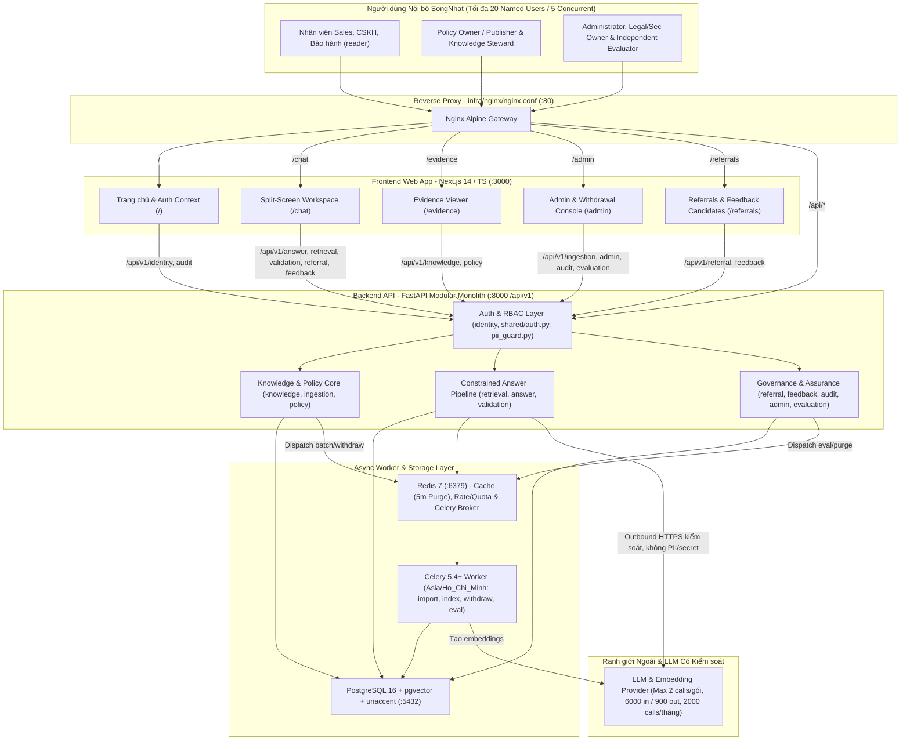

# Kiến trúc tổng thể — SongNhat CRM Knowledge & Policy Assistant (CKPA)

> Tài liệu tham chiếu chuẩn theo [SRS](../specs/srs.md) (Mục 4) và *SongNhat CRM Knowledge & Policy Assistant RFP*.

## Lựa chọn kiến trúc

**Modular Monolith + Constrained RAG + Deterministic Policy Control Layer**

*(Lưu ý RFP Mục 6 & Mục 13: đây là kiến trúc tham chiếu cho phương án phát triển tùy chỉnh có giới hạn; RFP không bắt buộc nhà cung cấp, model AI hay workflow engine cụ thể.)*



## Các module backend (12 modules gắn đủ vào `main.py`)

| Module | Trách nhiệm |
|---|---|
| `identity` | Đăng nhập, xác thực danh tính tổ chức, phân quyền RBAC tối thiểu & audience |
| `knowledge` | Quản lý tài liệu, phiên bản, passage, source references, tombstone & snapshot age |
| `ingestion` | Import 2 CSV UTF-8 cơ sở, validate, manifest đối soát, quarantine, idempotency (không nạp hồ sơ KH) |
| `policy` | Ma trận thẩm quyền 5 lớp, lifecycle 7 trạng thái, effective dates (`Asia/Ho_Chi_Minh`), phạm vi, typed critical fields, conflict hold |
| `retrieval` | Pre-filtered hybrid search (`pgvector` + FTS `unaccent` tiếng Việt thiếu dấu + viết tắt CRM) |
| `answer` | Điều phối trả lời: applicability → retrieval → LLM (`<=2` calls, `6000/900` tokens) → `AnswerPackage` 7 phần |
| `validation` | Kiểm tra citation, khớp critical fields, re-check authoritative state & quyền cuối (không stream trước check) |
| `referral` | Chuyển xử lý nội bộ (`referred`, `owner_responded`, `closed`) — không gửi tin/tạo task CRM |
| `feedback` | Ghi nhận 5 phân loại `KNW 07`, báo cáo chủ đề thiếu nguồn, hàng đợi `feedback_candidate` (`KNW 06`) |
| `audit` | Nhật ký truy cập/thay đổi, Cost & Quota Meter (`1000` pkg/`2000` calls), Exit Export định dạng mở (`OPS 08`) |
| `evaluation` | Quản lý phân vùng `60 Dev / 40 Val / 100 Sealed` (cách ly dev) + `80 Challenges` (`40 VN`) |
| `admin` | Duyệt phát hành, Instant Withdrawal (`<= 5` phút purge), `Snapshot Age`, `Emergency Disable` |

## Luồng hỏi đáp

```text
Staff question (+ optional governing_date & scope)
  → Authenticate & Authorize (identity) + PII Input Guard (shared/pii_guard.py)
  → Intent, Governing Date (Asia/Ho_Chi_Minh) & Scope Detection
  → Policy Applicability & Authority Matrix Check (policy) [Fail-closed nếu state unavailable]
  → Pre-Retrieval Audience/Permission/Effective Filter (identity + policy)
  → Hybrid Evidence Retrieval (retrieval — pgvector + FTS unaccent, max 8 passages)
  → Deterministic Critical Field Resolver & Conflict/Footnote Hold (policy)
  → Constrained LLM Answer Generation (answer — prompts/answer_system_vi.txt, max 2 calls)
  → Citation, Critical Field & Final Source-State Validation (validation — NO pre-check streaming)
  → Audit & Full Cost Metering (audit)
  → Display 7-Part AnswerPackage (frontend Split-Screen /chat)
```

## Nguyên tắc bất biến

- **Policy Control ngoài prompt:** Quyền truy cập, trạng thái phát hành, ngày hiệu lực giờ Việt Nam, phạm vi, xung đột và trường trọng yếu xử lý ở backend Python/SQL — không giao cho LLM.
- **Không hiển thị trước khi kiểm chứng:** Không stream hoặc hiển thị câu trả lời trước khi hoàn tất `validation` và re-check authoritative state cuối cùng.
- **Fail closed:** Khi dịch vụ quyền hoặc trạng thái thẩm quyền không khả dụng (hoặc nguồn vừa bị `withdrawn`), chặn trả lời và chuyển hướng tra cứu thủ công / chuyển chủ sở hữu.
- **Deterministic Critical Fields:** Ngưỡng, toán tử, tiền tệ/đơn vị, vai trò, thời hạn, ngoại lệ và tài liệu bắt buộc lấy từ DB; văn bản LLM không được sửa đổi.
- **Citation truy vết chuẩn:** Mỗi trích dẫn phải lưu `document_id`, `document_version_id`, `passage_id`, `page_number`, `clause_ref`, `quoted_text`.
- **Phạm vi cơ sở thuần khiết:** Không nhập hồ sơ khách hàng hay xây dựng code `O1` trong Base Scope; `O1` chỉ triển khai như một Change Request tách biệt nếu G0 ký duyệt riêng.

## Bộ tài liệu kỹ thuật & quản trị liên quan

- Đặc tả yêu cầu phần mềm chuẩn RFP: [srs.md](../specs/srs.md)
- Chi tiết 12 module backend & 3 worker tasks: [backend-modules.md](./backend-modules.md)
- Luồng hỏi-đáp, nhập liệu CSV & rút chính sách tức thời: [business-workflows.md](./business-workflows.md)
- Máy trạng thái vòng đời chính sách: [policy-lifecycle.md](./policy-lifecycle.md)
- Thiết kế CSDL (ERD) & Hợp đồng 2 CSV UTF-8: [erd-and-csv-contract.md](./erd-and-csv-contract.md)
- Tầng kiểm thử & hàng rào nghiệm thu độc lập: [testing-tiers.md](./testing-tiers.md)
- Ma trận tuân thủ 57 mã yêu cầu RFP: [compliance-matrix.md](../specs/compliance-matrix.md)
- Lộ trình triển khai 5 Gate cho đội 10 người: [roadmap.md](../specs/roadmap.md)
