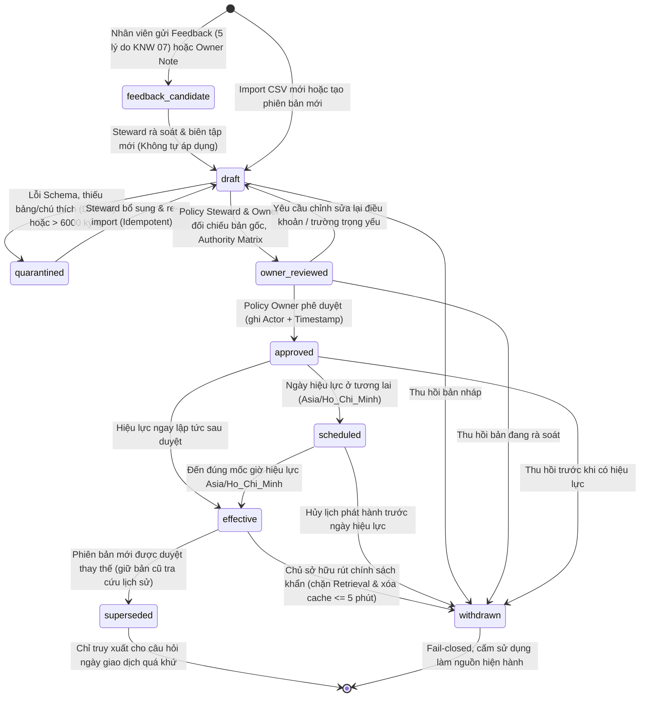

# Vòng đời Chính sách (Policy Lifecycle) — SongNhat CKPA

> Đặc tả máy trạng thái quản trị tri thức theo RFP (`WP 05`, `KNW 03`, `KNW 04`, `KNW 06`, `DAT 08`) và [SRS](../specs/srs.md) (Mục 5.4 & 5.7).

---

## 1. Sơ đồ Máy trạng thái (State Machine)

---

## 2. Quy tắc chuyển trạng thái bắt buộc

| Trạng thái | Được phép Retrieval? | Quy tắc kiểm soát cốt lõi |
|---|---|---|
| `feedback_candidate` | Không | Phản hồi nhân viên (`missing_source`, `outdated_rule`, `wrong_scope`, `missing_exception`, `rejected`) và ghi chú owner chỉ là ứng viên; **cấm tự huấn luyện hoặc tự cập nhật rule** (`KNW 06`). |
| `quarantined` | Không | Dòng lỗi UTF-8, thiếu bảng/chú thích thiết yếu (`DAT 08`), hoặc vượt `6.000` ký tự được cách ly kèm lý do và tạm giữ quy tắc bị ảnh hưởng. |
| `draft` → `owner_reviewed` → `approved` | Không | Mọi chuyển trạng thái bắt buộc ghi **Actor ID + Role + Timestamp** và đối chiếu bản gốc. |
| `scheduled` | Không (cho hiện hành) | Không được xem là hiện hành trước ngày/giờ hiệu lực theo múi giờ **`Asia/Ho_Chi_Minh`**. Chỉ hiển thị tham khảo khi người dùng hỏi chính sách tương lai và phải gắn nhãn rõ (*Worked Case 4*). |
| `effective` | Có (theo RBAC & Scope) | Chỉ phiên bản đang hiệu lực và đúng vai trò/phạm vi mới được đưa vào câu trả lời hiện hành. |
| `superseded` | Chỉ theo *Governing Date* | Dùng để đối chiếu câu hỏi giao dịch lịch sử quá khứ (*Worked Case 3*); sửa hồi tố tạo phiên bản mới thay thế và bảo toàn nội dung đã ghi nhận tại thời điểm cũ, không âm thầm viết lại lịch sử (`Phụ lục C`). |
| `withdrawn` | **Cấm tuyệt đối** | Rút khẩn cấp cập nhật authoritative state DB trước khi xác nhận, chặn retrieval & generation đang chạy (*Worked Case 9*), xóa cache Redis vật lý `<= 5 phút` và đánh dấu các câu trả lời đã mở là `stale`. |
