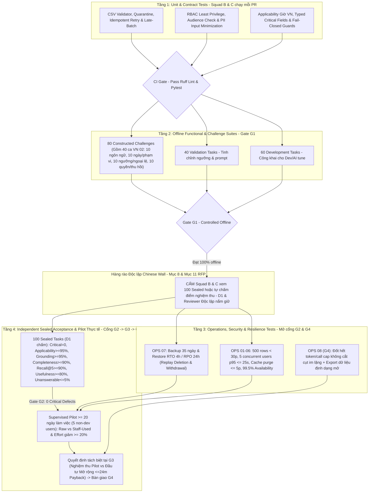

# Tầng Kiểm thử & Hàng rào Nghiệm thu Độc lập — SongNhat CKPA

> Khung kiểm thử 4 tầng và nguyên tắc độc lập theo Mục 8, Mục 9, Mục 11, Phụ lục D & Phụ lục G của RFP và [SRS](../specs/srs.md) (Mục 8).

---

## 1. Sơ đồ Tầng Kiểm thử & Chinese Wall

---

## 2. Ngưỡng Chấp nhận Nghiệm thu Độc lập (`G2` → `G3`)

| Tiêu chí | Ngưỡng bắt buộc (RFP Mục 8) | Ghi chú đo lường & Mẫu số |
|---|---|---|
| **Kiểm soát trọng yếu (`Critical Controls`)** | **`0` lỗi** | Không tiết lộ trái quyền, không bịa/sai `critical_fields`, không duyệt giả, không dùng nguồn tương lai/`withdrawn`. **Bất kỳ lỗi trọng yếu nào chặn phát hành.** |
| **Đúng phiên bản, ngày & phạm vi (`Applicability`)** | **`>= 95%`** | Tính trên tác vụ `100 Sealed` có thể trả lời; kết luận trọng yếu không căn cứ vẫn là lỗi chặn phát hành. |
| **Căn cứ & đầy đủ (`Grounding` & `Completeness`)** | **`>= 95%` căn cứ; `>= 90%` đầy đủ; `0` citation bịa** | Báo tách số nhận định, số tác vụ, lỗi trọng yếu, kết quả thô và kết quả nhân viên đã sử dụng. |
| **Truy xuất (`Recall@5`)** | **`>= 90%`** | Trên tập niêm phong có bằng chứng áp dụng đã duyệt; báo riêng số ca trả lời được, không trả lời được và thiếu nguồn. |
| **Hữu ích / chuyển tuyến (`Usefulness` & `Unanswerable`)** | **`>= 80%` hữu ích; `<= 5%` thiếu căn cứ khi không trả lời được** | `Hold` vẫn nằm trong mẫu số tổng; ca không thể trả lời vẫn áp dụng `0` dung sai lỗi trọng yếu. |
| **Quan sát Pilot có giám sát (`G3`)** | **`>= 20` ngày làm việc; `>= 5` non-dev users; Effort giảm `>= 20%`** | So sánh với cùng corpus đã làm sạch có thể tìm kiếm; tính đủ chuẩn bị, kiểm tra, lần thử thất bại, sửa và fallback; G3 yêu cầu business case riêng (TCO 3 năm + payback `<= 24` tháng). |

---

## 3. Phân bổ 80 Thử thách (Constructed Challenges — Báo cáo riêng)

- **40 ca chung toàn hệ thống:** Chính sách tương lai/lỗi thời, ranh giới ngưỡng (`<, <=, =, >=, >`), thiếu chú thích/bảng, xung đột hợp đồng, sai vai trò, ghi chú CRM cũ ghi đè, prompt injection và thu hồi giữa lúc generation (*Worked Case 9*).
- **40 ca định hướng Việt Nam (`VN 02`):**
  - `10` ca ngôn ngữ (Unicode, thiếu dấu, từ đồng nghĩa, viết tắt CRM, thuật ngữ sản phẩm trộn tiếng Anh, phủ định).
  - `10` ca ngày tháng & phạm vi (múi giờ `Asia/Ho_Chi_Minh`, giao dịch quá khứ, sửa hồi tố, chi nhánh/nhóm khách hàng).
  - `10` ca ngưỡng & ngoại lệ (biên số tiền/chiết khấu, đơn vị/tiền tệ, thiếu chú thích, tuyến ngoại lệ).
  - `10` ca quyền & thu hồi (direct link, citation/snippet, cache 5 phút, lỗi dịch vụ thẩm quyền fail-closed).
