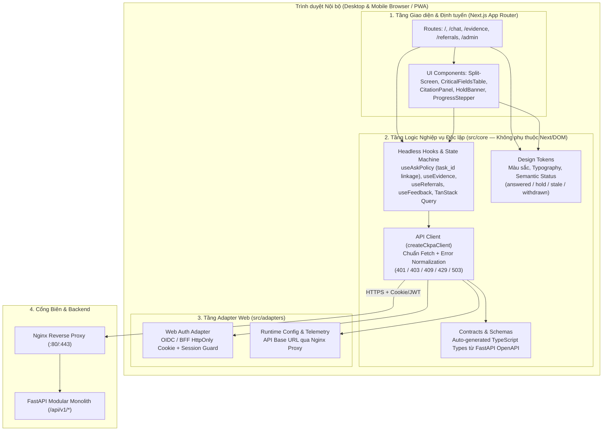

# Kiến trúc Frontend Web App Mục tiêu (Next.js App Router + Responsive Web / PWA)

> **Trạng thái:** Kiến trúc Mục tiêu (Target Web-App Architecture)
> **Phạm vi áp dụng:** Ứng dụng Web nội bộ **SongNhat CRM Knowledge & Policy Assistant (CKPA)** (`frontend/`), phục vụ nhân viên tra cứu (`reader`), chủ sở hữu chính sách (`policy_owner`), điều phối tri thức (`steward`) và quản trị (`admin`) trong Base Scope (`M`).
> **Tài liệu liên quan:** [02-architecture.md](./02-architecture.md), [03-database-and-contracts.md](./03-database-and-contracts.md), [frontend/package.json](../frontend/package.json).

---

## 1. Mục tiêu & Ràng buộc Bắt buộc (`INV-01..06`)

Kiến trúc Web App hướng tới 3 mục tiêu: **An toàn & Tuân thủ bất biến nghiệp vụ**, **Tách lớp sạch giữa Logic và Giao diện**, và **Trải nghiệm mượt trên cả Desktop lẫn trình duyệt di động (Responsive / PWA)**.

Mọi thành phần trên Web App bắt buộc bảo toàn `6` bất biến từ [02-architecture.md](./02-architecture.md):

| Bất biến | Yêu cầu thiết kế trên Web App |
|---|---|
| **INV-01 — Policy Control Outside Prompt** | Không cài đặt logic RBAC, tính ngày hiệu lực `Asia/Ho_Chi_Minh`, `6` chiều `scope` hay tính toán ngưỡng `critical_fields` trên trình duyệt. Web App chỉ thu thập đầu vào và hiển thị kết quả đã kiểm chứng từ Backend. |
| **INV-02 — Fail-Closed** | Khi nhận `401`, `403`, `501` hoặc `503 AUTHORITY_UNAVAILABLE`, Web App dừng hiển thị hướng dẫn ngay lập tức, chuyển sang trạng thái Fail-Closed kèm hướng dẫn tra cứu CSV thủ công / chuyển chủ sở hữu. |
| **INV-03 — No Pre-Verification Streaming** | Không dùng SSE/WebSocket để stream câu trả lời LLM chưa kiểm chứng. Gọi đồng bộ `POST /api/v1/answer` (`p95 <= 25s`) và hiển thị tiến trình chờ dạng Progress Stepper. |
| **INV-04 — Deterministic Critical Output** | Render `critical_fields` (giá trị, toán tử, đơn vị, tiền tệ, vai trò duyệt, thời hạn, ngoại lệ, hồ sơ bắt buộc) bằng component cấu trúc cố định từ JSON Backend, tách biệt hoàn toàn với đoạn diễn giải LLM. |
| **INV-05 — Untrusted Data Isolation** | Render an toàn dữ liệu đầu vào và trích dẫn (không `dangerouslySetInnerHTML` chưa sanitize); luôn hiển thị cảnh báo `SEC 02` (không nhập SĐT, email, CCCD/MST, dữ liệu khách hàng) và `pii_warning` từ Backend. |
| **INV-06 — Atomic Authoritative Withdrawal** | **Cấm lưu offline cache** nội dung `AnswerPackage`, `Passage` hoặc `CriticalField` (trong `localStorage`, `IndexedDB` hay Service Worker Cache). Xóa ngay cache bộ nhớ khi nhận `409 POLICY_WITHDRAWN`, `AnswerStatus.STALE` hoặc đăng xuất. |

---

## 2. Kiến trúc Phân tầng Mục tiêu của Web App

Ứng dụng Web (`frontend/`) được tổ chức theo mô hình **4 tầng tách biệt rõ ràng**, trong đó tầng nghiệp vụ `core/` hoàn toàn độc lập với Next.js và DOM:



### 2.1 Cấu trúc thư mục mục tiêu trong `frontend/src/`

```text
frontend/src/
├── app/                          # Next.js App Router (Layout, Pages, Error/Loading Boundaries)
│   ├── layout.tsx                # Root Layout, Providers (QueryProvider, AuthGuard, Banner nội bộ)
│   ├── page.tsx                  # (/) Trang chủ, ngữ cảnh xác thực, hướng dẫn tra cứu thủ công
│   ├── chat/page.tsx             # (/chat) Split-Screen Q&A Workspace
│   ├── evidence/page.tsx         # (/evidence) Evidence & Lineage Viewer (supersedes)
│   ├── referrals/page.tsx        # (/referrals) LocalReferral & hàng đợi feedback_candidate
│   └── admin/page.tsx            # (/admin) OpsSummary, nạp CSV 21/23 cột, Instant Withdrawal, Export
├── components/                   # UI Components tái sử dụng (Tailwind CSS + Design Tokens)
│   ├── layout/                   # AppShell, TopNav, RoleBadge, FailClosedScreen
│   ├── answer/                   # AnswerPackage7Parts, CriticalFieldsTable, CitationCard, StaleBanner, HoldCard
│   ├── chat/                     # QuestionForm (SEC 02 warning), ScopeSelector, GoverningDatePicker, ProgressStepper
│   ├── referrals/                # ReferralList, FeedbackForm (5 lý do KNW 07)
│   └── admin/                    # CsvImportPanel, WithdrawalDialog, OpsSummaryCards
├── core/                         # Tầng lõi thuần TypeScript (ESLint chặn import 'next/*' và DOM)
│   ├── contracts/                # Types sinh tự động từ FastAPI /openapi.json
│   ├── api/                      # createCkpaClient() & chuẩn hóa lỗi nghiệp vụ
│   ├── hooks/                    # useAskPolicy, useEvidence, useReferrals, useFeedback, useAdminOps
│   └── tokens/                   # Semantic status tokens & formatters (VND/USD, giờ Asia/Ho_Chi_Minh)
└── adapters/                     # Kết nối đặc thù trình duyệt / Next.js
    ├── auth.ts                   # Tích hợp OIDC / BFF HttpOnly Cookie, xử lý logout & session TTL
    └── config.ts                 # Đọc cấu hình API base URL (ưu tiên same-origin qua Nginx)
```

---

## 3. Thiết kế Kỹ thuật Trọng tâm

### 3.1 Contract-First với FastAPI (`src/core/contracts/`)
- Thay thế việc khai báo tay [frontend/src/types/answer.ts](../frontend/src/types/answer.ts) bằng bước sinh type tự động (`openapi-typescript`) từ `/openapi.json` của Backend FastAPI.
- Bảo đảm đồng bộ tuyệt đối cấu trúc `AnswerPackage` (`7` phần bắt buộc), `CriticalFieldItem`, `AnswerStatus`, `PolicyLifecycleStatus` và `ReferralItem` ngay tại bước CI (`npm run lint && npm run build`).

### 3.2 API Client & Chuẩn hóa Lỗi Fail-Closed (`src/core/api/`)
Thay thế lời gọi trực tiếp trong [frontend/src/lib/api.ts](../frontend/src/lib/api.ts) bằng factory `createCkpaClient(config)`:
- **Same-Origin qua Nginx**: Trình duyệt gọi `/api/v1/*` qua Nginx Reverse Proxy (giảm cấu hình CORS, hỗ trợ `HttpOnly`, `Secure`, `SameSite=Lax` Cookie cho phiên OIDC/BFF).
- **Xử lý lỗi tập trung theo mã trạng thái**:
  - `401 / 501`: Xóa toàn bộ state/query cache trên trình duyệt và chuyển về trang đăng nhập tổ chức.
  - `403`: Hiển thị thông báo từ chối theo least-privilege (`SEC 01`), không lộ sự tồn tại của tài liệu bị giới hạn.
  - `409 POLICY_WITHDRAWN`: Xóa ngay cache liên quan, hiển thị banner cảnh báo đỏ (`STALE`) và yêu cầu truy vấn mới (`INV-06`).
  - `429 QUOTA_EXCEEDED`: Hiển thị thông báo chạm trần gói/tháng (`OPS 06`) và hướng dẫn liên hệ quản trị.
  - `503 AUTHORITY_UNAVAILABLE`: Kích hoạt màn hình Fail-Closed + hướng dẫn tra cứu CSV thủ công (`INV-02`, `OPS 05`).

### 3.3 Quản lý Trạng thái & Chính sách Cache (`src/core/hooks/`)
Sử dụng **TanStack Query** kết hợp React state cục bộ theo nguyên tắc an toàn dữ liệu:
1. **Không lưu dữ liệu chính sách vào Web Storage**: Không ghi `AnswerPackage`, `Passage` hay `CriticalField` vào `localStorage`, `sessionStorage` hay `IndexedDB`.
2. **Tái xác thực trạng thái nguồn**: Đặt `staleTime: 0` cho `/evidence`, `/referrals` và `/admin/ops-summary`; tự động `refetchOnWindowFocus: true` để phát hiện ngay chính sách vừa bị thu hồi khi người dùng quay lại tab.
3. **Liên kết `task_id` xuyên suốt**: Hook `useAskPolicy()` quản lý vòng đời của một tác vụ hỏi đáp (giữ nguyên `task_id` khi người dùng hỏi bổ sung *follow-up* hoặc bấm *regenerate* theo quy định tính quota của RFP).
4. **Xóa sạch bộ nhớ khi đăng xuất / hết phiên**: Gọi `queryClient.clear()` khi logout hoặc nhận `401`.

### 3.4 Responsive Web & PWA An toàn
Web App đáp ứng cả màn hình Desktop văn phòng và trình duyệt điện thoại mà không cần duy trì codebase riêng:

| Màn hình | Desktop (`>= 1024px`) | Trình duyệt Di động / Tablet (`< 1024px`) |
|---|---|---|
| `/chat` | **Split-Screen 2 cột**: Trái (Form hỏi + Diễn giải + Referral/Feedback), Phải (Trích dẫn nguyên văn + Bảng `CriticalField` + Snapshot Age). | **Bố cục 1 cột + Tabs chuyển nhanh** (*Hướng dẫn* \| *Trường trọng yếu (DB)* \| *Trích dẫn gốc*), đảm bảo đủ **7 phần `AnswerPackage`** và không cắt chữ (`truncation`) trên cột số liệu/đơn vị. |
| `/evidence` | Split-view văn bản gốc & chuỗi lịch sử `supersedes`. | Bố cục dọc, highlight `quoted_text`, giữ nguyên kiểm tra `403/409`. |
| `/referrals` | Bảng quản lý kết hợp bộ lọc trạng thái & hàng đợi `feedback_candidate`. | Danh sách dạng Card dễ thao tác chạm. |
| `/admin` | Bảng điều khiển đầy đủ (`OpsSummary`, nạp CSV `21/23` cột, Instant Withdrawal, Export `OPS 08`). | Ưu tiên Desktop; hiển thị cảnh báo khuyến nghị dùng màn hình lớn cho thao tác nạp CSV. |

- **Quy tắc PWA (nếu bật `manifest.json` + Service Worker)**: Service Worker chỉ cache tài nguyên tĩnh (`JS`, `CSS`, font, icon); bắt buộc đặt chiến lược **`NetworkOnly`** cho toàn bộ `/api/v1/*` để tuyệt đối không phát tán nội dung chính sách đã bị thu hồi (`INV-06`).

### 3.5 Bảo vệ UX cho Chế độ Không Stream (`INV-03`)
Khi người dùng gửi câu hỏi (`POST /api/v1/answer`), giao diện hiển thị **Progress Stepper** rõ ràng thay vì màn hình trống:
1. *Kiểm tra quyền, phạm vi (`scope`) và ngày hiệu lực (`Asia/Ho_Chi_Minh`)...*
2. *Truy xuất văn bản hiệu lực và trường trọng yếu (`critical_fields`)...*
3. *Kiểm định trích dẫn nguyên văn và trạng thái thu hồi cuối...*

---

## 4. Quy chuẩn Chất lượng & Kiểm thử Frontend

- **Ranh giới kiến trúc tự động (ESLint)**: Cấu hình `no-restricted-imports` trong `frontend/src/core/**` cấm import `next/*`, `react-dom` hoặc truy cập trực tiếp `window`/`document`.
- **Kiểm thử Unit & Contract (Jest / Testing Library)**:
  - Render đầy đủ `7` phần của `AnswerPackage` và tính xác định của bảng `CriticalFieldItem` (`INV-04`).
  - Xử lý chính xác các trạng thái `answered`, `hold`, `clarification_required`, `referred`, `stale`, `refused_out_of_scope`.
  - Xóa cache và chặn hiển thị khi nhận `409 POLICY_WITHDRAWN` hoặc `503 AUTHORITY_UNAVAILABLE` (`INV-02`, `INV-06`).
- **Kiểm thử E2E (Playwright)**:
  - Luồng hỏi đáp đầy đủ trên Desktop (`1280x800`) và Mobile Viewport (`390x844`).
  - Xác nhận banner cảnh báo PII (`SEC 02`) và cảnh báo hướng dẫn nội bộ (`internal_use_warning`) luôn hiển thị.
  - Kiểm tra phân quyền hiển thị route `/admin` theo RBAC (`SEC 01`).
