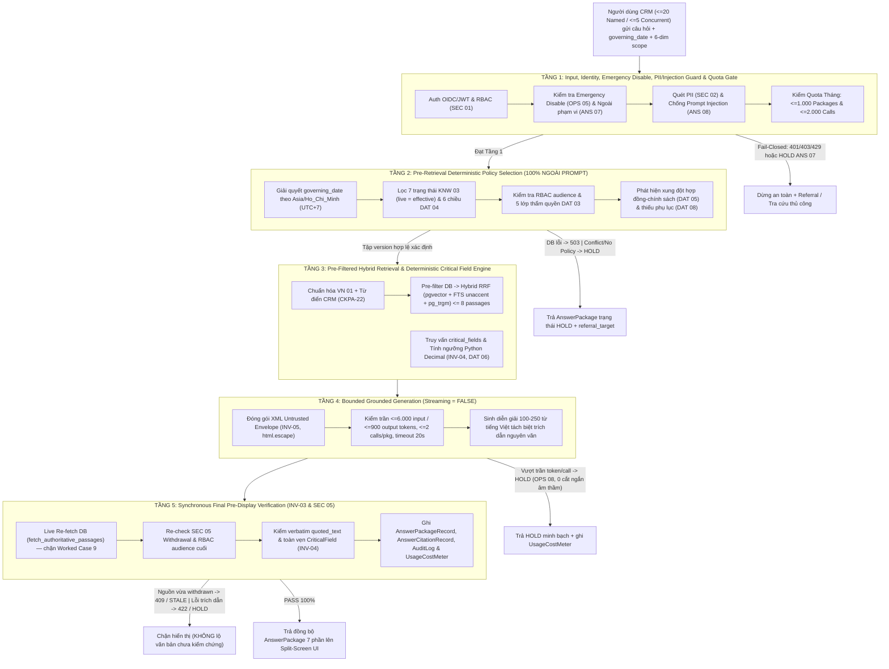

> **TRẠNG THÁI:** BẢN DỰ THẢO CHỜ RÀ SOÁT & PHÊ DUYỆT (FOR REVIEW — CHƯA KÝ DUYỆT CHÍNH THỨC). Tài liệu chỉ phục vụ rà soát nghiệm thu Sprint 1 Cổng G0; không cấu thành phê duyệt PO, chữ ký pháp lý, kết luận pháp chế chính thức, báo giá ràng buộc hay giờ công thực tế chưa đối soát. Các mục tiêu định lượng, giả định dự thầu và ví dụ Annex E từ RFP được ghi rõ là đề xuất/tham khảo.

# Đặc tả Kiến trúc `ANS 01`: Lựa chọn Chính sách Ngoài Prompt, Pipeline 5 Tầng, `AnswerPackage` 7 Phần & Ma trận Giới hạn Cứng Mục 2

| Thuộc tính | Giá trị |
|---|---|
| **Đơn vị thụ hưởng** | Công ty Cổ phần Thiết bị Công nghiệp Song Nhật *(ghi chú chuẩn: chờ `[P1]` / Legal Owner xác nhận chính thức theo ĐKKD, thay thế biến thể cũ)* |
| **Mã Jira / Sub-task** | `CKPA-21` (`CRM-G0-SUB13`) — thuộc Story `CKPA-20` (`CRM-G0-ST05`) |
| **Cổng & Sprint** | Cổng `G0` — Sprint 1 (`2026-11-09` .. `2026-11-13`) |
| **Mã Tiêu chí Nghiệm thu** | `G0-AC04` |
| **Tham chiếu RFP** | `Mục 2` (Limits / Context / Users / Refresh), `ANS 01..08`, `KNW 01..07`, `DAT 03..06`, `DAT 08`, `SEC 01..05`, `OPS 02`, `OPS 05`, `OPS 08`, `WP 03..05`, `VN 01`, `Phụ lục A (Hình 1–3)` |
| **Sản phẩm bàn giao** | `DEL01-E`: Kiến trúc Policy Selection ngoài Model Prompt, Pipeline 5 Tầng, Hợp đồng `AnswerPackage` 7 Phần, Ranh giới `12` Module API & Ma trận Giới hạn Cứng Mục 2 |
| **Chủ trì (Assignee)** | `[S3]` Phạm Lương Yến Nhi — Retrieval and application engineer *(Build Team — No Sealed Access)* |
| **Người giao việc (Reporter)** | `[S1]` Hoàng Tiến — Named lead / Scrum Master |
| **RACI / Phối hợp** | `[S2]` Trần Quốc Hưng (Integration engineer), `[P2]` Lý Hữu Tài (Policy owners), `[P4]` Ngô Thị Trà My (Staff users — `CKPA-22` `VN 01`), `[P5]` Nguyễn Anh Khoa (Privacy and security owners — `CKPA-17` RBAC) |
| **Tệp CSV đi kèm** | `CKPA-21_SUB13_Section2_Hard_Caps_And_Enforcement_Matrix.csv` |

---

## 1. Nguyên tắc Cốt lõi: `0%` Quyết định Quyền, Ngày, Phạm vi & Số học nằm trong Model Prompt (`ANS 01`)

Theo yêu cầu `ANS 01..08`, `DAT 03..06` và `Phụ lục A (Hình 1–3)` của RFP, mô hình ngôn ngữ lớn (LLM) **CHỈ được giao nhiệm vụ diễn giải có ràng buộc** trên tập đoạn trích dẫn đã được lọc sẵn và bảo chứng toàn vẹn. Toàn bộ quyết định kiểm soát được cưỡng chế bằng mã ứng dụng Python/SQL xác định (*Application Logic*) tuân thủ **`6` bất biến kiến trúc (`INV-01 .. INV-06`)**:

| Mã | Bất biến Kiến trúc | Nguyên tắc Cưỡng chế Bắt buộc | Điểm thực thi trên Backend |
|---|---|---|---|
| `INV-01` | **Policy Control Outside Prompt** | `100%` quyết định về `RBAC`/`audience`, `7` trạng thái `KNW 03`, ngày hiệu lực chi phối (`Asia/Ho_Chi_Minh`), `6` chiều `DAT 04`, `5` lớp thẩm quyền `DAT 03`, `DAT 05` Conflict Hold và tính toán ngưỡng `CriticalField` thực thi bằng mã Python/SQL trước khi gọi LLM. | `shared/auth.py`, `modules/policy/`, `modules/retrieval/` |
| `INV-02` | **Fail-Closed** | Khi không xác minh được danh tính (`401`/`501`), quyền truy cập (`403`), trạng thái thẩm quyền DB (`503 AUTHORITY_UNAVAILABLE`) hoặc gặp xung đột/thiếu phụ lục/vượt hạn mức, hệ thống dừng an toàn bằng `HOLD` hoặc mã lỗi rõ ràng, hướng dẫn chuyển chủ sở hữu / tra cứu CSV thủ công. | `main.py`, `shared/auth.py`, `shared/exceptions.py` |
| `INV-03` | **No Pre-Verification Streaming** | Khóa cứng `ENABLE_ANSWER_STREAMING = False`. Cấm stream bất kỳ token nào lên giao diện người dùng trước khi hoàn tất kiểm định đồng bộ ở Tầng 5 (trích dẫn nguyên văn, toàn vẹn trường trọng yếu, quyền & trạng thái DB mới nhất). | `config.py`, `modules/answer/service.py`, `modules/validation/service.py` |
| `INV-04` | **Deterministic Critical Output** | Giá trị, toán tử (`<=, <, >=, >, ==, in, between, required`), đơn vị, tiền tệ (`VND`/`USD`), vai trò phê duyệt, thời hạn, ngoại lệ và hồ sơ bắt buộc được đọc trực tiếp từ `critical_fields` và hiển thị bằng thành phần UI xác định; văn xuôi LLM không được thay đổi hay tự tính. | `modules/policy/service.py`, `modules/answer/schemas.py` |
| `INV-05` | **Untrusted Data Isolation** | Câu hỏi đầu vào và `<retrieved_passages>` luôn được đóng gói là dữ liệu không đáng tin cậy bằng XML có `html.escape` (`ANS 08`); không nhúng bí mật hệ thống, không tìm kiếm web mở, không cấp tool gọi ra ngoài cho LLM. | `modules/answer/service.py`, `prompts/answer_system_vi.txt`, `shared/pii_guard.py` |
| `INV-06` | **Atomic Authoritative Withdrawal** | Khi `withdrawn`, CSDL thẩm quyền commit trước khi trả `200 OK`, chặn tức thời các câu trả lời đang xử lý tại Tầng 5 (`409 POLICY_WITHDRAWN` / `STALE`) và xóa vật lý cache Redis trong `<= 300s`. | `modules/admin/service.py`, `modules/validation/service.py`, `worker/src/tasks/index_task.py` |

> **Ranh giới Phạm vi Cơ sở (`Base Scope — M`) vs Tùy chọn `O1`:** Tùy chọn `O1` (*Selected CRM Context* — ngữ cảnh tài khoản CRM chọn lọc) được đặt **TẮT (`OFF`)** hoàn toàn trong Base Scope. Pipeline 5 tầng dưới đây không gọi bảng khách hàng hay tệp CSV thứ `3`; chỉ phục vụ `3` họ chính sách (`POL-001..003`).

---

## 2. Kiến trúc Pipeline 5 Tầng (Ánh xạ RFP Phụ lục A — Hình 1, 2, 3)

### 2.1 Sơ đồ Luồng 5 Tầng Tổng thể (`AnswerOrchestratorService.execute_pipeline`)



### 2.2 Chi tiết Kỹ thuật từng Tầng Kiểm soát

#### Tầng 1 — Input, Identity, Emergency Disable, PII Guard, Injection Defense & Quota Gate
- **Xác thực & Phiên đồng thời:** Kiểm tra OIDC/JWT và đối chiếu vai trò `SEC 01` (`<= 20` named users, `<= 5` concurrent sessions). Nếu chưa nối OIDC thật trước G1 -> Fail-Closed `501`.
- **Chế độ Khẩn cấp (`OPS 05`):** Kiểm tra cờ `ckpa:emergency_disable` trên Redis; nếu đang bật -> trả `HOLD` kèm hướng dẫn tra cứu CSV nội bộ thủ công.
- **Biên phạm vi (`ANS 07`):** Chặn sớm các yêu cầu ngoài phạm vi (tư vấn pháp lý/thuế, ép phê duyệt chiết khấu/bảo hành miễn phí, hướng dẫn tự tháo lắp/sửa chữa thiết bị công nghiệp) bằng `HOLD` và định tuyến `referral_target` ngay trước khi tốn gọi LLM.
- **PII Guard (`SEC 02`) & Chống Injection (`ANS 08`):** `scan_query_for_pii` phát hiện và gắn `pii_warning` / che lọc SĐT, email, CCCD, MST cá nhân trước khi truyền dữ liệu ra ngoài ranh giới LLM; vô hiệu hóa thẻ điều khiển trong input người dùng.
- **Kiểm soát Ngân sách Tháng (`AuditMeterPort.check_monthly_quota`):** Nếu tháng `YYYY-MM` hiện tại đã đạt `1.000` `AnswerPackage` khởi tạo (tính cả `HOLD` và lỗi) hoặc `2.000` lượt gọi LLM -> dừng Fail-Closed `429 QUOTA_EXCEEDED` / `HOLD` (không tự động vượt ngân sách).

#### Tầng 2 — Pre-Retrieval Deterministic Policy Selection (`PolicyGatePort`)
Thực thi `100%` trong `backend/src/modules/policy/service.py` và PostgreSQL:
1. **Ngày hiệu lực chi phối (`resolve_governing_date_vn`):** Khóa múi giờ `Asia/Ho_Chi_Minh` (`UTC+7`). Mặc định là ngày hiện tại theo giờ VN; thiết lập cờ `is_historical = (governing_date < today_vn)` và `is_future_preview = (governing_date > today_vn and allow_future_preview)`.
2. **Lọc vòng đời `KNW 03` (`_is_status_eligible`):**
   - `effective`: hợp lệ cho chế độ phục vụ trực tiếp (*live*).
   - `superseded`: **chỉ** hợp lệ khi `is_historical = True` và `effective_from <= governing_date <= effective_to`.
   - `scheduled`: **chỉ** hợp lệ khi `is_future_preview = True` (có quyền xem trước tương lai) và không bao giờ chi phối giao dịch hiện tại.
   - `draft`, `owner_reviewed`, `approved`, `withdrawn`, `quarantined`, `feedback_candidate`: **tuyệt đối loại trừ** khỏi phục vụ trả lời.
3. **Khớp đúng `6` chiều `DAT 04` (`scope`):** So khớp tường minh cả `6` khóa `company`, `branch`, `role`, `customer_category`, `product`, `transaction_scope` (cho phép wildcard `all` theo quy tắc phân cấp `CKPA-10`). Thiếu chiều phạm vi làm mơ hồ ngữ cảnh -> yêu cầu làm rõ (`missing_facts`) hoặc `HOLD`, không để LLM đoán.
4. **Phân cấp `5` lớp thẩm quyền `DAT 03` & Xung đột `DAT 05`:**
   - Khi cùng tồn tại `customer_contract` (`DOC-006`) và `policy` (`DOC-001..003`) hiệu lực trên cùng phạm vi, hoặc nhiều phiên bản không phải `staff_note` cùng chồng lấn -> **bắt buộc kích hoạt `DAT 05 Conflict Hold` (`has_conflict = True`, `can_proceed = False`)** và chuyển `referral_target` tới `[P2]` Policy Owner. Tuyệt đối cấm tự suy diễn ưu tiên ghi đè.
   - `staff_note` (`DOC-007`) chỉ được gắn nhãn ngữ cảnh lịch sử có dẫn nguồn, không bao giờ tạo quy tắc chung hoặc thay thế phê duyệt.
5. **Kiểm tra `DAT 08`:** Nguồn đang bị đánh dấu `has_essential_attachments = False` hoặc `quarantined` kích hoạt `HOLD` kèm lý do thiếu bảng/phụ lục/chú thích thiết yếu.

#### Tầng 3 — Pre-Filtered Hybrid Retrieval & Deterministic Critical Field Engine
- **Pre-Filtered Hybrid Retrieval (`RetrievalPort.search_hybrid`):**
  1. Chuẩn hóa văn bản tiếng Việt và mở rộng từ viết tắt/đồng nghĩa CRM (`VN 01`, đồng bộ với từ điển `CKPA-22` của `[P4]`).
  2. **Bắt buộc Pre-Filter trong mệnh đề `WHERE` SQL TRƯỚC KHI tính điểm tương đồng:** chỉ giữ các `passages` có `document_version_id IN applicable_version_ids`, `audience` chứa vai trò của `AuthenticatedUser`, `is_tombstoned = FALSE`, `has_essential_attachments = TRUE`, và `CHAR_LENGTH(content) <= 6000`.
  3. Xếp hạng lai RRF (*Reciprocal Rank Fusion*) kết hợp `pgvector` cosine similarity + PostgreSQL Full-Text Search `unaccent` + `pg_trgm`.
  4. Cắt tập đầu ra theo trần cứng **`<= 8` đoạn (`ANSWER_MAX_PASSAGES = 8`)**, mỗi đoạn `<= 6.000` ký tự Unicode (`PASSAGE_MAX_CHARS = 6000`).
- **Deterministic Critical Field Engine (`PolicyService`):**
  - Đọc trực tiếp bảng `critical_fields` theo `policy_version_id` hợp lệ (`status != withdrawn`, `is_tombstoned = FALSE` ở G1).
  - Mọi kiểm tra biên (`evaluate_numeric_threshold`) dùng kiểu `Decimal` chính xác của Python cho các toán tử `<=`, `<`, `>=`, `>`, `==`, `between`, `in`, `required`, kèm nguyên vẹn `unit`, `currency`, `approval_role`, `time_limit`, `exception_condition`, `required_documents`.

#### Tầng 4 — Bounded Grounded Generation (`LLMGeneratorPort`)
- **Đóng gói Untrusted Data (`build_untrusted_prompt_envelope`):** Toàn bộ câu hỏi, `<= 8` đoạn trích dẫn và `critical_fields` được escape bằng `html.escape(..., quote=True)` bên trong các thẻ XML `<user_question>`, `<retrieved_passages>`, `<critical_fields>` tách biệt hoàn toàn với `prompts/answer_system_vi.txt` (`INV-05`).
- **Cưỡng chế Trần Token & Số lượt gọi (trước khi gọi LLM):**
  - Đếm token thực tế (`system_prompt + envelope`): nếu vượt **`6.000` input tokens** (`LLM_MAX_INPUT_TOKENS = 6000`) -> trả `HOLD` minh bạch (`OPS 08`), **cấm cắt ngắn âm thầm đoạn chính sách** làm sai lệch ngoại lệ.
  - Tham số gọi API khóa cứng `max_tokens = 900` (`LLM_MAX_OUTPUT_TOKENS = 900`), `stream = False`, `timeout = 20s` (`LLM_REQUEST_TIMEOUT_SECONDS = 20`).
  - Tối đa **`<= 2` lượt gọi/AnswerPackage** (`LLM_MAX_CALLS_PER_PACKAGE = 2`: `1` lượt sinh chính + tối đa `1` lượt sửa định dạng trích dẫn nếu Tầng 5 phát hiện lỗi cú pháp; hết `2` lượt vẫn lỗi -> trả `HOLD`, không retry ngầm).
  - Văn phong mục tiêu thông thường (*Normally*): **`100–250` từ tiếng Việt** súc tích, tách rời hoàn toàn phần `guidance_text` và mảng `verbatim_quotes`.

#### Tầng 5 — Synchronous Final Pre-Display Verification (`ValidationGatePort`)
Thực thi đồng bộ **sau khi LLM trả về và TRƯỚC KHI gửi JSON về trình duyệt** (`ENABLE_ANSWER_STREAMING = False`):
1. **Live DB Re-Fetch (`RetrievalPort.fetch_authoritative_passages`):** Truy vấn trực tiếp PostgreSQL cho toàn bộ `passage_id` được trích dẫn (bỏ qua cache Redis) để phòng chống *Worked Case 9* (chính sách bị thu hồi ngay trong vài giây LLM đang sinh).
2. **Kiểm tra Quyền & Thu hồi cuối (`ValidationService.verify_citations_and_state`):**
   - Kiểm tra lại `check_policy_audience(user, passage.audience)` -> nếu quyền vừa bị rút: `403 ACCESS_DENIED`.
   - Nếu bất kỳ đoạn trích nào có `status == withdrawn` hoặc `quarantined` hoặc `has_essential_attachments == False` -> chặn hiển thị ngay (`409 POLICY_WITHDRAWN` / `AnswerStatus.STALE`).
   - Nếu `quoted_text` không xuất hiện nguyên văn trong `passage.content` -> từ chối (`422 CITATION_INVALID` / `HOLD`).
3. **Kiểm tra Toàn vẹn Trường Trọng yếu (`verify_critical_fields_integrity`):** Đảm bảo không có `critical_field` nào bị `withdrawn`/`quarantined` và diễn giải không mâu thuẫn với thông số cấu trúc.
4. **Ghi Nhận Kiểm toán & Hạn mức:** Lưu `answer_packages`, `answer_citations`, `audit_logs`, `usage_cost_meters` (`llm_calls`, `input_tokens`, `output_tokens`, `is_hold`, `is_error`), sau đó mới giải phóng JSON `AnswerPackage` 7 phần ra giao diện Split-Screen `/chat`.

---

## 3. Hợp đồng JSON `AnswerPackage` 7 Phần (Chuẩn 6 chiều `DAT 04`)

Mọi phản hồi nghiệp vụ từ `POST /api/v1/answer`, `/follow-up` và `/regenerate` tuân thủ chặt chẽ Pydantic v2 `AnswerPackage` (`backend/src/modules/answer/schemas.py`), bảo toàn `task_id` xuyên suốt chuỗi câu hỏi nối tiếp và sử dụng chuỗi `scope` đầy đủ `6` chiều `DAT 04`:

```json
{
  "answer_id": "ans-20261112-001",
  "task_id": "task-crm-20261112-084",
  "status": "answered",

  "original_question": "Động cơ 30 kW của khách hàng doanh nghiệp bị lỗi biến tần trong thời hạn bảo hành thì định tuyến về đâu?",

  "governing_date": "2026-11-12",
  "timezone": "Asia/Ho_Chi_Minh",
  "scope": "company:SN;branch:all;role:cskh;customer_category:b2b_enterprise;product:industrial;transaction_scope:warranty_tier1_internal",
  "is_historical": false,
  "is_future_preview": false,

  "guidance_text": "Căn cứ Quy trình Tiếp nhận và Định tuyến Bảo hành thiết bị công nghiệp hiện hành ngày 12/11/2026, thiết bị có công suất định mức 30 kW (nhỏ hơn hoặc bằng ngưỡng 37 kW) sau khi đã thu thập đủ 03 chứng từ tiếp nhận hợp lệ thuộc diện định tuyến tới Tuyến 1 — Internal Tech Lead (Kỹ thuật nội bộ) trong thời hạn tối đa 4 giờ làm việc (giờ Việt Nam). Nhân viên CSKH cần đính kèm ảnh chụp tem nhãn (Nameplate) rõ số seri, Phiếu bảo hành chính hãng hoặc Hóa đơn GTGT và Biên bản mô tả sự cố trên ticket CRM. Lưu ý: nhân viên CSKH chỉ thực hiện tiếp nhận và định tuyến, không tự phán quyết bảo hành miễn phí hay tính phí và không hướng dẫn khách hàng tự tháo lắp thiết bị.",
  "verbatim_quotes": [
    "Yêu cầu bảo hành đối với thiết bị công nghiệp có công suất định mức nhỏ hơn hoặc bằng 37 kW đã nộp đủ 03 chứng từ tiếp nhận hợp lệ được định tuyến tới Tuyến 1 (Internal Tech Lead — Kỹ thuật nội bộ) trong thời hạn tối đa 4 giờ làm việc (giờ Việt Nam). Nhân viên CSKH chỉ thực hiện tiếp nhận và định tuyến, không tự phán quyết bảo hành miễn phí hay tính phí và không hướng dẫn tự tháo lắp thiết bị."
  ],

  "citations": [
    {
      "document_id": "DOC-003",
      "document_version_id": "VER-001",
      "passage_id": "PAS-023",
      "title": "Quy trình Tiếp nhận và Định tuyến Bảo hành - Định tuyến Thiết bị <= 37 kW (Tuyến 1)",
      "page_number": 1,
      "clause_ref": "Điều 2.1",
      "quoted_text": "Yêu cầu bảo hành đối với thiết bị công nghiệp có công suất định mức nhỏ hơn hoặc bằng 37 kW đã nộp đủ 03 chứng từ tiếp nhận hợp lệ được định tuyến tới Tuyến 1 (Internal Tech Lead — Kỹ thuật nội bộ) trong thời hạn tối đa 4 giờ làm việc (giờ Việt Nam).",
      "evidence_url": "/api/v1/knowledge/passages/PAS-023"
    }
  ],

  "critical_fields": [
    {
      "field_id": "CF-009",
      "policy_id": "POL-003",
      "policy_version_id": "PV-003",
      "document_version_id": "VER-001",
      "field_name": "Ngưỡng công suất định tuyến bảo hành Tuyến 1 (Kỹ thuật nội bộ <= 37 kW)",
      "field_type": "number",
      "operator": "<=",
      "value": "37",
      "unit": "kW",
      "currency": null,
      "approval_role": "Internal Tech Lead",
      "time_limit": "4 giờ làm việc",
      "exception_condition": "Áp dụng sau khi thu thập đủ 03 chứng từ tiếp nhận (PAS-021); thiết bị > 37 kW hoặc lỗi bo mạch điều khiển trung tâm bắt buộc định tuyến Tuyến 2 (CF-010); CSKH không tự phán quyết miễn phí hay tính phí (ANS 07)",
      "required_documents": [
        "Ảnh chụp tem nhãn (Nameplate) rõ số seri",
        "Phiếu bảo hành chính hãng hoặc Hóa đơn GTGT",
        "Biên bản mô tả sự cố trên ticket CRM"
      ],
      "source_clause": "Điều 2.3, trang 2 (PAS-023 / WAR-03-03)",
      "status": "effective"
    }
  ],

  "missing_facts": [],
  "hold_reason": null,
  "uncertainty_note": null,

  "referral_target": "[P2] Lý Hữu Tài — Warranty Policy Owner (Service Director)",
  "internal_use_warning": "Hướng dẫn làm việc nội bộ — nhân viên phải kiểm tra hoàn cảnh, nguồn hiện hành và thẩm quyền trước khi hành động; không thay thế phê duyệt hay thực thi.",

  "pii_warning": null,
  "snapshot_age_hours": 2.4,
  "llm_calls_used": 1
}
```

### Ánh xạ 7 Phần Bắt buộc (`ANS 03`)
1. **Phần 1 — Câu hỏi gốc (`original_question`):** Câu hỏi nhân viên đã nhập sau khi quét PII/Injection.
2. **Phần 2 — Ngày chi phối & Phạm vi 6 chiều (`governing_date`, `timezone`, `scope`, `is_historical`, `is_future_preview`):** Xác định rõ ngày theo `Asia/Ho_Chi_Minh` và đầy đủ `6` khóa `DAT 04`.
3. **Phần 3 — Diễn giải súc tích & Trích dẫn nguyên văn tách biệt (`guidance_text`, `verbatim_quotes`):** `100–250` từ tiếng Việt tách bạch khỏi trích dẫn nguyên văn.
4. **Phần 4 — Trích dẫn nguồn có thể nhấp (`citations`):** Neo thẳng tới `document_id`, `document_version_id`, `passage_id`, `page_number`, `clause_ref`, `evidence_url` (cùng kiểm tra `403`/`409` khi mở).
5. **Phần 5 — Trường chính sách trọng yếu có cấu trúc (`critical_fields`):** Render xác định từ PostgreSQL (`INV-04`), không cho LLM thay đổi giá trị/toán tử/đơn vị/tiền tệ.
6. **Phần 6 — Dữ kiện thiếu, Lý do `HOLD` & Ghi chú không chắc chắn (`missing_facts`, `hold_reason`, `uncertainty_note`):** Bắt buộc minh bạch mọi trường hợp không đủ căn cứ, xung đột `DAT 05`, thiếu phụ lục `DAT 08` hay vượt trần Mục 2.
7. **Phần 7 — Đầu mối chuyển tiếp & Cảnh báo nội bộ (`referral_target`, `internal_use_warning`):** Định tuyến đúng `Policy Owner` và nhắc rõ chỉ lưu hành nội bộ Công ty Cổ phần Thiết bị Công nghiệp Song Nhật.

---

## 4. Tổng quan Ranh giới `12` Module API (`/api/v1/*`) & Mã lỗi Fail-Closed

Kiến trúc Modular Monolith FastAPI (`backend/src/main.py`) đóng gói đầy đủ `12` module nghiệp vụ dưới tiền tố `/api/v1` (cùng `GET /health` công khai trả cờ `streaming_enabled: false` và `mounted_modules: 12`), đồng bộ ma trận phân quyền tối thiểu với `[P5]` (`CKPA-17`):

| # | Module | Prefix | Endpoints chính | Nhóm quyền RBAC chính (đồng bộ `CKPA-17`) | Vai trò trong Pipeline `ANS 01` |
|---:|---|---|---|---|---|
| 1 | `identity` | `/api/v1/identity` | `POST /token`, `GET /me`, `POST /check-permission` | Public (`/token`), Authenticated | Tầng 1: Xác thực OIDC/JWT & kiểm tra `audience` |
| 2 | `knowledge` | `/api/v1/knowledge` | `GET /passages/{id}`, `GET /documents/{id}/lineage`, `GET /snapshot-age` | Authenticated (`audience` checked) | Tầng 2/5: Xem nguồn gốc (`403`/`409`), phả hệ & `Snapshot Age` |
| 3 | `ingestion` | `/api/v1/ingestion` | `POST /csv/validate`, `GET /quarantine` | `steward`, `policy_owner`, `publisher`, `administrator` | Tiền nạp `2` Base CSV (`CKPA-13`/`CKPA-14`), cách ly `DAT 08` |
| 4 | `policy` | `/api/v1/policy` | `GET /authority-matrix`, `GET /versions/{id}/critical-fields`, `POST /threshold-check` | Authenticated | Tầng 2/3: `5` lớp `DAT 03`, `6` chiều `DAT 04`, toán học `DAT 06` |
| 5 | `retrieval` | `/api/v1/retrieval` | `POST /search` | Authenticated (trừ `privacy_security_owner`/`legal_owner`) | Tầng 3: Pre-filtered Hybrid RRF tiếng Việt (`<= 8` đoạn) |
| 6 | `answer` | `/api/v1/answer` | `POST /`, `POST /follow-up`, `POST /regenerate` | `reader`, `policy_owner`, `publisher`, `steward`, `administrator` | Điều phối đủ 5 tầng, trả đồng bộ `AnswerPackage` 7 phần |
| 7 | `validation` | `/api/v1/validation` | `POST /verify` | Authenticated (trừ `privacy_security_owner`/`legal_owner`) | Tầng 5: Re-fetch DB cuối, kiểm trích dẫn, quyền & `withdrawn` |
| 8 | `referral` | `/api/v1/referral` | `POST /`, `GET /`, `PATCH /{referral_id}` | Tạo/đọc: Staff (`reader`..`admin`, `referral_handler`); `PATCH`: `policy_owner`, `publisher`, `steward`, `administrator`, `referral_handler` | Chuyển tiếp nội bộ khi `HOLD` / vượt thẩm quyền (`WP 04`) |
| 9 | `feedback` | `/api/v1/feedback` | `POST /`, `GET /candidates` | Gửi: Staff (`reader`..`admin`, `referral_handler`); `/candidates`: `policy_owner`, `publisher`, `steward`, `administrator` | Thu nhận `5` lý do phản hồi `KNW 07` (`auto_applied = False`) |
| 10 | `audit` | `/api/v1/audit` | `GET /logs`, `GET /cost-meter`, `GET /export-open` | `/logs`: `privacy_security_owner`, `legal_owner`, `administrator`; `/cost-meter`: `policy_owner`, `publisher`, `administrator`, `privacy_security_owner`; `/export-open`: `policy_owner`, `publisher`, `steward`, `administrator`, `privacy_security_owner` | Nhật ký hạn chế, đếm quota `1.000`/`2.000` & xuất mở `OPS 08` |
| 11 | `evaluation` | `/api/v1/evaluation` | `POST /runs`, `GET /runs` | **Chinese Wall (`CKPA-17` `EP-26..29`):** `POST/GET raw sealed_100` nghiêm ngặt chỉ `independent_evaluator` (`[S4]`); `GET` báo cáo phân xử (`adjudication summary`): `ALLOW_CONTROLLED_REVIEW` cho `[P2]` (`policy_owner`) & `[P3]` (`steward`); **`administrator` (gồm Nhà cung cấp `[S5]`) = `DENY`** *(cần sửa `backend/src/shared/auth.py:65-72` ở G1)* | Bức tường ngăn cách Chinese Wall bảo vệ tập `sealed_100` |
| 12 | `admin` | `/api/v1/admin` | `POST /policies/{id}/transition`, `/withdraw`, `POST /emergency-disable`, `GET /ops-summary` | **Đồng bộ `CKPA-17` `EP-30..33`:** `/transition`: `policy_owner`, `publisher`, `steward` (**`administrator = DENY`**); `/withdraw`: `policy_owner`, `publisher`, `administrator`, `privacy_security_owner`; `/emergency-disable`: `policy_owner`, `administrator`, `privacy_security_owner`; `/ops-summary`: `policy_owner`, `publisher`, `steward`, `administrator`, `privacy_security_owner` | Vòng đời `KNW 03`, thu hồi tức thời `<= 300s` & tắt khẩn cấp |

- **Mã lỗi Fail-Closed đồng nhất (`backend/src/main.py`):** `401 Unauthorized`, `403 ACCESS_DENIED`, `404 POLICY_NOT_FOUND`, `409 POLICY_WITHDRAWN / STALE_ANSWER_BLOCKED / SOURCE_CONFLICT`, `422 INSUFFICIENT_EVIDENCE / CITATION_INVALID / CRITICAL_FIELD_MISSING`, `429 QUOTA_EXCEEDED`, `501 Not Implemented` (placeholder trước G1), `503 AUTHORITY_UNAVAILABLE`.

---

## 5. Tóm tắt Ma trận Giới hạn Cứng Mục 2 (`OPS 02`, `OPS 08`) & Hành vi khi Chạm Trần

> **Ghi chú theo RFP Mục 2:** Các ngưỡng định lượng dưới đây là **giả định dự thầu chung (Common Bid Assumptions) cần xác nhận chính thức tại Cổng G0** và khóa cứng ở tầng cấu hình runtime (`backend/src/config.py`). **Chi tiết đầy đủ `18` hạng mục trần cứng được liệt kê trong tệp CSV đi kèm `CKPA-21_SUB13_Section2_Hard_Caps_And_Enforcement_Matrix.csv`.**

| Hạng mục Giới hạn Cứng Mục 2 | Giá trị khóa cứng | Khóa cấu hình (`backend/src/config.py`) | Tầng cưỡng chế | Hành vi khi vượt trần (Cấm cắt ngắn âm thầm) |
|---|---|---|---|---|
| Input tokens / lượt gọi (gồm instructions) | `<= 6.000` | `LLM_MAX_INPUT_TOKENS = 6000` | Tầng 4 (Pre-call tokenizer) | Trả `HOLD` minh bạch (`OPS 08`), hướng dẫn thu hẹp phạm vi/câu hỏi; **0 cắt ngắn âm thầm** |
| Output tokens / lượt gọi | `<= 900` | `LLM_MAX_OUTPUT_TOKENS = 900` | Tầng 4 (API `max_tokens`) | Khóa cứng ở API parameter; nếu phản hồi bị cắt giữa chừng -> Tầng 5 bắt lỗi cấu trúc & trả `HOLD` |
| Số đoạn truy xuất / AnswerPackage | `<= 8` | `ANSWER_MAX_PASSAGES = 8` | Tầng 3 (Hybrid RRF `LIMIT 8`) | Giữ top `8` đoạn đã pre-filter; nếu thiếu bằng chứng trọng yếu -> trả `HOLD` |
| Độ dài mỗi mục văn bản nạp vào | `<= 6.000` ký tự Unicode | `PASSAGE_MAX_CHARS = 6000` | Ingestion (`DAT 02`) & Tầng 3 | Cách ly vào `quarantine_rows` (`PASSAGE_TOO_LONG`); **0 cắt ngắn âm thầm** |
| Lượt gọi sinh/sửa / AnswerPackage | `<= 2` | `LLM_MAX_CALLS_PER_PACKAGE = 2` | Tầng 4 (Orchestrator loop) | Tối đa `1` sinh + `1` sửa; quá `2` lượt vẫn lỗi -> trả `HOLD` |
| Tổng AnswerPackage khởi tạo / tháng | `<= 1.000` *(gồm HOLD & lỗi)* | `ANSWER_MAX_PACKAGES_PER_MONTH = 1000` | Tầng 1 (`AuditMeterPort`) | Fail-Closed `429 QUOTA_EXCEEDED` / `HOLD` + thông báo tra cứu thủ công |
| Tổng lượt gọi mô hình / tháng | `<= 2.000` | `LLM_MAX_CALLS_PER_MONTH = 2000` | Tầng 1 (`AuditMeterPort`) | Fail-Closed `429 QUOTA_EXCEEDED` / `HOLD` + cảnh báo `[S5]`/`[P1]` |
| Độ dài câu trả lời tiếng Việt thông thường | `100–250` từ tiếng Việt | Prompt rule + Tầng 5 checker *(bổ sung config G1)* | Tầng 4 & Tầng 5 | Diễn giải ngắn gọn trong khoảng `100–250` từ, tách biệt `verbatim_quotes` |
| Pre-Verification Streaming | `False` (TẮT) | `ENABLE_ANSWER_STREAMING = False` | Tầng 4 & Tầng 5 (`INV-03`) | Khóa bất biến; từ chối khởi động/test fail nếu bị bật `True` |
| Phiên đồng thời / Người dùng định danh | `<= 5` phiên / `<= 20` users (`1` công ty) | `PILOT_MAX_CONCURRENT_SESSIONS = 5`, `PILOT_MAX_NAMED_USERS = 20` | Edge / Tầng 1 (`identity`) | Từ chối tạo user vượt `20`; giới hạn hàng đợi/phiên đồng thời ở mức `5` |
| Độ trễ đầu-cuối `p95` (`OPS 02`) | `p95 <= 25s` tại `5` concurrent / `100` reqs | `OPS_LATENCY_P95_SECONDS = 25`, `LLM_REQUEST_TIMEOUT_SECONDS = 20` | Tầng 4 & Kiểm thử tải `OPS 02` | Quá timeout `20s` gọi LLM -> dừng an toàn trả `HOLD` + hướng dẫn tra cứu thủ công |
| Tùy chọn `O1` Selected CRM Context | `OFF` trong Base Scope | Không triển khai trong Base (`O1` tách biệt) | Toàn bộ Pipeline | Chặn mọi yêu cầu nạp/đọc dữ liệu khách hàng trong Base Scope (`DAT 07`) |

---

## 6. Khoảng trống Đồng bộ Codebase cần Thực hiện tại Gate `G1`

1. **Chuẩn hóa `AnswerQueryRequest.scope` sang `6` chiều `DAT 04` (`GAP-APP-01`):** Giá trị mặc định tại `backend/src/modules/answer/schemas.py` dòng `30` hiện mới có `5` chiều; `[S3]` cập nhật mặc định thành `company:SN;branch:all;role:all;customer_category:all;product:all;transaction_scope:all` và bổ sung bộ kiểm định khớp `6` chiều tại Tầng 2 (`PolicyService`).
2. **Nối `LLMGeneratorPort` & Bộ đếm Token Pre-call (`GAP-APP-02`):** Cài đặt adapter LLM thật theo nhà cung cấp đã kê khai ở `CKPA-18` (`SEC 04`, khóa không huấn luyện), tích hợp bộ đếm token trước gọi API để kích hoạt `HOLD` ngay khi vượt `6.000` input tokens (`OPS 08`).
3. **Bổ sung ngưỡng độ dài tiếng Việt `100–250` từ & Đồng bộ `VN 01` (`GAP-APP-03`):** Đồng bộ danh mục viết tắt/đồng nghĩa CRM tiếng Việt từ `CKPA-22` (`[P4]`) vào `VIETNAMESE_CRM_SYNONYMS` và bổ sung cảnh báo kiểm thử độ dài diễn giải `100–250` từ trong Tầng 5.
4. **Siết chặt Chinese Wall & RBAC `admin` trong `backend/src/shared/auth.py:65-72` (`GAP-APP-04`):** Loại bỏ ngoại lệ cho phép `administrator` truy cập phân vùng `sealed_100` tại `ensure_partition_access` (`CKPA-17` `EP-27`/`EP-29`: `administrator` gồm `[S5]` = `DENY`, chỉ `independent_evaluator` `[S4]` đọc/chạy raw `sealed_100` và `[P2]`/`[P3]` xem báo cáo phân xử có kiểm soát), đồng thời cập nhật `POST /api/v1/admin/policies/{id}/transition` cấm `administrator` tự phê duyệt/chuyển trạng thái chính sách (`EP-30`) và bổ sung quyền `privacy_security_owner` cho `/withdraw` & `/emergency-disable` (`EP-31`/`EP-32`).

---

## 7. Khung Rà soát & Ký xác nhận Cổng G0 (Chờ Phê duyệt)

| Vai trò RFP | Họ và tên | Trách nhiệm rà soát | Trạng thái xác nhận |
|---|---|---|---|
| `[S3]` Retrieval and application engineer | Phạm Lương Yến Nhi | Chủ trì kiến trúc `ANS 01`, Pipeline 5 tầng, `AnswerPackage` 7 phần & Ma trận trần Mục 2 | `[ ] Chờ ký xác nhận` |
| `[S2]` Integration engineer | Trần Quốc Hưng | Rà soát liên kết tầng lưu trữ `CKPA-13`/`CKPA-14` & `CriticalField` | `[ ] Chờ ký xác nhận` |
| `[P2]` Policy owners | Lý Hữu Tài | Xác nhận `0%` quyết định thẩm quyền/ngày/xung đột nằm trong prompt | `[ ] Chờ ký xác nhận` |
| `[P5]` Privacy and security owners | Nguyễn Anh Khoa | Đối chiếu đồng nhất `12` module API & RBAC với `CKPA-17` | `[ ] Chờ ký xác nhận` |
| `[S1]` Named lead / Scrum Master | Hoàng Tiến | Xác nhận hoàn tất `DEL01-E` (`CKPA-21`) cho Sprint 1 Review | `[ ] Chờ ký xác nhận` |
| `[P1]` Purchaser sponsor / Product Owner | Văn Mỹ Vân | Phê duyệt đầu ra kiến trúc `DEL01-E` tại Cổng `G0` | `[ ] Chờ ký xác nhận` |
