> **TRẠNG THÁI:** BẢN DỰ THẢO CHỜ RÀ SOÁT & PHÊ DUYỆT (FOR REVIEW — CHƯA KÝ DUYỆT CHÍNH THỨC). Tài liệu chỉ phục vụ rà soát nghiệm thu Sprint 2 Cổng G0; không cấu thành phê duyệt PO, chữ ký pháp lý, kết luận pháp chế chính thức, báo giá ràng buộc, lệnh giải ngân hay giờ công thực tế chưa đối soát. Các mục tiêu định lượng, giả định dự thầu và ví dụ Annex E từ RFP được ghi rõ là đề xuất/tham khảo.

# ĐẶC TẢ GIAO DIỆN EVIDENCE WORKSPACE (`DEL01-E`) & MA TRẬN 09 HỢP ĐỒNG TÍNH NĂNG ANNEX B

- **Đơn vị Bên Mua:** `Công ty Cổ phần Thiết bị Công nghiệp Song Nhật` *(chờ `[P1]` / Legal Owner xác nhận chính thức theo Giấy chứng nhận ĐKKD)*
- **Dự án:** SongNhat CRM Knowledge and Policy Assistant (`CKPA`)
- **Mã công việc Jira:** Sub-task `CKPA-29` (*CRM-G0-SUB19: [G0][DEL01-E] Chốt Workspace UI & 9 HĐ Tính năng*) — Thuộc Story `CKPA-28` (*CRM-G0-ST07*) & Epic `CKPA-3` (*CRM-G0-EP01*)
- **Tiêu chí nghiệm thu & Gói giao nộp:** `G0-AC04` | `DEL01-E`: Đặc tả Evidence Workspace & Bảng 09 Hợp đồng Tính năng Annex B
- **Tham chiếu RFP & SRS:** `RFP Mục 2`, `Mục 3 (DAT 03–08)`, `Mục 4 (ANS 01–08)`, `Mục 5 (KNW 01–07)`, `Mục 6 (WP 04–05)`, `Mục 7 (SEC 01, SEC 02, SEC 05)`, `Mục 9 (OPS 02, OPS 05, OPS 08)`, `VN 01`, `Annex A (Hình 1–3)`, `Annex B (RFP-ANXB-01..10)` | `SRS Mục 4–5`, `INV-01..06`
- **Chủ trì thiết kế (Assignee):** `[S3]` **Phạm Lương Yến Nhi** (*Retrieval and application engineer — Build Team, No Sealed Access*)
- **Người giao việc / Rà soát kỹ thuật (Reporter):** `[S1]` **Hoàng Tiến** (*Named lead / Scrum Master*)
- **Phối hợp & Rà soát nghiệp vụ (RACI):** `[S2]` **Trần Quốc Hưng** (*Integration engineer*), `[P2]` **Lý Hữu Tài** (*Policy owners — Policy Reviewer #1*), `[P3]` **Trần Chí Kha** (*Knowledge and data steward — Policy Reviewer #2*)
- **Tuyên bố Tuân thủ Tách vai (`SoD — RFP Mục 8 & Mục 11`):** Đặc tả giao diện, luồng API và 09 Hợp đồng Tính năng trong tài liệu này do `[S3]` Phạm Lương Yến Nhi thiết kế, được `[S1]`, `[S2]` và `[P2]` rà soát. **`[S4]` Phạm Quý Hải (Quality Lead — Independent QA) TUYỆT ĐỐI KHÔNG đồng thiết kế giao diện, mã nguồn hay prompt**; `[S4]` chỉ thực hiện rà soát độc lập tính khả kiểm (`testability`) tại `CKPA-35` (`SUB24`).
- **Lịch Sprint 2 & Ngày lập bản dự thảo:** `16/11/2026` (Múi giờ chuẩn `Asia/Ho_Chi_Minh`, `UTC+7`)
- **Tệp dữ liệu CSV đi kèm:** `CKPA-29_SUB19_AnnexB_9_Feature_Contracts_Matrix.csv` *(đúng 09 hợp đồng tính năng `B-01..B-09`)*

---

## 1. Kiến trúc Giao diện Split-Screen Evidence Workspace (`DEL01-E`)

Giao diện nội bộ `Evidence Workspace` (React / Next.js) kết nối đồng bộ tới Pipeline 5 Tầng của Backend FastAPI (`CKPA-21`) nhằm phục vụ tối đa `20` người dùng định danh / `5` phiên đồng thời của `Công ty Cổ phần Thiết bị Công nghiệp Song Nhật` (`1` công ty), tuân thủ nghiêm ngặt `ENABLE_ANSWER_STREAMING = False` (`INV-03`) và `OPTION_O1_ENABLED = False` (`Option O1` **TẮT** trong Base Scope).

```mermaid
flowchart LR
    subgraph TOP["THANH TRẠNG THÁI HỆ THỐNG (TOP BAR)"]
        TB1["Danh tính Tổ chức & Vai trò RBAC (SEC 01)"]
        TB2["Snapshot Age Badge (Cảnh báo > 25h — KNW/OPS 01)"]
        TB3["Trạng thái Option O1: OFF (Base Scope = 0 hồ sơ KH)"]
        TB4["Quota Tháng (<=1.000 pkg / <=2.000 calls) & Emergency Banner"]
    end

    subgraph LEFT["KHUNG TRÁI: TRUY VẤN & ANSWERPACKAGE 7 PHẦN (SYNCHRONOUS)"]
        QBOX["1. Ô câu hỏi TV (VN 01) + Ngày chi phối (UTC+7) + Bộ chọn 6 chiều DAT 04 + Cờ Future Preview"]
        WAIT["Trạng thái Chờ Kiểm định Đồng bộ (Streaming = FALSE — INV-03)"]
        MODES["Nhãn Chế độ: Hiện hành / Lịch sử / Future Preview / HOLD / Stale"]
        GUID["2. Khối Diễn giải Súc tích (100-250 từ TV — tách biệt trích dẫn)"]
        QUOTES["3. Khối Trích dẫn Nguyên văn (verbatim_quotes) + Nút Citations nhấp mở"]
        CFIELD["4. Thẻ Trường Trọng yếu Tất định (critical_fields render bằng Code — INV-04)"]
        HOLD_P["5. Khối Minh bạch: missing_facts + hold_reason + uncertainty_note + Khe O1 (LOCKED OFF)"]
        FOOTER["6. Chân trang Quản trị: Cảnh báo KNW 02 + Phiếu Local Referral 3 trạng thái (KNW 05) + Nút Báo lỗi 5 lý do (KNW 01/07)"]
        QBOX --> WAIT --> MODES --> GUID --> QUOTES --> CFIELD --> HOLD_P --> FOOTER
    end

    subgraph RIGHT["KHUNG PHẢI: EVIDENCE & LINEAGE VIEWER"]
        EV1["Văn bản nguồn gốc (GET /api/v1/knowledge/passages/{id}) — re-check 403/409"]
        EV2["Siêu dữ liệu DAT 01: document_id, version, page, clause_ref, authority_layer (5 lớp)"]
        EV3["Mốc thời gian song thời gian: effective_from..to, recorded_at, published_at (UTC+7)"]
        EV4["Phả hệ 7 trạng thái KNW 03 + 2 trạng thái intake (GET /documents/{id}/lineage)"]
        EV5["Cờ has_essential_attachments & Liên kết tài liệu gốc (DAT 08)"]
    end

    TOP --> LEFT
    QUOTES -->|"Nhấp citation pill"| RIGHT
    CFIELD -->|"Nhấp source_clause"| RIGHT
```

### 1.1 Quy chuẩn Các Thành phần UI Bắt buộc (`KNW 01..07`, `ANS 03..08`, `SEC 01..05`)

| Mã Thành phần UI | Tên Thành phần trên Workspace | Yêu cầu RFP | Hành vi Hiển thị & Kiểm soát Bắt buộc |
| :---: | :--- | :---: | :--- |
| **`UI-TOP-01`** | Thanh Danh tính & `Snapshot Age` | `SEC 01`, `OPS 01` | Hiển thị tên đăng nhập tổ chức, vai trò (`reader`, `policy_owner`/`publisher`, `steward`, `administrator`), đồng hồ `Asia/Ho_Chi_Minh`, và tuổi dữ liệu từ `GET /api/v1/knowledge/snapshot-age` (gắn cảnh báo màu cam/đỏ khi `snapshot_age_hours > 25`). |
| **`UI-TOP-02`** | Thanh Cảnh báo Ngắt khẩn cấp & Hạn mức | `OPS 05`, `OPS 08` | Khi `ckpa:emergency_disable = true` hoặc chạm trần `1.000` `AnswerPackage`/tháng / `2.000` calls/tháng: hiển thị banner đỏ chuyển sang chế độ tra cứu CSV nội bộ thủ công; khóa nút gửi câu hỏi mới không cắt ngắn âm thầm. |
| **`UI-INP-01`** | Bộ nhập Câu hỏi, Ngày `UTC+7` & 06 Chiều `DAT 04` | `DAT 04`, `ANS 01`, `VN 01`, `SEC 02` | Ô nhập tiếng Việt UTF-8 NFC kèm cảnh báo `pii_warning` nhắc nhân viên không dán CCCD/SĐT/email cá nhân/hồ sơ KH (`SEC 02`, nhận thức bộ lọc PII không tuyệt đối). Bộ chọn ngày mặc định hôm nay (`Asia/Ho_Chi_Minh`), 6 chiều chuẩn (`company:SN` khóa cứng; `role` gắn theo danh tính đăng nhập server-side; `branch`, `customer_category`, `product`, `transaction_scope` khớp đúng regex `CKPA-10`), công tắc opt-in `Xem trước chính sách tương lai (Future Preview)`. |
| **`UI-ANS-01`** | Bộ đệm Chờ Đồng bộ (Không Streaming) | `INV-03`, `SEC 05` | Khóa cứng `ENABLE_ANSWER_STREAMING = False`. Trong suốt lúc Tầng 1–5 xử lý, UI chỉ hiển thị trạng thái chờ *"Đang xác minh nguồn, quyền và tính toàn vẹn chính sách..."*. Chỉ hiển thị JSON `AnswerPackage` 7 phần sau khi Tầng 5 (`POST /api/v1/validation/verify` nội bộ) trả `PASS 100%`. |
| **`UI-ANS-02`** | Huy hiệu Ngữ cảnh Thời gian & Trạng thái | `DATE-01..05`, `KNW 03` | Bắt buộc hiển thị 1 trong 5 nhãn nổi bật: (1) `Hướng dẫn hiện hành (YYYY-MM-DD Asia/Ho_Chi_Minh)`; (2) `Hướng dẫn lịch sử (Historical Guidance)`; (3) `Hướng dẫn tương lai đã lên lịch (Future Preview — Chưa có hiệu lực)`; (4) `TẠM GIỮ — HOLD (<hold_reason>)`; (5) Banner đỏ `Stale / Nguồn đã bị thu hồi` khi phát hiện thay đổi hiệu lực trên phiên đang mở (`B-09`). |
| **`UI-ANS-03`** | Khối Diễn giải (`guidance_text`) Tách biệt Trích dẫn Nguyên văn (`verbatim_quotes`) | `ANS 03`, `KNW 01` | Diễn giải ngắn gọn tiêu chuẩn `100–250` từ tiếng Việt đặt trong thẻ riêng biệt, ngăn cách trực quan rõ ràng với khối `verbatim_quotes` (trích dẫn nguyên văn có khung viền & mã nguồn). Mỗi trích dẫn có thẻ `citation` nhấp được để mở khung Evidence bên phải. |
| **`UI-ANS-04`** | Thẻ Trường Trọng yếu Tất định (`critical_fields`) | `DAT 06`, `ANS 04`, `INV-04` | Bảng cấu trúc chỉ đọc do Frontend render trực tiếp từ mảng JSON `critical_fields` (truy xuất từ PostgreSQL): `field_name`, `operator` (`<=, <, >=, >, ==, between, in, required`), `value`, `unit`, `currency`, `approval_role`, `time_limit`, `exception_condition`, `required_documents`, `source_clause`. Văn xuôi LLM không bao giờ được chỉnh sửa hoặc tính lại ô này. |
| **`UI-ANS-05`** | Khe Hiển thị Tùy chọn `O1` (Có điều kiện — **TẮT ở Base**) | `Mục 2`, `DAT 07`, `SEC 02` | Kiến trúc giao diện dự phòng vùng hiển thị ngữ cảnh chọn lọc (`Selected CRM Context`) có điều kiện gắn cờ `OPTION_O1_ENABLED`. Trong toàn bộ Base Scope (`M`), cờ khóa cứng `False`: khe này hiển thị trạng thái bị vô hiệu hóa (`Option O1: OFF — Base Scope không truy cập hồ sơ khách hàng`) và không có nút chọn/nhập bản ghi khách hàng nào. |
| **`UI-ANS-06`** | Khối `missing_facts`, `hold_reason` & `uncertainty_note` | `ANS 06`, `DAT 05`, `DAT 08` | Hiển thị danh sách dữ kiện còn thiếu cần nhân viên bổ sung (`missing_facts`) kèm nút `Hỏi nối tiếp (/follow-up)` giữ nguyên `task_id`; hiển thị mã `HOLD` rõ ràng (`HOLD_DAT05`, `HOLD_DAT08`, `HOLD_ANS06`, `HOLD_ANS07`, `HOLD_SEC05`, `HOLD_OPS08`) và ghi chú độ không chắc chắn (`uncertainty_note`). |
| **`UI-GOV-01`** | Cảnh báo Nội bộ Bắt buộc (`KNW 02`) | `KNW 02`, `SCP-O05` | Luôn gắn cố định trên mọi `AnswerPackage` (cả khi in/sao chép): *"Hướng dẫn làm việc nội bộ — nhân viên phải kiểm tra hoàn cảnh, nguồn hiện hành và thẩm quyền trước khi hành động; không thay thế phê duyệt hay thực thi."* |
| **`UI-GOV-02`** | Tiện ích `Local Referral` 3 Trạng thái (`KNW 05`) | `KNW 05`, `SCP-O06` | Nút `Chuyển Chủ sở hữu (Local Referral)` điền sẵn `task_id`, `answer_id`, `referral_target` và ngữ cảnh tối thiểu (không PII KH) qua `POST /api/v1/referral/`. Bảng theo dõi cục bộ hiển thị đúng **03 trạng thái vòng đời**: `referred` → `owner_responded` → `closed` (`PATCH /api/v1/referral/{id}`). Tuyệt đối không ghi ngược CRM (`0` writeback) và không tích hợp workflow engine bên ngoài. |
| **`UI-GOV-03`** | Nút Báo lỗi / Phản hồi (`KNW 01`) & 05 Lý do (`KNW 07`) | `KNW 01`, `KNW 06`, `KNW 07` | Nút `Báo sai sót / Góp ý nguồn` trên mọi câu trả lời mở hộp thoại chọn đúng **05 mã lý do chuẩn `KNW 07`**: (1) `missing_source` (*Thiếu nguồn*); (2) `outdated_rule` (*Quy định lỗi thời*); (3) `wrong_scope` (*Sai phạm vi 6 chiều*); (4) `missing_exception` (*Thiếu điều kiện ngoại lệ*); (5) `rejected` (*Không chấp nhận/sai nội dung*). Gửi qua `POST /api/v1/feedback/` vào trạng thái `feedback_candidate` (`auto_applied = False`) chờ `[P3]` & `[P2]` duyệt; không tự động sửa quy tắc hay huấn luyện mô hình. |
| **`UI-EVD-01`** | Khung Xem Bằng chứng & Phả hệ (`Evidence Viewer`) | `DAT 01`, `DAT 08`, `KNW 03`, `SEC 01` | Gọi `GET /api/v1/knowledge/passages/{passage_id}` và `GET /api/v1/knowledge/documents/{document_id}/lineage` có kiểm tra quyền `audience` và trạng thái `withdrawn` trực tiếp trên server (`403`/`409`). Hiển thị văn bản gốc, mục/trang gốc, lớp thẩm quyền `DAT 03` (`policy`, `sop`, `manufacturer_terms`, `customer_contract`, `staff_note`), mốc `effective_from..to` tách biệt `recorded_at`, và sơ đồ 7 trạng thái `KNW 03` (`draft`, `owner_reviewed`, `approved`, `scheduled`, `effective`, `superseded`, `withdrawn`) + 2 trạng thái tiếp nhận (`feedback_candidate`, `quarantined`). |

---

## 2. Tóm tắt 09 Hợp đồng Tính năng Annex B (`RFP-ANXB-01..10`)

Mỗi tình huống trong 09 ca Annex B được đặc tả đủ **09 trường hợp đồng bắt buộc (`RFP-ANXB-10`)** (*inputs, rights, governing date, 6-dim scope, allowed output, hold reason, owner, audit evidence, test ID*) cùng ánh xạ UI/API tại tệp `CKPA-29_SUB19_AnnexB_9_Feature_Contracts_Matrix.csv`, đồng bộ 100% với từ điển 6 chiều `DAT 04` của `CKPA-10`:

| Mã Ca | Tính năng (`RFP Annex B`) | Chuỗi Phạm vi 6 Chiều `DAT 04` Mẫu Chuẩn | Thành phần UI & API Trọng tâm | Ràng buộc An toàn & `HOLD` Cốt lõi |
| :---: | :--- | :--- | :--- | :--- |
| **`B-01`** | Câu hỏi CRM chung (`General CRM question`) | `company:SN;branch:all;role:sales;customer_category:b2b_enterprise;product:industrial;transaction_scope:quotation_standard` | `UI-INP-01`, `UI-ANS-03/04`, `UI-ANS-05 (O1 OFF)`, `POST /api/v1/answer/` | `0` hồ sơ KH; hiển thị trường báo giá & `CF-004` tất định; thiếu scope/clause -> `HOLD_ANS06`. |
| **`B-02`** | Ngoại lệ thương mại (`Commercial exception`) | `company:SN;branch:all;role:sales;customer_category:b2b_enterprise;product:industrial;transaction_scope:quotation_exception` | `UI-ANS-04`, `UI-ANS-06`, `UI-GOV-02`, `POST /api/v1/policy/threshold-check` | Render `CF-002/003` & tuyến duyệt bằng code; cấm tự cấp chiết khấu/suy luận phê duyệt (`HOLD_ANS07`). |
| **`B-03`** | Giao dịch gắn ngày (`Dated transaction`) | `company:SN;branch:all;role:cskh;customer_category:b2b_factory;product:motor_3phase;transaction_scope:warranty_intake` | `UI-INP-01` (Date Picker `UTC+7`), `UI-ANS-02` (`Historical Guidance`), `UI-EVD-01` | Hỏi làm rõ ngày sự kiện (`HOLD_ANS06`); chọn đúng bản `superseded`/`effective` tại ngày đó; chồng lấn -> `HOLD_DAT05`. |
| **`B-04`** | Thay thế theo lịch (`Scheduled replacement`) | `company:SN;branch:all;role:sales;customer_category:b2b_distributor;product:industrial;transaction_scope:quotation_standard` | `UI-INP-01` (`Future Preview` toggle), `UI-ANS-02`, `GET /documents/{id}/lineage` | Bản `scheduled` không chi phối hôm nay; chỉ xem trước khi hỏi rõ kèm nhãn nổi bật; sai lệch trạng thái -> `HOLD_DAT05`. |
| **`B-05`** | Hợp đồng mâu thuẫn (`Conflicting contract`) | `company:SN;branch:all;role:sales;customer_category:b2b_enterprise;product:industrial;transaction_scope:quotation_exception` | `UI-ANS-06 (HOLD_DAT05)`, `UI-EVD-01` (so sánh song song có RBAC), `UI-GOV-02` | **100% `HOLD_DAT05`** + Local Referral; cấm mô hình tự phân xử; kiểm tra `audience` 3 tầng trên `DOC-006`. |
| **`B-06`** | Ghi chú CRM cũ (`Old CRM note`) | `company:SN;branch:all;role:sales;customer_category:b2b_enterprise;product:industrial;transaction_scope:quotation_exception` | `UI-ANS-03`, `UI-ANS-06`, `UI-EVD-01` (nhãn lớp `staff_note`) | Chỉ xem là lịch sử ghi nguồn (`0% PII`, có RBAC); cấm tạo quy tắc chung/quyền lợi KH khác (`HOLD_ANS07`/`HOLD_DAT05`). |
| **`B-07`** | Thiếu chú thích (`Missing footnote`) | `company:SN;branch:all;role:sales;customer_category:b2b_project;product:inverter_mv;transaction_scope:quotation_exception` | `UI-ANS-06 (HOLD_DAT08)`, `UI-EVD-01` (`has_essential_attachments=false`), `GET /ingestion/quarantine` | Chỉ giải thích phần đầy đủ; **100% `HOLD_DAT08`** trên ngưỡng thiếu chú thích/bảng; cách ly `quarantined`. |
| **`B-08`** | Chỉnh sửa dữ liệu CRM (`Data correction`) | `company:SN;branch:all;role:crm;customer_category:b2b_enterprise;product:all;transaction_scope:crm_legal_update` | `UI-ANS-04 (CF-005..008)`, `UI-ANS-05 (O1 OFF)`, `UI-GOV-02`, `UI-INP-01 (pii_warning)` | Chỉ giải thích thủ tục xác minh & chuyển tuyến; `0%` tiết lộ dữ liệu KH, `0` writeback CRM (`HOLD_ANS07`). |
| **`B-09`** | Thu hồi giữa lúc trả lời (`Withdrawal mid answer`) | `company:SN;branch:all;role:cskh;customer_category:b2b_factory;product:inverter_mv;transaction_scope:warranty_tier2_vendor` | `UI-ANS-01 (No Streaming)`, `UI-ANS-02 (Stale Banner)`, `POST /admin/policies/{id}/withdraw`, `POST /validation/verify` | Commit DB trước `ack`; chặn gói đang sinh (`409`/`HOLD_SEC05`); cấm tái dùng cache; xóa vật lý `<= 300s`; test riêng văn bản đã hiển thị. |

---

## 3. Ràng buộc Triển khai G1 & Đồng bộ Mã nguồn (`[S3]` + `[S2]`)

1. **Đồng bộ `6` chiều `DAT 04` trong `backend/src/modules/answer/schemas.py`:** Cập nhật đầy đủ regex kiểm định 6 khóa `company`, `branch`, `role`, `customer_category`, `product`, `transaction_scope` khớp `CKPA-10` trước G1.
2. **Đồng bộ `Option O1 = OFF` trong `backend/src/config.py` và Frontend:** Bổ sung biến cấu hình tường minh `OPTION_O1_ENABLED = False` (và trả về tại `GET /health` + `GET /api/v1/admin/ops-summary`) để UI hiển thị khe O1 bị khóa và unit test chặn hoàn toàn mọi route O1 trong Base Scope.
3. **Móc kiểm thử xác định cho `B-09` & `OPS 05` (chỉ bật trong môi trường `ENV=test`):** Cung cấp cơ chế tạm dừng/tiếp tục kiểm soát được giữa Tầng 4 và Tầng 5 trên môi trường Test cô lập để `[S4]` Phạm Quý Hải tự chạy kiểm chứng độc lập `Withdrawal Mid-Answer` mà không cần can thiệp mã nguồn Production.
4. **Hàng rào phiên & làm mới trạng thái `Stale` (`B-09`):** UI kiểm tra trạng thái phiên/trích dẫn qua cơ chế polling nhẹ (`GET /api/v1/knowledge/passages/{id}` hoặc kiểm tra trạng thái hiệu lực) khi người dùng mở lại cửa sổ hoặc nhấp vào trích dẫn đã hiển thị trước đó; ghi rõ giới hạn làm mới giao diện đang mở (`active view refresh limits`) trong hồ sơ kiểm thử `OPS 05`.

---

## 4. Xác nhận Rà soát & Phê duyệt `DEL01-E` (Chờ Ký Xác Nhận)

| Vai trò RFP Mục 11 | Họ và tên | Trách nhiệm Rà soát (Tuân thủ SoD — Không có `[S4]` đồng thiết kế) | Trạng thái | Ngày xác nhận |
| :--- | :--- | :--- | :---: | :---: |
| **`[S3]` Retrieval and application engineer** | Phạm Lương Yến Nhi | Chủ trì thiết kế Evidence Workspace UI & 09 Hợp đồng Tính năng Annex B (`DEL01-E`) | `[ ] Chờ ký xác nhận` | `... / ... / 2026` |
| **`[S2]` Integration engineer** | Trần Quốc Hưng | Rà soát tương thích Schema 2 CSV Base, `critical_fields` & trạng thái `quarantined` | `[ ] Chờ ký xác nhận` | `... / ... / 2026` |
| **`[S1]` Named lead / Scrum Master** | Hoàng Tiến | Rà soát & nghiệm thu kỹ thuật `CKPA-29` (`SUB19`) đúng tiến độ Sprint 2 | `[ ] Chờ ký xác nhận` | `... / ... / 2026` |
| **`[P2]` Policy owners (Policy Reviewer #1)** | Lý Hữu Tài | Xác nhận 09 Hợp đồng Tính năng khớp quy tắc thẩm quyền `DAT 03` & `HOLD` (`CKPA-09`) | `[ ] Chờ ký xác nhận` | `... / ... / 2026` |
| **`[P1]` Purchaser sponsor / Product Owner** | Văn Mỹ Vân | Phê duyệt gói đặc tả `DEL01-E` tại Cổng G0 | `[ ] Chờ ký xác nhận` | `... / ... / 2026` |
