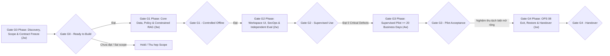

# ROADMAP — SongNhat CRM Knowledge & Policy Assistant (CKPA)

> **ROADMAP triển khai dự án theo 5 Release Gates (`G0 → G4`) cho đội `10` thành viên (`Squad A–D`)**  
> Căn cứ đặc tả: [SRS](./srs.md) và *SongNhat – CRM Knowledge and Policy Assistant RFP* (`06/11/2026`).  
> Kế hoạch Jira chuẩn import: [docs/work-packages/05-jira-5gates-import.csv](../work-packages/05-jira-5gates-import.csv).

---

## 1. Tổng quan Lộ trình 5 Cổng Phát hành (Không gộp G3 và G4)

Theo Mục 9 & Mục 10 của RFP, dự án triển khai theo **5 cổng phát hành độc lập (`G0 → G4`)** trên khung kế hoạch tham chiếu **12 tuần** (`2` tuần Discovery + `10` tuần Implementation bao gồm tối thiểu **`20` ngày làm việc** sử dụng có giám sát).

| Cổng | Tên cổng | Thời lượng tham chiếu | Trọng tâm trên Repo & SRS | Điều kiện thông cổng bắt buộc |
|---|---|---|---|---|
| **G0** | `Ready to Build` | Tuần 1–2 (`2026-11-06` – `2026-11-19`) | `docs/specs/srs.md`, `docs/architecture/erd-and-csv-contract.md`, `data/sample/` | Chốt 3 họ chính sách, duyệt `30` đoạn + `10` dòng trường đầu, `4` tuần lịch sử (hoặc kế hoạch quan sát), so sánh `3` phương án có giá, quyết định Base Scope (tách riêng `O1`). |
| **G1** | `Controlled Offline` | Tuần 3–5 (`2026-11-20` – `2026-12-10`) | `identity`, `ingestion`, `knowledge`, `policy`, `retrieval`, `answer`, `validation`, `worker/` | Nạp & đối soát `100%` corpus (`<=300` đoạn, `<=50` trường), xác minh quyền/ngày hiệu lực giờ VN/xung đột/trích dẫn gốc; test offline `60 Dev + 40 Val`. |
| **G2** | `Supervised Use` | Tuần 6–7 (`2026-12-11` – `2026-12-24`) | `frontend/`, `referral`, `feedback`, `audit`, `admin`, `evaluation`, `infra/` | Đạt **0 lỗi trọng yếu** & đủ ngưỡng Mục 8 trên **`100 Sealed` + `80 Challenges` (`40 VN`)**, pass `OPS 01–07`, xong rà soát pháp lý `SEC 03`, đào tạo & sẵn sàng tra cứu thủ công dự phòng. |
| **G3** | `Pilot Acceptance` | Tuần 8–11 (`2026-12-25` – `2027-01-22`) | Pilot thực tế `>= 20` ngày làm việc (`5` non-dev users), `DEL 03`, `DEL 05` | Hoàn tất `>= 20` ngày làm việc quan sát (kéo dài nếu ngày lễ/lưu lượng thấp), đo giảm `>= 20%` effort tổng, báo cáo TCO 3 năm + payback `<= 24` tháng; quyết định mở rộng tách riêng với nghiệm thu. |
| **G4** | `Handover` | Tuần 12 (`2027-01-23` – `2027-01-29`) | `OPS 08`, `DEL 04`, `DEL 06` | Pass kiểm thử restore (`RTO 4h / RPO 24h` có replay xóa/rút/quyền), xóa/dọn cache 5 phút, export mở `OPS 08`; chấp nhận mã, mapping, cấu hình, fixtures hợp pháp và tài liệu vận hành. |

---

## 2. Phân bổ Đội 10 Người (4 Squads) & Hàng rào Độc lập

| Squad | Thành viên | Trọng tâm xuyên suốt 5 Gate | Ràng buộc RFP |
|---|---|---|---|
| **Squad A** *(2)* | `A1` PM/BA Lead; `A2` Policy & Knowledge Steward | `G0` Discovery, curation `300` đoạn/`50` trường, Authority Matrix, `SEC 03` pháp lý, điều phối Pilot `G3`, sign-off `G4` | Không bịa rule; `A2` hỗ trợ nhãn độc lập khi không sửa code/prompt |
| **Squad B** *(3)* | `B1` Data/Ingestion Eng; `B2` Policy/Lifecycle Eng; `B3` Retrieval/Index Eng | `G0` chốt CSV/ERD → `G1` ingestion/policy/retrieval core → `G2` fix bug khử định danh → `G4` export mở `OPS 08` | Logic quyền/ngày/ngưỡng ở Python/SQL; **cấm xem `100 Sealed`** |
| **Squad C** *(3)* | `C1` Answer/Validation Eng; `C2` Frontend Workspace Eng; `C3` Identity/SecOps Eng | `G0` Docker/CI/API → `G1` RBAC/answer/validation/PII → `G2` Split-Screen UI, 5m cache purge, Cost Meter, OPS restore → `G4` `DEL 06` | **Cấm xem `100 Sealed`**; không tự chấm điểm; không stream trước check |
| **Squad D** *(2)* | `D1` Independent QA & Eval Lead; `D2` Commercial, TestOps & Handover Eng | `G0` Test Plan/3-route compare → `G1` `40 Val + 80 Challenges` → `G2` chấm `100 Sealed` + `OPS 01–07` → `G3` Pilot `DEL 03`/`DEL 05` → `G4` `OPS 08` & `DEL 04` | `D1` giữ tuyệt đối **`100 Sealed`**; không tham gia tune hệ thống |

---

## 3. Quy trình Điều phối Jira & Git từ Gate `G0` đến `G4`

1. **Import Backlog chuẩn 5 Gate:** Sử dụng tệp [05-jira-5gates-import.csv](../work-packages/05-jira-5gates-import.csv) (gồm `5` Epic theo Gate, `10` Story và các Task liên kết trực tiếp với `SRS-FR/NFR`).
2. **Phát task cuốn chiếu (Rolling Dispatch):** Tại một thời điểm chỉ kích hoạt Sprint của Gate hiện tại; mỗi thành viên giữ tối đa `1–2` task `In Progress`; không mở Gate kế tiếp khi điều kiện thoát của Gate trước chưa được nghiệm thu.
3. **Liên kết Branch Git từ Jira Summary:** Mọi Task đều có `Summary` ngắn gọn bằng tiếng Anh không dấu để tạo nhánh chuẩn `<type>/<ISSUE-KEY>-<summary-slug>` (chi tiết tại [git-playbook.md](../playbooks/git-playbook.md) và [jira-git-workflow.md](../playbooks/jira-git-workflow.md)).
4. **Kiểm soát thay đổi phạm vi (`SEC 08`):** Mọi đề xuất bật `O1` hoặc thay đổi giới hạn/nhà cung cấp/model phải qua Change Request, phê duyệt chi phí/chủ sở hữu và chạy lại các kiểm thử bị ảnh hưởng.
